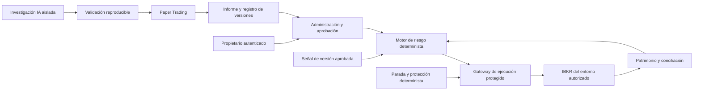

# TradingAgent: preservación del capital

Estado: diseño de fase 1. Fecha: 2026-10-03. No es una implementación operativa ni una autorización para operar.

Actualización vigente: [entregas A/B — capital virtual y viabilidad económica](virtual-capital-and-feasibility.md). Implementa US$100 asignados y presupuesto acumulado US$20 en simulación, conservando límites previos más estrictos. Este documento mantiene el diseño histórico; Live sigue deshabilitado.

Actualización fase 2: este documento conserva las decisiones y valores históricos de fase 1. La solicitud posterior reemplaza la política de investigación por 0,25 % ordinario, 0,50 % máximo, 1 % diario, 2 % semanal y 5 % drawdown. El alcance realmente implementado, sus pruebas y limitaciones se documentan en [phase2-implementation.md](phase2-implementation.md); no interpretar todos los componentes siguientes como ya construidos.

Graphify fue consultado antes de ampliar el contexto: no existía `graphify-out/graph.json` y su detector encontró cero archivos compatibles. Esta es la arquitectura inicial propuesta; no se presupone código, infraestructura, cuenta ni integración existente. Plan de implementación y verificación: [implementation-and-validation.md](implementation-and-validation.md).

## 1. Decisión central e invariantes

Preservar capital y limitar pérdidas tiene prioridad sobre rentabilidad y crecimiento compuesto. Abstenerse es una salida correcta del sistema. Los porcentajes siguientes son hipótesis preliminares de investigación del propietario, no niveles de riesgo validados ni garantía de pérdida máxima efectiva.

| Parámetro de la política inicial | Valor preliminar | Aplicación |
| --- | --- | --- |
| Riesgo objetivo máximo por operación | 0,5 % del patrimonio vigente | Incluye pérdida estimada, costos y ejecución adversa |
| Pérdida neta máxima diaria | 1,5 % | Realizada y no realizada, después de costos |
| Pérdida neta máxima semanal | 3 % | Realizada y no realizada, después de costos |
| Drawdown máximo desde el máximo histórico | 5 % | Patrimonio ajustado por aportes y retiros |
| Operaciones simultáneas | 1 | Incluye reservas, entradas pendientes y posiciones abiertas |
| Martingala y promediar posiciones perdedoras | Prohibidos | Sin multiplicadores de recuperación ni ampliación de exposición perdedora |
| Aumentar apalancamiento para eludir límites | Prohibido | Tope independiente por instrumento y cuenta |
| Alcanzar cualquier límite | Suspensión automática | Comparación `>=`, estado persistente y alerta |

Invariantes no delegables al modelo:

- La IA puede investigar, producir código candidato, proponer parámetros de estrategia y analizar resultados. No puede cambiar políticas de riesgo, aprobarse, reiniciar suspensiones ni acceder al canal del bróker.
- Toda apertura o aumento de exposición requiere estrategia autorizada, política vigente, estado conciliado y aprobación determinista del motor de riesgo inmediatamente antes del envío.
- Ante entradas inválidas, datos incompletos, indisponibilidad de IA o infraestructura crítica, se bloquean nuevas entradas y aumentos de exposición. Las cancelaciones de entradas y la protección/reducción de posiciones existentes dependen de un controlador determinista, no de OpenAI.
- Estrategias nuevas o cambios materiales necesitan evidencia y aprobación explícita del propietario vinculada a una versión inmutable antes de Live.
- Paper y Live tendrán identidades, cuentas, credenciales, persistencia, reservas, colas y autorizaciones separadas. Un puerto o un indicador en pantalla no bastan para identificar el entorno.
- La fase 1 solo produce documentos. No incluye conexiones, previews de órdenes, órdenes sin transmitir ni activación de Paper o Live.

## 2. Componentes y límites de confianza

Propuesta tecnológica, todavía no instalada: C# y ASP.NET Core para control, riesgo y ejecución; Python aislado para investigación; PostgreSQL para estado transaccional y auditoría. Comenzar con un núcleo modular, un worker de investigación aislado y un proceso de ejecución protegido. No se justifica aún una plataforma extensa de microservicios.



Las flechas representan contratos futuros, no servicios activos. El paso de Paper a Live nunca es automático.

| Componente | Responsabilidad y permiso |
| --- | --- |
| Research Worker | Investigar y mejorar candidatos en sandbox; sin secretos del bróker ni escritura en políticas, aprobaciones o tablas operativas |
| Validation Pipeline | Evaluar artefactos congelados con datasets, costos, semillas y versiones reproducibles; emitir resultados que la IA no puede sobrescribir |
| Strategy Registry | Conservar artefactos y manifiestos inmutables, evidencia y estado del ciclo de aprobación |
| Admin & Approval API | Autenticar al propietario, versionar políticas, registrar aprobaciones, revocaciones y reanudaciones |
| Portfolio & Reconciliation | Construir patrimonio, exposición, margen y pérdidas desde datos de cuenta y ledger; detectar discrepancias |
| Risk Engine | Aplicar política, calcular tamaño, reservar capacidad y decidir `ALLOW`, `DENY` o `HALT`; sin dependencia de OpenAI |
| Execution Gateway | Única identidad de aplicación con acceso de envío al bróker; verificar autorización exacta, vigencia y estado; ejecutar idempotencia y seguimiento |
| Safety Controller | Vigilar límites y salud, detener entradas y mantener la gestión defensiva autorizada |
| Audit & Reporting | Evidencia de decisiones y cambios, métricas y alertas sin secretos; exportación independiente con retención protegida |

El código generado por IA tampoco se ejecuta dentro del proceso privilegiado: contenedor/proceso sin acceso a red de ejecución, con CPU, memoria, tiempo y sistema de archivos limitados. Entrega señales estructuradas, nunca llamadas arbitrarias al SDK de IBKR. La interfaz REST de administración verifica autorización en servidor; WebSockets, si se incorporan, solo distribuyen estado a usuarios autorizados.

## 3. Patrimonio, períodos y presupuestos

### 3.1 Fuente y calidad

`E_t` es el patrimonio actual en la moneda base: valor neto de liquidación conciliado con IBKR, con P&L realizado/no realizado, FX, comisiones, financiación y otros cargos. No confundir patrimonio con efectivo disponible, poder de compra o margen. Los conceptos de `NetLiquidation`, `AvailableFunds` y `ExcessLiquidity` son distintos en la [referencia oficial de valores de cuenta de IBKR](https://www.interactivebrokers.com/docs/tws-api/doc/account-portfolio-data/account-updates/account-value-keys).

Registrar origen, instante del bróker, instante de recepción y versión de cada snapshot. Exigir límites administrativos de antigüedad, desfase entre fuentes y tolerancia de conciliación. Si faltan o no se cumplen, denegar entradas. No asumir que una actualización de cuenta aislada ofrece una vista atómica o instantánea de todas las posiciones.

El ledger evita contar P&L o comisiones dos veces. Para cargos aún no recibidos, reservar una estimación conservadora reconciliable; sustituirla al llegar el importe real. Para activos, valorar conservadoramente con mercado y FX válidos. Todas las cantidades monetarias usan aritmética decimal y reglas explícitas de redondeo.

### 3.2 Aportes, retiros y máximo histórico

Guardar el máximo nominal de patrimonio para auditoría, pero usar un índice de patrimonio por participación `V_t` para los límites de rendimiento: un aporte no es ganancia y un retiro no es pérdida de trading. Si `U_t` son participaciones contables, `E_t = U_t * V_t`. Un flujo externo confirmado `F` cambia `U` en `F / V`, manteniendo `V` constante; el P&L cambia `V`. Procesar flujos y valoraciones en orden auditable. Un flujo incierto bloquea entradas hasta conciliación.

Guardar `H_t = max(V_0 ... V_t)` de forma durable, por cuenta y entorno. Reinicios, cambios de estrategia, depósitos y cambios de política no borran máximos ni suspensiones. Un inicio con patrimonio cero/negativo o sin historial conciliado no permite operar.

Definiciones propuestas para investigación:

- `V_day` y `V_week`: índice al comienzo del día y semana de riesgo.
- `Loss_day = max(0, 1 - V_t / V_day)`; `Loss_week = max(0, 1 - V_t / V_week)`.
- `Drawdown = max(0, 1 - V_t / H_t)`.
- Son pérdidas netas respecto al inicio del período; no suma bruta de cada trade perdedor. El drawdown continuo cubre devoluciones de ganancias respecto al máximo histórico.
- Propuesta inicial de reloj: días UTC de 00:00 a 00:00 y semanas desde lunes 00:00 UTC. Zona y calendario definitivo deben fijarse antes de Paper según mercados elegidos; no se cambian durante un período para reiniciar límites.
- Incluyen posiciones mantenidas entre períodos y operaciones manuales en la cuenta. Si no se pueden observar todas, se requiere cuenta dedicada o se bloquea operación automática.

### 3.3 Capacidad disponible antes de una entrada

Con las fracciones preliminares `r_trade=0.005`, `r_day=0.015`, `r_week=0.03`, `r_dd=0.05`:

```text
Floor_day  = (1 - r_day)  * V_day
Floor_week = (1 - r_week) * V_week
Floor_dd   = (1 - r_dd)   * H_t
Room_j     = max(0, U_t * (V_t - Floor_j))
B_trade    = r_trade * E_t
B_new      = max(0, min(B_trade,
                       Room_day  - R_existing - Buffer,
                       Room_week - R_existing - Buffer,
                       Room_dd   - R_existing - Buffer))
```

`R_existing` cubre pérdida adicional estimada desde la valoración actual hasta salidas adversas de posiciones abiertas y entradas pendientes/reservadas. No vuelve a sumar pérdidas no realizadas ya incorporadas en `E_t`. No conceder créditos por correlaciones o coberturas no validadas. `Buffer` es una reserva administrativa adicional, calibrada en investigación y obligatoria antes de operar. Si el estado no permite calcular riesgo, abstenerse.

La comparación de límites ocurre antes del sizing: alcanzar cualquiera produce `HALT`, aunque una fórmula entregue cero. La operación solo es admisible si su riesgo estimado cabe en `B_new` y el riesgo total permanece bajo los límites de cuenta. El slot de una operación ya ocupado deniega una segunda entrada, incluso si existe presupuesto restante.

### 3.4 Composición y tamaño monetario

Recalcular sobre `E_t` actualizado, manteniendo constante el porcentaje autorizado. A igualdad de precio, distancia de salida, costos y restricciones, el presupuesto monetario cae proporcionalmente al patrimonio; el tamaño final puede caer más por lotes mínimos o límites restantes. Nunca redondear hacia arriba para alcanzar el mínimo.

Ejemplo didáctico sin flujos: con patrimonio 10.000, el techo por operación es 50; con 11.000, es 55; con 9.800, es 49. No son importes garantizados de pérdida ni tamaños aprobados: otros límites pueden reducirlos a cero. Si el máximo fue 10.000 y el patrimonio llega a 9.500, el drawdown del 5 % suspende las nuevas entradas; no se opera con un presupuesto de 47,50.

Para instrumentos lineales cuya unidad de precio y multiplicador estén validados:

```text
Risk(q) = q * abs(entry - stop) * multiplier * FX
          + Fees_roundtrip(q) + SpreadSlippage(q) + GapStress(q)
q = mayor cantidad permitida por los incrementos del contrato
    tal que Risk(q) <= B_new y se cumplen TODOS los controles de admisión
```

Los costos dependen del instrumento, mercado, cuenta, plan de comisiones, cantidad y condiciones de ejecución; no siempre son lineales. No duplicar spread si ya está incluido en precios ejecutables. Nunca mover artificialmente el stop para hacer caber una cantidad. Derivados no lineales requieren valoración por escenarios; la fórmula lineal no se les aplica automáticamente.

Ejemplo sintético: presupuesto 50, comisiones totales 2 y pérdida por unidad estresada 2,50. Con unidades enteras, 19 unidades estiman 49,50 de riesgo; 20 estiman 52 y no caben. Si el mínimo verificado es 20, se deniega por capital incompatible.

El multiplicador de recuperación tras pérdidas es siempre 1. Inicialmente se propone prohibir todo escalado posterior a la entrada, además de martingala y promediar pérdidas. Reversar o fragmentar órdenes, repartir entre estrategias o aumentar leverage no puede evadir la agregación de riesgo por cuenta. Los fills parciales de una intención previamente reservada no son nuevas decisiones de ampliación: mantienen su reserva y pueden provocar cancelación del remanente si cambia el riesgo.

## 4. Política administrativa y aprobación humana

La política numérica será configurable por el propietario mediante identidad administrativa separada, MFA/reautenticación para cambios sensibles, autorización de servidor y una identidad de base de datos con permisos exclusivos. La IA solo recibe una vista de lectura; no tiene herramienta, credencial ni ruta de red que permita modificarla. La separación no depende de instrucciones en un prompt.

Cada `RiskPolicyVersion` es inmutable e incluye fracciones, concurrencia, universo, leverage, margen mínimo libre, costos/escenarios, buffers, antigüedad de datos, reloj, autor, motivo y vigencia. El cambio crea una versión, nunca sobrescribe el historial. Las prohibiciones centrales no son interruptores editables por la estrategia. Una recomendación de la IA no constituye cambio administrativo.

Activación de política: pausar entradas, revisar posiciones y reservas, invalidar permisos de envío pendientes, evaluar el nuevo estado y registrar la decisión administrativa. Endurecer límites puede suspender; relajarlos no elimina un `HALT` ni aprueba una estrategia. Cambiar una política vinculada a una aprobación requiere nueva autorización antes de reanudar entradas Live. El propietario no puede convertir un estado de datos inválido en un permiso de ejecución por omisión de controles.

```text
CANDIDATE -> BACKTESTED -> RISK_VALIDATED -> PAPER_PASSED
          -> PENDING_OWNER_APPROVAL -> APPROVED_FOR_LIVE -> LIVE_ENABLED
          -> SUSPENDED / REVOKED / RETIRED
```

Las flechas de aprobación y habilitación exigen eventos humanos verificables. La aprobación puede autorizar la ejecución automática de esa versión dentro de su alcance; no autoriza versiones futuras. `APPROVED_FOR_LIVE` no enciende por sí solo el proceso Live. Los fallos de validación quedan en `REJECTED` o regresan como un candidato nuevo, sin promover el anterior.

El manifiesto inmutable fija hash de código y artefacto, dependencias, parámetros, reglas de entrada/salida, universo, frecuencia, stops, sizing, política de riesgo, proveedor/modelo/prompt/herramientas cuando afecten señales, datasets, resultados y protocolo de evaluación. La aprobación enlaza el hash completo, versión de evidencia, cuenta, entorno Live, alcance temporal, límites, propietario autenticado y fecha. Se conserva firma/verificación de identidad y evidencia de autorización, no solo texto generado por IA.

Cambios en señales, ejecución, instrumentos, parámetros, modelos/prompts decisorios, sizing, límites o dependencias que alteren comportamiento se consideran materiales por defecto: nuevo hash, nuevas pruebas, Paper y aprobación. La IA no decide que su propio cambio sea inmaterial. Caducidad, revocación, desviaciones operativas o ruptura de supuestos impiden nuevas entradas.

## 5. Evaluación y expediente de estrategia

Antes de evaluar, fijar el protocolo y criterios de aceptación administrativamente. Los resultados no pueden usarse para suavizar a posteriori el umbral que decide si pasan. Umbral desconocido o evidencia insuficiente significa `INCOMPLETE`, nunca aprobado. Rentabilidad neta positiva y ausencia de violaciones de controles son necesarias, pero no suficientes.

| Evidencia obligatoria | Cálculo/criterio que debe quedar registrado |
| --- | --- |
| Rentabilidad neta | Equity y retornos después de comisiones, spread, slippage, financiación, borrow y FX aplicables; comparar supuestos con cuenta real |
| Max Drawdown | Caída máxima de equity mark-to-market ajustada por flujos; magnitud, duración y recuperación; controlar intratrade, no solo trades cerrados |
| Rachas perdedoras | Máximo histórico y distribución simulada de rachas y pérdidas acumuladas |
| Factor de beneficio | Ganancias netas positivas agregadas / valor absoluto de pérdidas netas; sin pérdidas observadas informar indefinido y baja evidencia, no calidad infinita |
| Expectativa | `p_win * avg_win - p_loss * avg_loss`, neta por operación; tamaño muestral e intervalo de incertidumbre |
| Riesgo de ruina | Probabilidad estimada de cruzar un piso administrativo de capital o no poder operar el mínimo viable dentro de un horizonte definido; además probabilidad de tocar 5 % de drawdown |
| Fuera de muestra | Período temporal no usado para ajuste; separación de datos y prevención de fuga/look-ahead y sesgo de supervivencia |
| Walk-forward | Ventanas cronológicas de ajuste/validación y test, reentrenamiento solo con pasado; purga/embargo donde existan etiquetas solapadas |
| Monte Carlo | Bootstrap por bloques/regímenes, semillas, trayectorias de equity compuesta, gaps y costos estresados; no suponer independencia de trades sin evidencia |
| Sensibilidad | Spread, comisiones, slippage, latencia, liquidez y rechazos; buscar degradación y zonas de parámetros frágiles |
| Regímenes | Tendencia, rango, alta/baja volatilidad, crisis/gaps, liquidez reducida; clasificar sin información futura |
| Capital e IBKR | Misma política y sizing con capital objetivo, lotes, margen, moneda, permisos y disponibilidad de instrumentos; cuantificar operaciones abstendidas |

Separar el holdout final del proceso de selección; registrar número de candidatos ensayados y corregir/evaluar sesgo de selección por búsquedas repetidas. Calcular intervalos y escenarios pesimistas. En riesgo de ruina, declarar definición de ruina, horizonte, método, supuestos y error; cero eventos en una simulación no significa riesgo cero.

El informe al propietario contendrá: descripción completa y motivos de propuesta, manifiesto/hash, comparación con versión anterior, datos y períodos usados, todos los resultados anteriores, resultados Paper, fallos observados, incertidumbre, costos, capital mínimo viable, riesgos conocidos, escenarios concretos de suspensión y un campo separado para su decisión. Las explicaciones de IA se adjuntan a la evidencia reproducible, no la sustituyen. Backtesting favorable y Paper favorable no garantizan rentabilidad futura.

## 6. Admisión y ejecución con IBKR (fases posteriores)

Se propone un adaptador `BrokerPort` con implementación inicial TWS API mediante IB Gateway/TWS; fijar SDK y versión compatibles en la fase de integración. No se presume soporte uniforme entre productos, cuentas o rutas. La [referencia de ContractDetails](https://www.interactivebrokers.com/docs/tws-api/ref/contract-details) documenta mínimos, incrementos y reglas de precio; deben verificarse para el contrato y ruta seleccionados, sin asumir que siempre estarán completos.

Antes de autorizar una entrada:

1. Verificar estado de salud, entorno/cuenta, versión aprobada, política, permisos, slot único, parada y snapshots conciliados.
2. Resolver contrato por identidad estable, moneda, multiplicador y mercado; verificar universo, horario, tipo de orden, tamaño mínimo, incremento de cantidad, tick dependiente de precio y nocional mínimo si aplica.
3. Calcular tamaño con costos completos, tolerancia de ejecución, liquidez y gap stress; validar efectivo liquidado si corresponde, margen inicial/mantenimiento y colchón de liquidez libre después de la operación. El poder de compra no reemplaza el límite de pérdida.
4. En integración futura, obtener estimaciones de margen/comisiones cuando estén soportadas. IBKR expone `whatIf` en su [referencia Order](https://www.interactivebrokers.com/docs/tws-api/ref/order); es una estimación, no una garantía de aceptación o costo final. Si no hay dato fiable ni modelo conservador previamente validado para ese caso, denegar. No efectuar esta consulta en fase 1.
5. Recalcular con metadatos y precios finales, redondeando hacia abajo. Verificar apalancamiento y exposición independientes del stop, incluso cuando un stop muy cercano produzca poco riesgo teórico. Límites de leverage aún no definidos bloquean la habilitación del instrumento.
6. Bajo transacción y exclusión por cuenta, reservar riesgo y slot; emitir un permiso de un solo uso ligado al hash exacto de intención, snapshot, política, aprobación, cantidad, precios, cuenta, entorno, caducidad y época de suspensión.
7. El gateway consume una vez el permiso, comprueba de nuevo estado/precios dentro de tolerancias y versiones inmediatamente antes del envío. Una modificación exige nueva evaluación. El SDK del bróker no queda expuesto como herramienta de IA.

Cada rechazo devuelve códigos auditables, por ejemplo `RISK_DAILY_LIMIT`, `MIN_SIZE_EXCEEDS_BUDGET`, `MARGIN_INSUFFICIENT`, `DATA_STALE`, `STRATEGY_NOT_APPROVED`, `EXECUTION_UNKNOWN`. No reintentar indefinidamente ni elevar tamaño, margen o leverage para superar un rechazo. No configurar overrides automáticos de advertencias o controles del bróker.

### 6.1 Estado, duplicados y conciliación

Estados internos mínimos: `PROPOSED`, `DENIED`, `RESERVED`, `DISPATCHING`, `ACKNOWLEDGED`, `PARTIALLY_FILLED`, `FILLED`, `CANCEL_PENDING`, `CANCELLED`, `REJECTED`, `UNKNOWN`. Mantener cantidad ejecutada/restante aparte del estado: una cancelación puede coexistir con ejecución parcial y con fills tardíos.

- Identidad de intención estable por entorno/cuenta/estrategia/señal, deduplicación también de señales equivalentes y restricción única en PostgreSQL. Reservas, decisión y outbox se confirman en una transacción.
- Un único escritor de ejecución por cuenta con fencing; no solo bloqueo local de proceso. Mapear intención a `orderId`, `clientId`, `permId` y ejecuciones cuando estén disponibles.
- Antes de invocar envío, persistir `DISPATCHING`. Un timeout o caída tras envío produce `UNKNOWN`: conservar reserva, bloquear entradas y conciliar; no reenviar a ciegas aunque el outbox repita un mensaje. No prometer exactly-once entre base de datos y bróker.
- Deduplicar ejecuciones por identidad de bróker/entorno/cuenta, tratar correcciones/busts y comisiones tardías. Usar estados, ejecuciones y snapshot de posiciones conjuntamente. IBKR describe callbacks para fills parciales en su [lección oficial de órdenes TWS](https://www.interactivebrokers.eu/campus/trading-lessons/python-placing-orders/).
- Cada fill parcial actualiza exposición, costos y protección de la cantidad realmente ejecutada; conservar riesgo para el remanente. Cancelar remanente si deja de cumplir y conservar reserva hasta confirmar cancelación y reconciliar fills tardíos. No asumir que un bracket protege automáticamente toda ejecución parcial: verificar semántica por instrumento y tipo de orden en pruebas.
- Conciliar al arrancar/reconectar, periódicamente, tras eventos críticos y antes de habilitar entradas: posiciones, órdenes abiertas, ejecuciones, efectivo, comisiones y margen. Diferencias no explicadas o eventos externos/manuales suspenden y alertan. Los deltas de posición solos no identifican de manera fiable una intención desconocida.
- La cancelación no es instantánea. Reemplazos no pueden duplicar exposición durante cancel/replace. Una expiración local solo libera reservas nunca enviadas, con exclusión transaccional; no libera órdenes enviadas o ambiguas por tiempo transcurrido.

### 6.2 Suspensión y protección independiente

Estados de cuenta: `DISABLED`, `READY`, `HALTED_RISK`, `HALTED_DATA`, `HALTED_AI`, `HALTED_EXECUTION`, `EMERGENCY_STOP`. Persistir causas múltiples: resolver una no elimina las demás. Cambios de día/semana crean bases nuevas, pero no reanudan una cuenta suspendida automáticamente. Reanudación exige propietario autenticado, condición resuelta, conciliación y política/aprobación vigentes; no borra historial ni máximo.

La parada bloquea nuevas entradas, invalida permisos, cancela entradas pendientes cuando sea posible y conserva protecciones. La gestión de posiciones continúa bajo una política de salida defensiva preautorizada: mantener protección, reducir o cerrar exposición según reglas deterministas y estado conocido. Una IA caída no puede bloquear este controlador ni pedirle que abra/reverse una posición.

No cancelar indiscriminadamente stops al activar la parada. Cancelar todo y cerrar todo son acciones distintas. Antes de liquidar, conciliar cantidades, coordinar salidas/protecciones y evitar ventas duplicadas o reversión accidental. Con conectividad perdida no se puede asegurar cancelación o cierre: alertar al propietario para intervención directa en el bróker y conservar evidencia de estado desconocido. La arquitectura incluye heartbeat y watchdog local, no una promesa de continuidad ante caída total de máquina o red.

Un Stop Loss no asegura el precio de salida; un stop-limit puede no ejecutarse, según la sección 4 de la [divulgación oficial de riesgos de órdenes de IBKR](https://gdcdyn.interactivebrokers.com/Universal/servlet/Registration_v2.formSampleView?formdb=3074). Gaps, suspensiones de mercado y fallos pueden producir pérdidas mayores al presupuesto y superar 1,5 %, 3 % o 5 % antes de reaccionar. Esos valores son umbrales de control, no seguros de capital. IBKR también advierte sobre limitaciones de órdenes simuladas en su [documentación de riesgos de ejecución](https://www.interactivebrokers.com/en/trading/simulatedOrderTypes.html). Medir y reportar excesos, nunca presentarlos como imposibles.

## 7. Contratos persistentes y auditoría

Entidades propuestas, siempre particionadas por cuenta y entorno cuando corresponda:

- `RiskPolicyVersion`, `PolicyActivation` y `RiskAccountState`: política histórica, activación administrativa, versión/época y motivos de suspensión.
- `EquitySnapshot`, `ExternalCashFlow`, `RiskPeriod` y `HighWaterMark`: calidad del dato, valores nominales/por participación y puntos de referencia durables.
- `StrategyVersion`, `EvaluationProtocolVersion`, `ValidationRun`, `PaperRun` y `OwnerApproval`: hashes, datasets, ejecución reproducible, resultado y autorización revocable.
- `TradeIntent`, `RiskDecision`, `RiskReservation`, `ExecutionPermit`, `OutboxEvent`, `BrokerOrder`, `Fill`, `CommissionAdjustment` y `ReconciliationRun`: trazabilidad desde señal hasta conciliación.
- `AuditEvent`: actor humano/servicio, evento, timestamps UTC, correlación, hashes anterior/nuevo y razón. Acceso append-only para aplicación, exportaciones a almacenamiento con retención protegida; un hash solo no impide manipulación por un administrador privilegiado.

Contratos estructurados con esquema versionado, campos obligatorios, tamaños máximos, timestamps, identidad e idempotencia; rechazar campos desconocidos en comandos sensibles, valores no finitos, signos inválidos y datos fuera de rango. El riesgo monetario y porcentaje efectivos siempre los calcula el motor, aunque la IA sugiera otros valores. No almacenar secretos en artefactos, reportes, prompts o logs.

## 8. Límites del diseño actual

Quedan por fijar: capital/moneda objetivo, tipo y jurisdicción de cuenta IBKR, instrumentos/mercados, permisos y suscripciones, horizonte/frecuencia, costos por plan, datos históricos, umbrales estadísticos, apalancamiento/exposición autorizados, buffers, frescura de datos, duración mínima de Paper y procedimiento de salida de emergencia. No se inventan valores operativos para estos campos: su ausencia bloqueará la futura habilitación.

Este diseño incorpora los requisitos y define sus controles y pruebas futuras. No demuestra rentabilidad, integridad de un motor aún inexistente ni compatibilidad probada con una cuenta concreta de IBKR.
