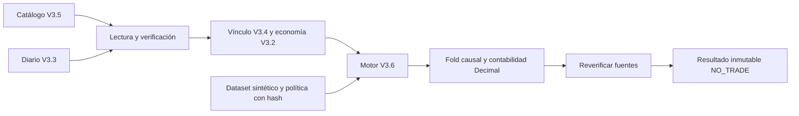

# Core V3.6 — backtesting determinista por eventos sintéticos

Alcance autorizado: 2026-10-18, America/La_Paz. Base comprobada: rama
`codex/core-v3-5-strategy-catalog`, HEAD `5c62008`. Rama de trabajo:
`codex/core-v3-6-event-backtester`. Estado de investigación: **NO_TRADE**.

## Diseño expuesto antes de implementar

Crear un subpaquete hermano `python/trading_agent/core_v3/event_backtest/`.
Separar contratos, lectura verificada, aritmética y fold de eventos. Recibir
dataset y política completos en memoria; devolver un resultado inmutable.
No añadir una base, host, endpoint, proveedor o adaptador de órdenes.

El alcance no requiere editar archivos de V3.1–V3.5 ni sistemas históricos.
Los documentos previos sin seguimiento de Fase 0 y el PDF permanecen ajenos.
La orden exige aprobación adicional para editar código auditado; no fue
necesaria porque todos los cambios son adiciones.

Dependencias concretas: primitivas V3.1; escenario/evidencia económica V3.2;
solicitud y diario V3.3; AST y comparaciones causales V3.4; versión, validación,
prefijo y lectura del catálogo V3.5. Ninguna aceptación económica se transforma
en autorización operativa o afirmación estadística.

Riesgos principales fijados antes de programar: orden de eventos al compartir
timestamp de cierre/apertura, ambigüedad OHLC, doble costo, precisión Decimal,
capital al precio efectivo, mutación concurrente de evidencias y recursos.

## Archivos añadidos

| Archivo | Responsabilidad |
|---|---|
| `python/trading_agent/core_v3/event_backtest/__init__.py` | Paquete sin arranque ni efectos al importarlo. |
| `event_backtest/contracts.py` | Contratos cerrados, versionados, frozen/slots; límites y consistencia. |
| `event_backtest/reader.py` | `prepare`/`load`: lectura V3.5/V3.3 verificada y recalculada, sin mutadores. |
| `event_backtest/accounting.py` | Precios ejecutables adversos, comisiones, financiación y FX. |
| `event_backtest/simulation.py` | Fold de eventos y estado de una posición. |
| `event_backtest/engine.py` | Frontera pública, errores controlados y verificación posterior. |
| `python/tests/test_core_v36_contracts.py` | Wire, inmutabilidad, procedencia y límites. |
| `python/tests/test_core_v36_binding.py` | Catálogo, hashes, invalidación y preservación. |
| `python/tests/test_core_v36_accounting.py` | Ejemplos numéricos independientes. |
| `python/tests/test_core_v36_engine.py` | Operaciones, causalidad, reproducibilidad y timeframes. |
| `python/tests/test_core_v36_adversarial.py` | Gaps, cobertura, financiación, capacidad y recuperación. |
| `python/tests/test_core_v36_security.py` | Autoridad, integridad y dependencias/efectos. |
| `python/tests/core_v36_offline_check.py` | Wrapper nuevo sobre las barreras históricas intactas. |
| `docs/architecture/core-v3-6-event-backtester.md` | Diseño, evidencia, límites e inventario. |

Las rutas abreviadas `event_backtest/*` pertenecen al mismo subpaquete nuevo.

## Contratos y lectura controlada

Todos los contratos de este incremento usan `schema_version=1`, bajo
`trading.core_v3.backtest.*`. Se implementan `BacktestRequest`, `BacktestPolicy`,
`BacktestEvent`, `SimulatedOrder`, `SimulatedFill`, `PositionState`, `TradeRecord`,
`EquitySnapshot`, `BacktestResult` y `BacktestEvidence`. Los auxiliares son
`SyntheticBar`, `SyntheticDataset`, `CostBreakdown` y `BacktestMetrics`.

Se reutilizan Money/Price/Quantity, InstrumentIdentity, CatalogRef y Timeframe.
No se amplía el decodificador anterior: la frontera nueva admite colecciones
inmutables acotadas. Rechaza extras, versiones desconocidas, duplicados JSON,
floats/bool en finanzas, no finitos y permisos. Las copias wire no mutan objetos.

`prepare` recibe instancias exactas de Catalog y ResearchJournal ya abiertas por
el host. Verifica historial completo del catálogo, registro/version/hash,
operación VALIDATED al cutoff explícito y ausencia de una invalidación o revisión
pendiente posterior sobre esa versión. Comprueba el prefijo real del diario y
recalcula el vínculo V3.4/V3.2. Un diccionario de aprobación o un objeto con un
método history parecido no es una fuente válida.

El request fija catálogo/id/version/hash, operación, prefijo de catálogo,
cutoff de investigación y hashes de solicitud original, escenario, postflight,
dataset y política. La evidencia añade identidad de estrategia, instrumento,
timeframe, prefijo de investigación y versión exacta del motor.

`run` vuelve a verificar esos vínculos antes y después del cálculo. Appends no
relacionados que preservan los prefijos pueden coexistir; cambio de contenido,
rollback de prefijo, corrupción, invalidación o fuente ausente bloquean. Una
alteración detectada después del fold descarta sus métricas/operaciones del
resultado devuelto. No hay transacción global ni snapshot atómico de dos bases.

No se actualizan diarios, presupuesto ni estado del catálogo. En particular,
run no llama a register, reconcile, diagnose, diseñadores, reservas o consumo.



## Dos relojes y datasets

`research_cutoff` es el reloj de validación de los snapshots de investigación.
El dataset tiene una línea temporal **simulada** separada, que puede describir
un escenario sintético posterior a ese cutoff. Esto no refresca las observaciones
de cartera/costos/margen/FX ni las convierte en evidencia auténtica.

Las barras son OHLC **mid** sintéticas, con opened_at, closed_at y available_at;
el open está disponible en opened_at por definición de este modelo. Duración,
alineación, contigüidad, IDs únicos y términos del instrumento son obligatorios.
El backtester V1 requiere `available_at == closed_at` para avanzar una barra:
un retraso declarado devuelve INCONCLUSIVE antes de procesarla, conservando
únicamente el prefijo ya conocido. No rellena huecos ni interpola precios.

La estrategia ya registrada se aplica retrospectivamente a una simulación
hipotética. Esto no prueba que su selección/diseño fuese causal respecto a una
muestra histórica, ni implementa walk-forward, OOS o holdout.

## Orden de eventos y ejecución

Para cada barra:

1. Open conocido. Con posición previa, protecciones ante gap primero.
2. Horizonte vencido y orden pendiente de la señal de una barra anterior.
3. Admisión de entrada al precio efectivo; si pasa, se mantiene una posición.
4. Observación de protecciones intrabar cuando OHLC está disponible al cierre.
5. Cierre disponible, cálculo de reglas y valoración.
6. Señal/orden declarativa para una apertura de barra posterior.

El cierre de la barra i y la apertura de i+1 pueden compartir timestamp. El
orden total es explícito: la señal tiene menor secuencia, la entrada tiene
`fill.bar_index > order.signal_bar`, y su timestamp no es anterior a la decisión.
El fill usa el open de i+1, nunca el cierre conocido de i. El resultado valida
referencias y secuencias de órdenes, fills, trades y agregados.

Las comparaciones reutilizan `_matches` de V3.4, luego de verificar su AST por
los contratos/validadores originales. Se evalúan exclusivamente con el prefijo
de barras cerradas disponibles. SMA/cruces usan las comparaciones racionales
auditadas, no medias flotantes ni código generado. Una historia insuficiente
o reglas simultáneamente contradictorias produce INCONCLUSIVE.

El bracket conserva los precios absolutos registrados. Un fill de entrada
fuera de SL/TP se rechaza y no abre una posición. No se mueve el bracket para
acomodar el precio y no se cambia la cantidad de la versión.

SL/TP son umbrales mid de salida bajo el modelo trigger-market del simulador,
no una promesa de semántica de órdenes limit del broker. Si el open cruza el
stop, el fill toma ese open adverso más fricciones. Una apertura favorable
más allá del target se limita al umbral target, sin mejora gratuita.

Si OHLC toca stop y target, **STOP_FIRST**. Se registra la ambigüedad, sin
inventar un camino intrabar. Un toque intrabar se detecta y fecha al cierre;
se cobra financiación hasta ese momento, conservadoramente. No hay estimación
de segundos/ticks desconocidos dentro de la vela.

Las salidas por reglas llenan al siguiente open. Horizonte = instante de entrada
más horas del escenario; se cierra en la primera apertura admisible al vencer.
Sin ese evento futuro la posición queda inconclusa. `close_at_end=True` permite
el cierre de una posición al último close bajo una política fijada antes del
fold; no crea una vela adicional. Una nueva señal de entrada en ese último
cierre se registra como rechazo `ENTRY_AFTER_WINDOW`, sin orden ni fill.

## Economía y capital

Todos los supuestos económicos proceden del contexto original verificado:
spread = ask−bid; slippage por lado; comisión máxima entre mínimo y tarifa por
cantidad; financiación fija por trade y tarifa cantidad/hora; FX quote→cuenta;
margen inicial/mantenimiento, exposición, allocation y riesgo disponibles.
No hay costos ausentes convertidos a cero.

Compra = mid + medio spread + slippage; venta = mid − medio spread − slippage.
Se redondea compra hacia arriba al tick y venta hacia abajo. El costo adicional
de grilla se muestra separado. Cantidad, precio y multiplicador conservan sus
unidades. Una sola conversión FX constante se aplica a cada importe quote.

Para cada trade, bruto es el movimiento de **mid** por cantidad/multiplicador
y dirección. Costos = apertura + cierre + spread + slippage + redondeo +
financiación. Neto = bruto − costos. Los precios de fill ya contienen las
fricciones; no se vuelve a restarlas al calcular el mismo resultado por fills.
La prueba numérica independiente verifica ambas formas de cálculo.

Las sumas financieras usan un contexto Decimal local de precisión 160. Los
límites auditados de Money no se relajan ni se redondean para aceptar una suma.
La financiación se prorratea por segundos enteros transcurridos y se redondea
hacia arriba a 12 decimales de moneda de cuenta. El retorno fraccional por
trade usa notional efectivo de entrada y redondea hacia abajo a 12 decimales;
es una medida descriptiva. Una precisión monetaria no representable es un
rechazo controlado, no ganancia por truncamiento.

Capital inicial = mínimo entre equity y asignación del snapshot. La variable
interna cash representa capital realizado de la asignación; no pretende ser
el cash ledger de compra/venta de acciones de IBKR. Se debita comisión al
entrar y solo el resto del neto al cerrar. Se comprueban margen/costos,
exposición y riesgo al precio efectivo antes de cada entrada. Las pérdidas
cerradas consumen el presupuesto original; ganancias no lo restauran.

Solo hay una posición. El margen no se libera para abrir otra simultánea.
Los stress económicos declarados limitan admisión, sin limitar artificialmente
la pérdida que un gap puede realizar. Mantenimiento se comprueba en cierres:
una insuficiencia genera salida al siguiente open, sujeta a protección y
cobertura; no modela una liquidación intrabar auténtica del broker.

## Métricas y estados

Los agregados bruto/costos/neto, ganadoras/perdedoras/breakeven corresponden
solo a trades cerrados. N=0 no se convierte en ganador ni en estadística de
ventaja. Comisión ya cobrada de una posición abierta se refleja en capital
realizado; financiación acumulada y liquidación hipotética se reflejan en mark.

Se devuelven capital inicial, final realizado y marcado; exposición máxima
observada, drawdown realizado por eventos monetarios y drawdown marcado por
cierres disponibles. La valoración de cierre usa salida adversa ejecutable,
comisión de cierre y financiación acumulada. No es DD continuo intrabar.

- COMPLETE: ventana procesada, sin posición ni órdenes pendientes.
- INCONCLUSIVE: warmup/cobertura, orden/posición pendiente, disponibilidad
  tardía, conflicto de reglas o límite de eventos/trades. Conserva el prefijo
  económico calculado y los estados pendientes, sin extender datos.
- REJECTED: integridad/binding, política/límites de entrada, precisión o tamaño
  de resultado. Un resultado descartado no presenta métricas parciales como
  completas.

Una orden de entrada rechazada conserva su orden y evento de rechazo, sin fill
ni exposición ejecutada. Una orden pendiente se distingue de un trade abierto.
Las protecciones/horizonte están predeclarados en la posición; el registro de
su orden de salida se materializa cuando se activa y referencia su entrada.

## Recursos y recuperación

Máximos duros: 128 barras, 1024 eventos, 16 posiciones iniciadas/trades, 720
horas de política y 131072 bytes por documento/resultado. max_bars, max_events,
max_trades, max_duration_hours y max_result_bytes pueden reducirlos. Los límites
de estructuras y bytes acotan memoria; no se afirma un límite portable de RSS.
Se reserva capacidad para 12 eventos antes de procesar una barra completa.
Si el resultado excede bytes se devuelve un rechazo compacto, sin truncarlo.

128 barras de H1 no cubren todas las hipótesis posibles de 720 horas; eso queda
inconcluso si necesita precios adicionales. Este incremento no implementa
ventanas múltiples, checkpoints persistentes ni streaming. No son necesarios
para los fixtures acotados y no se simula cobertura inexistente.

La recuperación es replay de una función sin escrituras. KeyboardInterrupt
propaga la interrupción y no deja un experimento parcialmente registrado.
Mismos request, prefijos, dataset, política y motor producen los mismos bytes.
El host debe conservar esas entradas si quiere reproducir el resultado; no se
instala un repositorio de resultados en esta entrega.

## API y ejemplos reproducibles

```python
from trading_agent.core_v3.event_backtest.reader import prepare
from trading_agent.core_v3.event_backtest.engine import run

request = prepare(
    'backtest-1', catalog, journal, 'catalog-1', 1, 'registration-1',
    synthetic_dataset, simulation_policy, research_cutoff=explicit_cutoff,
)
result = run(request, catalog, journal, synthetic_dataset, simulation_policy)
serialized = result.to_json()
```

Fixtures de integración: q=26 EUR, multiplicador 1, spread 0.0002 USD/EUR,
slippage 0.00005 por lado, comisiones USD0.50 por lado, financiación cero.
La cantidad procede de la búsqueda V3.2; 50 es su máximo, no el testigo.

| Operación | Mid entrada/salida | Fill entrada/salida | Bruto USD | Costos USD | Neto USD |
|---|---|---|---:|---:|---:|
| LONG target | 1.10 / 1.14 | 1.10015 / 1.13985 | 1.04 | 1.0078 | 0.0322 |
| SHORT target | 1.10 / 1.06 | 1.09985 / 1.06015 | 1.04 | 1.0078 | 0.0322 |
| LONG stop | 1.10 / 1.09 | 1.10015 / 1.08985 | -0.26 | 1.0078 | -1.2678 |
| SHORT stop | 1.10 / 1.11 | 1.09985 / 1.11015 | -0.26 | 1.0078 | -1.2678 |

Costos: comisión 1; spread 0.0052; slippage 0.0026; grilla/financiación 0.
Target y stop tocados en la misma vela producen el caso stop. Un gap adverso
puede perder más. Con capital inicial 100, el target deja 100.0322, sin implicar
una estrategia estadísticamente rentable. DD realizado incluye USD0.50 de la
comisión de entrada aunque el trade termine con ganancia en esa misma vela.

Fixture separado de financiación/FX: q=38, financiación fija quote 0.1 más
0.01 por unidad/hora, duración una hora y FX USD→EUR 1.2: financiación EUR0.576;
bruto EUR1.824; costos EUR1.78968; neto EUR0.03432. No son cotizaciones reales.

## Verificación

Verificación final: **259 pruebas pasadas en 314.740 segundos**;
**OFFLINE_BARRIER_VIOLATIONS: 0**.

| Grupo | Pasadas |
|---|---:|
| V3.6 contratos/dataset/política | 4 |
| V3.6 vínculo catálogo/investigación | 4 |
| V3.6 contabilidad independiente | 4 |
| V3.6 motor causal | 8 |
| V3.6 escenarios adversariales/recuperación | 16 |
| V3.6 seguridad/integridad | 7 |
| Total nuevo V3.6 | **43** |
| V3.1 | 36 |
| V3.2 | 38 |
| V3.3 | 32 |
| V3.4 | 37 |
| V3.5 | 29 |
| Forex fase 1 | 28 |
| Contratos AI históricos | 16 |
| Regresiones anteriores intactas | **216** |
| Total final | **259** |

Comando ejecutado desde la raíz:

```powershell
.venv/Scripts/python.exe -B python/tests/core_v36_offline_check.py
```

El wrapper nuevo conserva las selecciones anteriores y añade test_core_v36_*.
Reutiliza el main histórico sin editarlo. Su audit hook deniega eventos socket,
subprocesos/os.system/os.startfile, apertura/listado de la `.local` real y
SQLite fuera del temporal canónico del sistema. Las bases de ambas fuentes se
crean en directorios temporales nuevos; las pruebas de corrupción solo alteran
esas copias de fixture. La prueba de ejecución también prohíbe apertura Python
de archivos y los mutadores/diseñadores mientras calcula el backtest.

No se crearon bases persistentes en el proyecto, conexiones a servicios,
lecturas de secretos, inferencias ni operaciones de broker. No se ejecutaron
.NET/API, scripts operativos ni un launcher de datos. La barrera es evidencia
del proceso de pruebas, no un sandbox de producción o certificación del host.

Casos ejecutados durante el desarrollo: Forex/acciones sintéticas; LONG/SHORT;
M1/M5/H1; señal/fill en eventos distintos; salida técnica, horizonte y cierre
explícito; stop/target/ambos/gaps; comisión/spread/slippage/grilla; financiación
y FX; posición pendiente y N=0; cambios de hashes; corrupción real de journals
temporales; pérdida de cola del catálogo; fuente sustituida; presupuesto intacto;
interrupción y replay; límites; precisión y autoridad. Los detalles permanecen
en las pruebas nuevas, sin modificar regresiones anteriores.

Defectos encontrados y corregidos mediante reproducciones en pruebas nuevas:

1. Una entrada rechazada incrementaba la exposición máxima. Ahora solo cuentan
   posiciones efectivamente llenadas y sus observaciones de entrada/cierre.
2. DD realizado omitía la comisión inicial si había salida rentable en la misma
   vela. Ahora se actualiza después de cada cambio de capital realizado.
3. El wire permitía referencias de fills, agregados o capital inconsistentes.
   Ahora reconcilia causas, órdenes, fills, trades y capital; también detecta
   un fill-event repetido con secuencia nueva y timestamps todavía válidos.
4. Una salida intrabar podía omitir el notional de cierre en el pico observado.
   Se registra también ese precio conocido, sin inventar exposición intrabar.
5. close_at_end descartaba una señal de entrada final sin motivo. Ahora queda
   un rechazo explícito por fin de ventana; no se fabrica un evento futuro.

Se corrigieron además expectativas de los fixtures nuevos: el testigo del gate
básico es q=26, no su máximo 50; el tick Forex ilustrativo es 0.00005. El fixture
de medio spread diminuto declara su tolerancia de entrada de 0.000000000001 en el wire
decimal, sin exponentes. Esas correcciones no cambiaron fuentes ni pruebas
históricas para obtener verde.

Sensibilidad verificada: se cambió temporalmente `if stop_hit:` por
`if stop_hit and not target_hit:`. Los dos casos BOTH (LONG y SHORT) fallaron
porque el mutante escogía TARGET. Se restauraron bytes originales en finally
y se comprobó igualdad SHA-256 antes de la ejecución final. Es una mutación
puntual y revisión interna, no un score global ni auditoría independiente.

Graphify: grafo existente de 424 nodos/1039 aristas. Se seleccionó vocabulario
real `cost execution research risk strategy`; BFS encontró 171 nodos y mostró
33 con presupuesto 1100 tokens. La salida es parcial y el grafo histórico no
describe V3.6. Se contrastaron StrategyVersion en Research.cs:L16 y el test
histórico CostOverrunPersistsNetLossAndHaltsWithoutDoubleCharging en su fuente;
no se ejecutaron sus dependencias PostgreSQL. La integración nueva se trazó
directamente sobre los contratos/validadores/diarios Python actuales.

Se ejecutó reflect --if-stale y se leyeron sus lecciones. No se reconstruyó el
grafo. La CLI se usó porque el intérprete apuntado por .graphify_python no tiene
instalado el módulo graphify. La reflexión es determinista; no se atribuye su
costo ni el costo histórico de extracción al consumo de esta sesión.

## Git y preservación

Rama `codex/core-v3-6-event-backtester`, desde `5c62008`. Commits funcionales:
`9a92112` (contratos), `72cb560` (lectura/economía), `788b7d1` (motor y casos)
y `24ea690` (conciliación de resultados/seguridad). Un commit posterior añade
este informe; su hash se informa en el cierre de la entrega.

`git diff --name-status 5c62008..HEAD` al cierre:

```text
A docs/architecture/core-v3-6-event-backtester.md
A python/tests/core_v36_offline_check.py
A python/tests/test_core_v36_accounting.py
A python/tests/test_core_v36_adversarial.py
A python/tests/test_core_v36_binding.py
A python/tests/test_core_v36_contracts.py
A python/tests/test_core_v36_engine.py
A python/tests/test_core_v36_security.py
A python/trading_agent/core_v3/event_backtest/__init__.py
A python/trading_agent/core_v3/event_backtest/accounting.py
A python/trading_agent/core_v3/event_backtest/contracts.py
A python/trading_agent/core_v3/event_backtest/engine.py
A python/trading_agent/core_v3/event_backtest/reader.py
A python/trading_agent/core_v3/event_backtest/simulation.py
```

Son **14 adiciones**, sin paths modificados/eliminados de la base. El filtro
M/D/R está vacío; `git diff --check` pasó. `git status --short` conserva solo:

```text
?? docs/architecture/core-v3-phase0-audit.md
?? docs/manual/TradingAgent_Manual_Tecnico_Integral.pdf
```

Esos dos documentos estaban presentes antes del trabajo y no se incorporaron.
No se hizo push, merge, despliegue ni edición de configuraciones, contratos,
migraciones, servicios, frontend o fuentes históricas. No hubo cambios a las
pruebas previas para aceptar el nuevo paquete.

## Límites y riesgos restantes

No hay datos auténticos, profundidad/liquidez, colas/latencia, fills parciales,
sesiones reales, dividendos, disponibilidad de préstamo, cambios históricos de
margen/FX/costos ni liquidaciones reales. Esos supuestos no se deducen del nombre
del instrumento. Instrumentos, capital y fuentes son los del fixture verificado.

Los hashes no autentican al host y no detectan rollback coordinado de copias
válidas de ambos almacenes sin anclas externas. Un propietario de archivos o
Python modificado no es un atacante aislado por este paquete. Las lecturas
posteriores son comprobaciones puntuales, no una transacción entre dos bases.

No se certifican producción, rendimiento HFT, backup/disaster recovery, ni
integración de broker. Persisten todos los límites históricos de V3.5.

Rollback de código: revisar árbol y revertir commits específicos de V3.6.
No borrar diarios ni usar reset/clean para obtener una base. Este motor no crea
datos persistentes propios. No hubo push, merge ni despliegue.

## Inventario obligatorio del backend

| Estado | Componente | Capacidad y límite |
|---|---|---|
| IMPLEMENTADO Y VERIFICADO | Core V3.1 | Contratos/importación offline; sin autenticación de mercado. |
| IMPLEMENTADO Y VERIFICADO | Core V3.2 | Economía acotada, pre/postflight; sin expectativa estadística. |
| IMPLEMENTADO Y VERIFICADO | Core V3.3 | Investigación simulada, presupuesto/diario y recuperación. |
| IMPLEMENTADO Y VERIFICADO | Core V3.4 | AST cerrado y diagnóstico causal; sin órdenes. |
| IMPLEMENTADO Y VERIFICADO | Core V3.5 | Catálogo durable, versiones y reconciliación de investigación. |
| IMPLEMENTADO Y VERIFICADO | Core V3.6 | Fold de eventos sintéticos y 43 pruebas nuevas; no promoción ni permisos. |
| EXISTENTE, INTEGRACIÓN O RECERTIFICACIÓN PENDIENTE | Python histórico, .NET, IBKR, R20 y Kronos | Preservados. No se acredita operación V3 por existir en el repo. |
| PENDIENTE | Datos reales autenticados | Ingesta, procedencia, calidad y datasets con productores confiables. |
| PENDIENTE | Validación estadística OOS | Particiones, holdout, incertidumbre, selección múltiple y stress. |
| PENDIENTE | Análisis de régimen | Clasificador causal versionado con evidencia. |
| PENDIENTE | Clasificación/selección de estrategias | Ranking comparable, biblioteca y NO_TRADE. |
| PENDIENTE | Integración IA controlada | Proveedores autorizados, uso/costos y fallos inciertos. |
| PENDIENTE | Cartera y riesgo agregado | Capital compartido y autoridad operativa única. |
| PENDIENTE | Operación Python/.NET | Contratos/roles y fronteras de autoridad entre procesos. |
| PENDIENTE | Paper | SDK simulado, conciliación, guardias y aprobación específica. |
| PENDIENTE | Live | Autorización y validación independientes. |
| PENDIENTE | Observabilidad, recuperación y despliegue | Operación integral, backups, anclas y recuperación de broker. |

**No se implementa V3.7 ni se habilitan Paper/Live.** Una fase posterior necesita
alcance y autorización propios; este informe no los concede.
