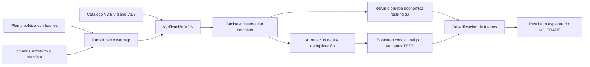

# Core V3.7 — validación estadística sintética

Alcance autorizado el 2026-10-18, America/La_Paz. Base comprobada: rama
`codex/core-v3-6-event-backtester`, commit `58fbbf1`. Rama de trabajo:
`codex/core-v3-7-statistical-validation`. Estado obligatorio: **NO_TRADE**.

## Diseño presentado antes de implementar

Paquete hermano `python/trading_agent/core_v3/statistical_validation/`, con
contratos, planificación, adaptador de lectura/ejecución V3.6, agregación,
incertidumbre, robustez y coordinador. Datos completos en memoria; fuentes
Catalog V3.5 y ResearchJournal V3.3 abiertas por el host. No crea bases, hosts,
endpoints, transportes, proveedores o adaptadores de órdenes.

Dependencias conservadas: primitivas V3.1, contexto/economía V3.2, evidencia de
investigación V3.3, reglas/timeframes V3.4, catálogo V3.5 y backtester V3.6.
No modifica ninguna fuente ni prueba anterior. No consume presupuesto V3.3.

Las decisiones expuestas fueron: fijar candidatas, particiones y política antes
del cálculo; usar warmup únicamente como contexto; purgar horizontes y aplicar
embargo; reiniciar capital en cada ventana; mantener resultados completos o
inconclusos; no asumir independencia de trades; condicionar bootstrap a bloques
IID explícitos; ejecutar nuevamente cambios de ejecución y probar equivalencia
económica solo donde todas las decisiones sensibles a costos estén cubiertas.
Nunca declarar OOS sin evidencia externa del acceso reservado.



## Archivos y fronteras

| Archivo nuevo | Responsabilidad |
|---|---|
| `statistical_validation/__init__.py` | Paquete sin arranque. |
| `statistical_validation/contracts.py` | Wire cerrado, contratos frozen/slots y límites. |
| `statistical_validation/planning.py` | Manifiestos, grillas temporales, warmup, purge/embargo y comparabilidad. |
| `statistical_validation/evidence.py` | Solicitudes ancladas, ejecución real V3.6, referencias y reverificación. |
| `statistical_validation/statistics.py` | Descriptivos Decimal y bootstrap reproducible. |
| `statistical_validation/aggregation.py` | Particiones, ventanas, cobertura y trades únicos. |
| `statistical_validation/robustness.py` | Reruns de política y prueba económica restringida. |
| `statistical_validation/coordinator.py` | API, accesos, reintentos, límites y resultados. |
| `python/tests/test_core_v37_*.py` | Ocho suites nuevas; no reemplazan regresiones. |
| `python/tests/core_v37_offline_check.py` | Añade V3.7 a las selecciones históricas intactas. |
| Este informe | Arquitectura, ejemplos, verificaciones y límites. |

Las ocho rutas de producto abreviadas pertenecen a
`python/trading_agent/core_v3/`. No se añadió una dependencia de runtime.

## Contratos y conservación

Contratos bajo `trading.core_v3.statistics.*`, `schema_version=1`:
`ValidationRequest`, `ValidationPolicy`, `DatasetManifest`, `TemporalSplit`,
`ExperimentPlan`, `BacktestObservation`, `StatisticalMetrics`,
`RobustnessMetrics`, `ValidationEvidence`, `ValidationResult`. Los auxiliares
nombran candidatas, chunks, referencias de observación, métricas por ventana,
grupos, estimaciones, escenarios y accesos. Reutilizan el wire financiero
auditado y la frontera de colecciones V3.6; no amplían sus decodificadores.

Se rechazan extras, versiones desconocidas, duplicados JSON, floats/bools
financieros, no finitos, valores fuera de precisión, permisos y procedencia
distinta de SYNTHETIC. Los originales V3.6 no se reescriben ni se retocan sus
métricas. Los diccionarios serializados son copias. Los hashes identifican
contenido; no autentican a un productor ni hacen confiable al host Python.

Cada observación conserva candidata/CatalogRef, operación de validación,
cutoff de investigación, manifiesto, ventana, warmup, dataset, política,
BacktestRequest y BacktestResult íntegros y hash del resultado. La solicitud
V3.7 fija hashes de plan/política, prefijo de accesos y solicitudes fuente.
Las nuevas ventanas se ligan a esos pins cambiando únicamente ID y hashes de
dataset/política; V3.6 verifica las fuentes antes y después de cada fold.

El resultado raíz contiene referencias a observaciones y pruebas. El retorno
`ExperimentRun` conserva también sus documentos completos en memoria. El host
debe archivarlos si necesita reproducirlos después; no hay persistencia V3.7.
Las pruebas económicas se conservan como JSON canónico separado con hash y
scope `COUNTERFACTUAL_EQUIVALENCE_ONLY`, nunca como backtests V3.6 falsificados.

## Modelo temporal y dos relojes

Se mantienen el cutoff original de investigación y el tiempo simulado del
dataset por separado. Un timestamp sintético posterior no refresca saldo,
costos, margen, FX ni procedencia. No hay captura real.

Un manifiesto reúne hasta cuatro chunks contiguos, cada uno de hasta 128 barras,
con instrumento, timeframe, IDs y hashes. No hay interpolación. El coordinador
puede planificar hasta 512 barras en total, pero cada ejecución V3.6 conserva
sus 128 barras, 16 trades iniciados, 1024 eventos y una posición simultánea.

Índices de ventanas: intervalos semiabiertos `[evaluation_start,evaluation_end)`.
`history_start` limita el contexto permitido. Se incluyen exactamente
`required_bars - 1` barras anteriores, por lo que el primer cierre de evaluación
es la primera oportunidad de señal; no se abren posiciones en warmup. Su
disponibilidad debe preceder la primera apertura evaluada. Disponibilidad tardía
dentro de evaluación permanece INCONCLUSIVE según V3.6.

Cada fold contiene TRAIN → VALIDATION → TEST. La separación mínima es
`max(max_holding_bars) + embargo_bars`. Se aplica dentro del fold y entre todas
las ventanas puntuadas de distintos folds. VALIDATION/TEST no se solapan.
TRAIN puede expandirse o solaparse por diseño; sus trades repetidos no se
transforman en observaciones independientes.

Ejemplo H1 ejecutado con el fixture de warmup 4, horizonte 1 y embargo 1:

| Fold | TRAIN | VALIDATION | TEST |
|---|---|---|---|
| 1 | `[3,6)` | `[15,18)` | `[27,30)` |
| 2 | `[39,42)` | `[51,54)` | `[63,66)` |
| 3 | `[75,78)` | `[87,90)` | `[99,102)` |

Cada intervalo tiene tres barras de evaluación y tres de contexto anterior.
Las separaciones son nueve barras, superiores a las dos exigidas. El ejemplo
de cuatro folds ocupa 144 barras en dos chunks y doce backtests pequeños.
No encadena capital ni riesgo: cada ventana reinicia el snapshot original.

No hay entrenamiento de un modelo ni ajuste automático: TRAIN es una partición
de investigación sobre una estrategia ya registrada. Variantes de parámetros
deben llegar como versiones/candidatas fijadas en el plan; el coordinador no las
genera ni selecciona una ganadora.

## Holdout, acceso y riesgo de sobreajuste

Un registro/version/hash anteriores al fold no demuestran que el diseñador no
vio la serie completa. Este incremento no tiene una atestación externa de
acceso reservado: devuelve **OOS_NOT_ESTABLISHED**. Con reutilización conocida,
devuelve **RETROSPECTIVE_SPLIT_ONLY**. No ofrece una vía para autodeclarar OOS.

El coordinador registra en memoria los intervalos leídos, incluido warmup, antes
del cálculo. Si un TRAIN posterior toca un TEST conocido, exige
`reuse_test_declared=True`; deja registrado que perdió condición no observada.
Compara instrumento/timeframe/intervalos, por lo que renombrar el dataset no
evita la comprobación. Puede rechazar conservadoramente escenarios sintéticos
independientes que usan el mismo instrumento y tiempo.

Ese historial cubre **solo esa instancia**. No es una auditoría del host,
no sobrevive reinicios y no acredita ausencia de accesos externos. Todos los
resultados son exploratorios. Una solicitud preparada antes de otro acceso
queda obsoleta; un reintento idéntico ya terminado devuelve el mismo resultado
tras reverificar las fuentes. Hay exclusión local no bloqueante; llamadas
concurrentes/reentrantes devuelven COORDINATOR_BUSY. No hay coordinación entre
procesos ni transacción entre los dos almacenes.

La política declara candidatas, variantes, familia de comparaciones y selección
posterior. Exige familia al menos candidatas × variantes × (1 + escenarios).
Esto es un límite conservador sobre lo declarado, no evidencia del universo
real de hipótesis probadas fuera del coordinador. Selección posterior bloquea
inferencia; no hay ranking automático ni promoción.

## Descriptivos y agregación

Métricas por candidata y TRAIN/VALIDATION/TEST/ALL_UNIQUE: trades cerrados,
ganadoras/perdedoras/breakeven, bruto, costos, neto, promedio positivo/negativo,
win rate, profit factor neto, expectancy neta, reward/risk realizado,
desviación estándar muestral y media retirando un trade de mayor valor absoluto
(empate: primero declarado). Se publican también capital y retorno por ventana,
DD realizado/mark y el peor DD observado entre ventanas.

No se concatena artificialmente una curva de capital. ALL_UNIQUE es suma de
experimentos con capital reiniciado, no una cuenta simulada única. Trades de
desarrollo que se superponen pertenecen a la primera ventana declarada; se
publica el número excluido, sin escoger retrospectivamente el más rentable.
Se rechazan contextos, instrumentos, monedas, políticas o warmups incompatibles.

N=0 tiene neto cerrado cero, pero sin win rate, PF, expectancy ni dispersión.
Sin pérdidas PF es `null`, no infinito. Reward/risk necesita ambos signos.
No hay Sharpe, Sortino ni anualización: falta una convención temporal apropiada
para esas estimaciones. Drawdown conserva la semántica de cierres/eventos V3.6,
no se anuncia DD continuo intrabar.

Ejemplo neto independiente para TARGET / STOP / TARGET, q=26 EUR:

| Métrica | Resultado |
|---|---:|
| Trades / ganadoras / perdedoras | 3 / 2 / 1 |
| Bruto USD | 1.82 |
| Costos USD | 3.0234 |
| Neto USD | -1.2034 |
| Win rate | 0.666666666667 |
| PF neto | 0.050796655624 |
| Expectancy USD/trade | -0.401133333333 |
| Reward/risk realizado | 0.025398327812 |
| Desviación muestral USD | 0.750555349947 |
| Expectancy sin mayor extremo USD | 0.0322 |

El cambio al quitar la pérdida ilustra sensibilidad, no justifica descartarla.
V3.6 cobra USD0.50 al entrar: el DD realizado puede existir aunque termine
ganando en esa misma vela. Capital inicial 100 → target 100.0322; stop 98.7322.

## Incertidumbre condicional

Unidad de remuestreo: una ventana TEST completa, con todos sus trades y los
casos de cero trades. Se requieren ventanas de igual duración y cobertura
completa, mínimos de trades/ventanas fijados antes de observar resultados y
ausencia de selección posterior declarada.

`UNKNOWN` o `DEPENDENT_UNMODELLED` no producen intervalo ni tamaño independiente
inventado. `IID_WINDOW_BLOCKS_ASSUMED` declara independencia **y** distribución
idéntica de los bloques. No basta que no se solapen o sean intercambiables:
variables perfectamente correlacionadas también pueden ser intercambiables.
El tamaño independiente publicado queda condicionado a esa hipótesis, no es
una estimación empírica de effective sample size.

Bootstrap percentil de media neta por ventana, con generador local SHA-256 de
contador, semilla entera y rechazo de módulo para índices uniformes. Versión
fijada en el motor; no usa el RNG global. Corrección Bonferroni sobre la familia
declarada, cuantiles nearest-rank y endpoints redondeados hacia afuera a doce
decimales. Si no hay ni un draw de resolución en cada cola ajustada, devuelve
BOOTSTRAP_RESOLUTION_INSUFFICIENT.

Ejemplo reproducible: tres TEST con netos `[0.0322,-1.2678,0.0322]`, seed=7,
200 réplicas, nivel nominal 90%, familia=1: intervalo condicional
`[-1.2678,0.0322]` USD de **media por ventana**, no por trade. Tres bloques no
acreditan validez asintótica ni significancia. Es una ilustración sintética.
Con `min_trades=100`, devuelve INCONCLUSIVE / INSUFFICIENT_SAMPLE e intervalo
`null`, aun si los descriptivos son favorables. La política por defecto exige
20 trades y tres TEST; los ejemplos pequeños declaran mínimos ilustrativos.

Las sumas monetarias siguen exactas y acotadas. Medias/ratios/desviaciones son
analíticas, redondeadas a doce decimales; no se utilizan para reconstruir P&L.
Precisión no representable causa rechazo controlado; no se relajan Money ni
los límites anteriores.

## Robustez y prueba económica

Cada escenario inmutable tiene ID y hash. Un cambio de `close_at_end` ejecuta
de nuevo V3.6 con otra política y conserva la nueva observación completa.

Spread/slippage/comisiones/financiación mayores no se inyectan en una fuente
histórica reetiquetada. Se admite una prueba restringida para un resultado
COMPLETE con exactamente un trade cerrado y una sola orden ENTRY admitida:

1. Derivar supuestos de costos monotónicamente adversos, en moneda quote y
   unidades originales, con referencias DERIVED.
2. Recalcular los fills con ExecutionMath V3.6, manteniendo mids, cantidad,
   señales, bracket absoluto, tiempos y reglas originales.
3. Crear un estado inicial temporal verificado y repetir la admisión exacta
   V3.6: geometría, exposición, margen, financiación de horizonte y riesgo.
4. En cada cierre con posición, recalcular mark y demostrar que no introduce
   una salida por mantenimiento. Usar índices de barra, pues timestamps de
   cierre y siguiente apertura pueden coincidir.
5. Recalcular costos/neto y DD. No existe una segunda entrada cuyo tamaño o
   admisión pudiera cambiar por nuevas pérdidas/capital. Señales y triggers
   mid son independientes de esas fricciones en este motor concreto.

La prueba completa usa `Context(prec=160)` y trap Inexact, igual que V3.6.
Con otra admisión, mantenimiento distinto, múltiples trades/entradas,
incompletitud o error de precisión devuelve ROBUSTNESS_NOT_ESTABLISHED;
no fabrica un resultado de estrés. Las pruebas tienen su wire propio y
preservan el resultado original. No son equivalencia general para un broker.

Ejemplo ejecutado: añadir USD0.10 a la comisión de apertura del TARGET cambia
neto de USD0.0322 a USD−0.0678 y marca fragilidad. Spread/slippage y financiación
tienen escenarios separados. No se intenta reparar la estrategia ni mover TP.

## Estados, límites y recuperación

- COMPLETE: cálculo técnico exploratorio terminado bajo la política declarada.
- INCONCLUSIVE: muestra/inferencia/robustez/OOS requeridos no establecidos,
  ventana V3.6 incompleta/rechazada, o interrupción. Cobertura parcial explícita.
- REJECTED: entrada incompatible, cambios/corrupción de evidencia o límite duro.
  Descarta agregados; no presenta métricas parciales como resultados finales.

Siempre: `trading_decision=NO_TRADE`, `execution_authority=False`,
`paper_execution_eligible=False`, `live_enabled=False`,
`statistically_validated=False`. La deserialización rechaza activarlos.

| Recurso | Máximo absoluto, reducible por política |
|---|---:|
| Chunks / barras totales | 4 / 512 |
| Ventanas / folds / candidatas | 12 / 4 / 4 |
| Escenarios | 4 |
| Trabajos base+escenarios, incluidas pruebas económicas | 64 |
| Posiciones iniciadas acumuladas, incluidas abiertas y reruns | 256 |
| Réplicas bootstrap | 512 |
| Bytes de entrada agregados | 524288 |
| Bytes por observación / resultado raíz / documento de prueba | 131072 |
| Unidades de trabajo | 32768 |
| Accesos / experimentos cacheados por instancia | 128 / 2 |

Unidades de trabajo: trabajos × 128 más réplicas × ventanas × candidatas;
es un presupuesto determinista, no segundos de CPU. Colecciones, documentos,
cache y número de iteraciones acotan memoria lógica; no se promete RSS ni
deadline portable. Los límites propios de cada V3.6 siguen activos. Un wire
excedido produce rechazo compacto, sin truncar arrays ni métricas.

Antes de cada simulación, su máximo de trades se reduce a la capacidad restante
según una regla fija de recursos; no cambia señales, cantidades ni precios.
Si V3.6 devuelve un rechazo sin contabilidad, se detienen las ventanas siguientes:
un rechazo compacto por tamaño puede haber descartado trades ya simulados y
no permite suponer consumo cero. Se conserva el resultado recibido y el estado
INCONCLUSIVE / BACKTEST_ACCOUNTING_UNAVAILABLE.

La instancia registra accesos antes de calcular. KeyboardInterrupt durante el
fold devuelve INCONCLUSIVE con lo completo hasta entonces; incluso antes de
la primera observación conserva el acceso y el resultado de interrupción para
el reintento. No hay checkpoints durables ni recuperación tras caída del host.
El replay necesita conservar todas las entradas y el prefijo de accesos.
Interrupciones en agregación/bootstrap/reverificación y rechazos posteriores a
la reserva conservan un desenlace cacheado y archivos disponibles, sin agregar
conclusiones definitivas. Si una reverificación fue interrumpida, el archivo es
parcial y el reintento debe verificarlo antes de devolverlo. La cobertura de un
grupo compara sus IDs con todas las ventanas esperadas, no solo las recibidas.

## API

```python
from trading_agent.core_v3.statistical_validation.coordinator import Coordinator

coordinator = Coordinator()
request = coordinator.prepare(
    'validation-1', plan, validation_policy, synthetic_chunks, catalog, journal,
)
artifact = coordinator.run(
    request, plan, validation_policy, synthetic_chunks, catalog, journal,
)
result_json = artifact.result.to_json()
observation_jsons = tuple(o.to_json() for o in artifact.observations)
counterfactual_proof_jsons = artifact.proofs
```

El host debe suministrar contratos exactos, catálogo/diario reales y abiertos.
No se aceptan diccionarios de aprobación ni lectores parecidos por duck typing.
Los fixtures reproducibles están en `test_core_v37_planning.example` y usan
estrategias simuladas ya registradas antes de iniciar validación.

## Verificación

Verificación final sobre el código de `12d5fe1`: **302 pruebas pasadas en
605.007 segundos; OFFLINE_BARRIER_VIOLATIONS: 0**. El commit posterior solo
añade este informe.

| Grupo | Pasadas |
|---|---:|
| V3.1 | 36 |
| V3.2 | 38 |
| V3.3 | 32 |
| V3.4 | 37 |
| V3.5 | 29 |
| V3.6 | 43 |
| Forex fase 1 | 28 |
| Contratos AI históricos | 16 |
| Baseline anterior intacto | **259** |
| V3.7 | **43** |
| Total final | **302** |

| Suite nueva | Casos | Cobertura principal |
|---|---:|---|
| `test_core_v37_contracts.py` | 6 | Wire, inmutabilidad, autoridad, procedencia, conteos y límites. |
| `test_core_v37_planning.py` | 7 | Cronología, warmup, purge/embargo entre folds, disponibilidad, chunks y moneda. |
| `test_core_v37_coordinator.py` | 4 | Flujos completos, deduplicación, walk-forward, bootstrap, selección, hashes y test reutilizado. |
| `test_core_v37_statistics.py` | 7 | Neto/costos, N=0, PF, RR, dispersión, extremos y dependencia/semilla. |
| `test_core_v37_robustness.py` | 3 | Cinco shocks económicos, ejecución real V3.6, contexto Decimal y pins estables. |
| `test_core_v37_adversarial.py` | 8 | Incompletitud, interrupción, fuentes cambiadas, recursos, OOS y fragilidad. |
| `test_core_v37_recovery.py` | 4 | Cobertura parcial, interrupción posterior, terminal idempotente y contabilidad ausente. |
| `test_core_v37_security.py` | 4 | Corrupción real temporal, sustitución, fuentes exactas y fronteras sin efectos. |
| Total V3.7 | **43** | Exclusivamente offline. |

Comando desde la raíz:

```powershell
.venv/Scripts/python.exe -B python/tests/core_v37_offline_check.py
```

El wrapper importa el main histórico sin editarlo, conserva sus seis selecciones
y añade `test_core_v37_*.py`. El hook deniega socket, subprocess/os.system/
os.startfile, apertura/listado de la `.local` real y SQLite fuera del temporal
canónico del sistema. Las alteraciones de corrupción afectan solo fixtures
temporales. Pruebas nuevas prohíben también mutadores, diseñadores y apertura
Python de archivos durante validación. No prueban aislamiento de producción.

Graphify se consultó primero sobre el grafo histórico de 424 nodos/1039 aristas,
con vocabulario real `backtest cost evaluation research strategy`; BFS encontró
198 nodos y mostró 39 con presupuesto 1200 tokens. No describe V3.7 ni se infiere
ausencia de relaciones por ausencia de nodos. Se contrastaron `backtest.py` y
`test_quant.py` actuales, y se trazaron directamente contratos, reader, engine,
simulation, accounting y fuentes V3.3–V3.6. No se reutilizó el simulador histórico
LONG como si fuese el motor V3.6. `reflect --if-stale` no necesitó actualizar;
se leyeron las lecciones existentes. No se reconstruyó el grafo ni se ejecutó
un modelo para extraerlo.

Se aplicaron senior-software-engineer y Graphify, TDD incremental y revisión
adversarial interna con contexto separado. La revisión corrigió la hipótesis
IID, la necesidad de contexto Decimal idéntico y el purge entre folds. Esto
no equivale a una auditoría independiente del incremento completo.

Reproducciones nuevas durante el desarrollo:

1. Purge omitido entre folds: prueba nueva falló; se aplica también a todos los
   límites cronológicos entre ventanas puntuadas.
2. Grupo TRAIN/ALL_UNIQUE parcial marcado completo: ahora compara IDs esperados.
3. Interrupción en postprocesamiento propagada sin desenlace: queda INCONCLUSIVE
   cacheado, sin conclusiones agregadas.
4. Límite de trades después de reservar accesos perdía el archivo/reintento:
   conserva terminal y observaciones disponibles.
5. Rechazo compacto V3.6 podía ocultar consumo de entradas: una reproducción
   contó tres entradas con presupuesto uno. Ahora detiene llamadas siguientes
   cuando no hay contabilidad verificable. No se modificó V3.6 para conseguirlo.
6. Un rerun podía tomar un prefijo nuevo tras un append ajeno del catálogo:
   prueba nueva reprodujo secuencias 5 y 8. Ahora hereda el pin de su observación
   base; no cambian sus bytes por un append ajeno que conserva la evidencia.

Los tres casos centrales de recuperación fallaron antes y pasaron después;
el caso de contabilidad vacía también se reprodujo antes de corregir.
Sensibilidad: invertir la condición nueva de independencia del bootstrap
produjo un fallo y un error en las siete pruebas estadísticas. Se restauraron
los bytes en `finally` y se comprobó SHA-256
`13190d1549c7c3fea7594c5c2675debed4ccaff569513d54da4db54816af1670`;
las siete volvieron a pasar. Es una mutación puntual, no un score global.

## Git, preservación y rollback

| Commit | Contenido |
|---|---|
| `0c3f0d7` | Contratos, estadística básica y planificación temporal. |
| `19687fd` | Coordinador, archivo verificable, agregación y robustez con pruebas funcionales. |
| `99e4204` | Regresiones adversariales, seguridad y recuperación. |
| `140eb58` | Procedencia obligatoria y límites de observaciones independientes. |
| `12d5fe1` | Preservación de pins de catálogo en reruns de ejecución. |

Un commit posterior añade este informe; su hash se comunica en el cierre.

Diff final contra `58fbbf1`: **18 adiciones; cero modificaciones, eliminaciones
o renombres de archivos de la base**. `git diff --check 58fbbf1` pasó. Las ocho
fuentes, ocho suites, wrapper e informe se enumeran arriba. Tras guardar este
informe, `git status --short` conserva exclusivamente:

```text
?? docs/architecture/core-v3-phase0-audit.md
?? docs/manual/TradingAgent_Manual_Tecnico_Integral.pdf
```

Todos los archivos de esta entrega son adiciones frente a `58fbbf1`. Se mantienen
ajenos los documentos previamente sin seguimiento de Fase 0 y el PDF. No hay
ediciones de contratos/fuentes/pruebas auditados, frontend, configuración,
migraciones, credenciales ni diarios históricos. No se leyeron secretos ni
`.local`, ni se conectaron servicios ni se ejecutaron brokers/modelos.

Rollback: revisar el árbol y revertir los commits V3.7 específicos en orden
inverso. No usar reset/clean ni borrar journals. V3.7 no crea datos persistentes
propios. No se hizo push, merge, despliegue ni se inició V3.8.

## Inventario obligatorio del backend

| Grupo | Componentes | Estado y límite |
|---|---|---|
| IMPLEMENTADO Y AUDITADO | Core V3.1–V3.6 | Baseline independiente aportado por el usuario: 259 pruebas y cero violaciones. Se ejecuta además como regresión de esta entrega. |
| IMPLEMENTADO; VERIFICACIÓN CODEX | Core V3.7 | 43 pruebas nuevas; 302 totales. Auditoría independiente completa pendiente. No emite certificaciones ni permisos. |
| EXISTENTE, PENDIENTE DE INTEGRACIÓN O RECERTIFICACIÓN | Python histórico, .NET, IBKR, R20, Kronos y frontend | Preservados; su existencia no acredita integración operativa V3. |
| PENDIENTE PARA COMPLETAR EL BACKEND | Datos reales autenticados | Ingesta, procedencia y calidad con productores confiables. |
| PENDIENTE PARA COMPLETAR EL BACKEND | Análisis de régimen | Clasificador causal versionado y evidencia. |
| PENDIENTE PARA COMPLETAR EL BACKEND | Ranking y selección | Comparabilidad, selección múltiple y NO_TRADE. |
| PENDIENTE PARA COMPLETAR EL BACKEND | Sol y Kronos controlados | Proveedores autorizados, presupuestos y manejo de uso incierto. |
| PENDIENTE PARA COMPLETAR EL BACKEND | Cartera y riesgo agregado | Capital compartido y autoridad operativa única. |
| PENDIENTE PARA COMPLETAR EL BACKEND | Comunicación Python/.NET | Contratos, roles y límites de autoridad entre procesos. |
| PENDIENTE PARA COMPLETAR EL BACKEND | Operación y conciliación IBKR | SDK simulado, intenciones durables, reconciliación y guardias. |
| PENDIENTE PARA COMPLETAR EL BACKEND | Persistencia y observabilidad | Archivo de evidencia, anclas externas, métricas y trazas. |
| PENDIENTE PARA COMPLETAR EL BACKEND | Paper Trading | Validación operativa y autorización específica posteriores. |
| PENDIENTE PARA COMPLETAR EL BACKEND | Live Trading | Autorización y validación independientes. |
| PENDIENTE PARA COMPLETAR EL BACKEND | Recuperación y despliegue | Backups, recuperación de broker y operación integral. |

Persisten supuestos sintéticos V3.6: sin liquidez real, parciales, sesiones,
préstamo, cambios históricos de FX/margen/costos ni liquidaciones reales. Los
hashes no detectan rollback coordinado válido sin anclas externas. No hay
evaluación OOS auténtica, certificación de rentabilidad, HFT o producción.
