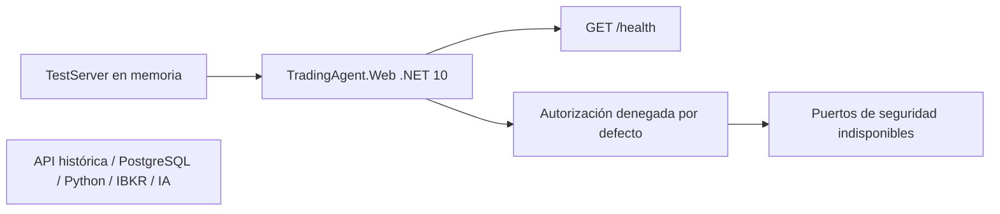

# M01.1 — fundamentos seguros del BFF

2026-10-20, America/La_Paz. **OFFLINE / NO_TRADE**.
Rama local: `codex/m01-1-bff-foundations`. Base:
`b7b3402989ec5e7ca2eeee9c26c32dc5a94c73f9`.
Implementa solamente la primera etapa aprobada de
[M01](m01-auth-audit.md) y del [diseño BFF](m01-supabase-auth-design.md).
La [evidencia verificable](m01-1-bff-evidence.json) separa ejecución de inspección.
No constituye una auditoría independiente ni una aprobación operativa.

## Arquitectura entregada

`src/TradingAgent.Web` es un ejecutable ASP.NET Core independiente, net10.0,
sin ProjectReference, paquetes externos de aplicación ni acceso al host legacy.
Su única ruta de producto es `GET /health`, respuesta `{"status":"ok"}`.
Es liveness del proceso: devuelve 200 aun cuando identidad/sesión están
indisponibles; no declara disponibilidad de datos, autenticación o trading.
No publica versión, entorno, cuentas, dependencias ni configuración.



El nodo histórico no tiene conexión desde Web. No se registran PaperFeed,
DashboardBroadcaster, SignalR, repositorios, migradores, procesos Python,
adaptadores IBKR, proveedores de IA ni clientes HTTP salientes. Solo se permite
el servicio interno del host entre los IHostedService de la composición final.
No existe proxy, token administrativo, conexión financiera ni mecanismo de órdenes.

`CreateEmptyBuilder` evita cargar appsettings, secretos de usuario, variables
de entorno y argumentos como configuración de aplicación. El entorno predeterminado
es Production. Kestrel queda preparado para loopback IPv4:5185, sin Server header,
con cuerpo máximo configurado de 4096 bytes y timeouts de cabeceras/keep-alive
de 10/15 segundos. **No se inició ese listener**: todas las pruebas usaron TestServer.
El callback de composición es código confiable para pruebas; no es una API remota.

Las respuestas llevan no-store, nosniff y CSP restrictiva. Los errores tienen
código cerrado y correlationId UUID generado en servidor; no reflejan excepciones,
query, bearer, cookies ni identificadores enviados por el cliente. Rutas ausentes
devuelven 404, métodos no permitidos 405 y rutas protegidas 503. La política
predeterminada y la fallback deniegan incluso a un principal marcado como
autenticado. Solamente salud tiene AllowAnonymous en el producto.

## Contratos y puertos

| Contrato/puerto | Garantía y límite de M01.1 |
|---|---|
| ExternalIdentity | Referencia inmutable `(issuer HTTPS, subject UUID)`; rechaza credenciales, query, fragmento y UUID vacío. Construirla no verifica un proveedor ni concede permisos. |
| IdentityVerification | Resultado tipado indisponible, identidad null. Reserva el campo de identidad para la implementación posterior sin aparentar una verificación actual. |
| SessionView | schemaVersion=1; usuario/expiración/preferencia null, sin capacidades ni entornos accesibles; UNAVAILABLE, NONE, OFFLINE, NO_TRADE y executionAuthorized=false. Sin constructor público ni setters. |
| WebError | code y correlationId; sin texto libre, tokens ni detalles internos. Códigos no definidos se rechazan. |
| IExternalIdentityVerifier | Recibe memoria de credencial y cancelación; la implementación actual no decodifica, guarda ni transmite el contenido. |
| IWebSessionReader | Devuelve únicamente una vista indisponible; no emite cookies ni crea/persiste sesiones. |
| IWebAuthorizer | Referencias de sesión/recurso y capacidad de investigación; siempre Denied. Un GUID o capacidad recibidos no son grants. |

UnconfiguredSecurity es un cierre explícito por ausencia de implementación.
No es un proveedor falso con ruta de éxito. Todos los puertos respetan cancelación.
Los estados activos, almacenes, verificación JWT/JWKS, MFA y políticas de recursos
necesitan implementación y pruebas en una etapa posterior aprobada.
No se añade siquiera una ruta de sesión/login en esta entrega.

## SDK, compilación y dependencias

Solo estaban instalados SDK9.0.316 y sus frameworks históricos. Se descargó
SDK10.0.402 win-x64 del distribuidor oficial, se verificó SHA-512 antes de extraer
y ejecutar, y se dejó bajo `tmp/m011/dotnet`, ignorado por Git. Runtime y framework
ASP.NET Core usados:10.0.13. El checksum y URL figuran en la evidencia.
.NET10 es LTS según la [política oficial](https://dotnet.microsoft.com/en-us/platform/support/policy/dotnet-core).

`build/web/global.json` fija ese SDK únicamente al trabajar desde ese directorio.
`Web.props` se importa explícitamente en los dos proyectos nuevos: net10.0,
análisis recomendado10.0, nullable, advertencias como errores y auditoría NuGet
de dependencias directas/transitivas desde severidad low. No hay supresiones.
`NuGet.Config` limita restauración/auditoría a nuget.org. Los dos lockfiles están
versionados. Web no tiene paquetes NuGet de aplicación; los paquetes adicionales
son del proyecto de pruebas. La auditoría de NuGet no cubre por sí sola el runtime
compartido ni garantiza ausencia de vulnerabilidades desconocidas.
[Referencia de auditoría](https://learn.microsoft.com/en-us/nuget/concepts/auditing-packages).

La solución nueva vive en `build/web/TradingAgent.Web.slnx`. No se editan la solución,
Directory.Build.props ni proyectos históricos. La evaluación MSBuild confirmó
net9.0 y NuGetAudit=false históricos, frente a net10.0 y auditoría all de Web.
La invocación normal de dotnet desde la raíz sigue seleccionando9.0.316.

Comprobación reproducible desde la raíz con un SDK10.0.402 ya disponible:

```powershell
./build/web/check.ps1 -Dotnet ./tmp/m011/dotnet/dotnet.exe
```

También admite `-Dotnet` con la ruta de otro SDK10.0.402, sin instalarlo globalmente.
El script restaura en locked mode sin caché HTTP, compila Release con warnaserror,
ejecuta pruebas sin rebuild/restore y rechaza reportes de paquetes vulnerables o
incompletos. Registra resultados bajo tmp/m011/check y restaura las variables de
entorno que ajusta. SDK/restore/audit contactan fuentes públicas; OFFLINE describe
el sistema financiero, no la descarga de herramientas o documentación pública.

## Pruebas ejecutadas y preservación

**21 pruebas pasadas, cero omitidas/fallidas. Build:0 advertencias/0 errores.**
Auditoría directa y transitiva: dos proyectos, ninguna vulnerabilidad reportada.

| Grupo | Casos | Evidencia |
|---|---:|---|
| Contratos | 5 | Identidad inválida, aislamiento de issuer, sesión sin autoridad, puertos denegados, cancelación y errores cerrados. |
| Frontera HTTP | 12 | Salud mínima, nueve rutas/métodos adversos con bearer/cookie inválidos, ruta protegida futura y excepción sin detalles. |
| Aislamiento | 4 | Ciclo del host sin ConnectStart/ResolutionStart, DI sin proveedores/worker/cliente saliente/DP, metadatos compilados y políticas cerradas aun con principal autenticado. |

Durante un ciclo completo de TestServer y llamadas a los tres puertos se observaron
**0 eventos de inicio de conexión socket y0 de DNS**. Los nombres se contrastaron
con el runtime oficial [SocketsTelemetry](https://github.com/dotnet/runtime/blob/v10.0.13/src/libraries/System.Net.Sockets/src/System/Net/Sockets/SocketsTelemetry.cs)
y [NameResolutionTelemetry](https://github.com/dotnet/runtime/blob/v10.0.13/src/libraries/System.Net.NameResolution/src/System/Net/NameResolutionTelemetry.cs).
El cliente HTTP de TestServer usa transporte en memoria, sin listener TCP.
[Referencia de pruebas ASP.NET](https://learn.microsoft.com/en-us/aspnet/core/test/integration-tests?view=aspnetcore-10.0).

La inspección PE cubre también delegados generados: no hay referencias a clientes
socket/HTTP salientes, procesos, escrituras File/Directory/StreamWriter, DB,
SignalR, motores, carga dinámica por los métodos comprobados ni P/Invoke.
Junto con la composición DI, los contadores de red y los hashes, sostiene cero
escrituras operativas en los caminos probados. No es un contador global de I/O,
un firewall, un sandbox de Python/.NET ni prueba contra código malicioso inyectado
en el proceso. No se inspeccionaron bases reales ni directorios privados.
Las escrituras de SDK, compilación y resultados son artefactos de herramientas.

Se contrastaron bytes/SHA-256 de los **707 archivos versionados de la base**:
cero diferencias. También se preservaron los hashes de los dos documentos
untracked preexistentes. El diff final es exclusivamente aditivo. PostgreSQL y
sus once SQL, Core V3.9 completo, Market Analyst, Vue, autenticación y frameworks
históricos permanecen intactos. No se rerunearon las suites cuantitativas ni
las suites .NET históricas; sus resultados anteriores no se atribuyen a M01.1.

TDD: el primer intento falló por host ausente. Regresiones nuevas reprodujeron
405 convertido en503 y política Default que aceptaba un principal autenticado.
La prueba DI detectó DataProtectionHostedService al usar AddAuthentication;
se corrigió con AddAuthenticationCore, sin registrar esquemas ni proveedor de
claves. [API oficial](https://learn.microsoft.com/en-us/dotnet/api/microsoft.extensions.dependencyinjection.authenticationcoreservicecollectionextensions.addauthenticationcore?view=aspnetcore-10.0).
El código final pasa todos esos controles. La primera invocación del SDK informó
la instalación automática de un certificado de desarrollo; no se ejecutó trust
ni se usó en un listener. El wrapper desactiva esa generación para futuras primeras
invocaciones. No se inspeccionaron ni eliminaron claves del perfil del usuario.

## Riesgos y siguiente frontera

No existe autenticación funcional, persistencia de sesiones, CSRF, rate limiting
de login, autorización por recursos, TLS de producción ni gestión de claves.
No hay rutas que los necesiten salvo la salud pública mínima. Añadir rutas de
datos, AllowAnonymous o reemplazar la composición requiere una revisión específica;
la aprobación de M01.1 no autoriza esa ampliación. Salud200 no es readiness.
No se afirma seguridad de producción ni se habilita acceso remoto.

Revisión interna de corrección, arquitectura, seguridad, claridad y recursos;
no auditoría independiente. No se enviaron documentos a terceros. No se ejecutaron
IBKR/TWS, SQL, migraciones, servicios históricos, inferencia, captura, órdenes,
Supabase Auth ni React. **Sin push, merge o despliegue. M01.1 termina aquí.**
