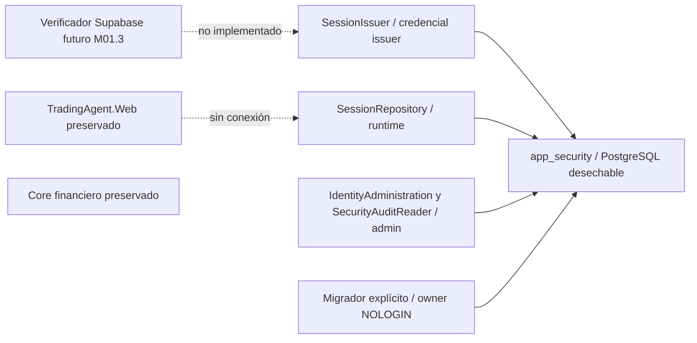

# M01.2 — persistencia de seguridad PostgreSQL

Estado: **OFFLINE / NO_TRADE**. Base: `6fb5068e8ab77658530874856bdabb05b9af2316`.
Rama: `codex/m01-2-postgres-security`. Requiere auditoría independiente del usuario.
No se integra todavía con TradingAgent.Web ni con Supabase. No se inicia M01.3.

## Fronteras

`Identity.Persistence` usa Npgsql10.0.3 y contratos propios. `Identity.Migrations`
contiene el ejecutable y dos scripts SQL embebidos. No referencian proyectos
financieros, Web, Python, proveedores de IA ni SDK de broker. Los nuevos proyectos
importan las propiedades estrictas net10.0 de M01.1 sin cambiar sus archivos.
La solución nueva es `build/identity/TradingAgent.Identity.slnx`.

El único destino implementado es `DisposableTarget`: loopback numérico, puerto
alto, nombre generado `m012_test_<UUID>` y marcador de base comprobado al conectar.
No existe modo operativo ni migración de arranque. Habilitar un destino real y
aprovisionar credenciales exige otra entrega y aprobación. No se conectó a la
instancia habitual del proyecto ni se inspeccionaron sus cuentas/configuraciones.

## Modelo SQL privado

| Entidad | Invariantes |
|---|---|
| app_users | UUID interno; UNIQUE issuer/subject; vínculo inmutable; INVITED/ACTIVE/DISABLED; authz_version creciente; email informativo opcional. |
| role_permissions | Catálogo cerrado versión1: Viewer Read; Researcher Read/ManageResearch; Operator Read/Supervise; Administrator Read/ManageSecurity. |
| user_roles | Concesión explícita, actor, expiración y revocación irreversible; historial y una concesión no revocada por usuario/rol. |
| resource_grants | UUID exacto, tipo Account/Study/Experiment/Strategy/Platform, Paper o Live y una capacidad; historial, expiración y revocación. |
| web_sessions | Hash de referencia aleatoria; vínculo usuario/issuer/subject/provider_session_id; AAL2 para uso; expiración absoluta/inactividad, authz_version y CAS row_version. |
| security_audit_events | Acción/resultado cerrados, actor, recurso, UTC, correlación, política y UUID de sesión interno no secreto. |
| settings | Dominio de administración UUID, política1 y ceremonia bootstrap de una sola ejecución. |
| migration_ledger | Versión, checksum SHA-256 y fecha; separado de las once migraciones históricas. |

Ningún registro recibe Viewer o Administrator automáticamente. El registro
administrativo crea INVITED sin roles. El bootstrap inicial es una ceremonia SQL
explícita exclusiva del owner; el servicio no puede ejecutarla. En pruebas se
provisionan identidades ficticias adicionales desde el fixture privilegiado.

La autorización exige sesión válida, usuario ACTIVE, versión vigente, rol con
capacidad y grant exacto del mismo recurso/entorno. Administrator no obtiene
acceso universal ni permiso de ejecución. Platform solo admite ManageSecurity
sobre el UUID de dominio. Las operaciones globales de estado/rol requieren
administración en cada entorno con grants vigentes del objetivo: Paper no puede
reactivar autoridad Live latente. Otorgar o revocar un grant usa su entorno exacto.

La ceremonia owner_scope inicializa explícitamente un ámbito administrativo
adicional y revoca las sesiones anteriores del actor. Comprueba usuario/rol y
reloj después de bloquear. Un grant Live de lectura sigue devolviendo
execution_authorized=false. No se implementa execute_live ni acceso financiero.

## Credenciales y privilegios

Los roles de grupo son NOLOGIN, sin SUPERUSER/BYPASSRLS/CREATEDB/CREATEROLE/
REPLICATION. Un DBA del fixture crea el esquema vacío propiedad del owner y
logins aleatorios separados; el migrador no recibe CREATE sobre la base.

| Grupo SQL | Acceso efectivo previsto |
|---|---|
| identity_migration_owner | Propiedad exclusiva del esquema; acceso mediante SET ROLE del login migrador. |
| web_security_runtime | authorize, self_user, session_change; lectura del ledger; sin emisión ni administración. |
| identity_session_issuer | create_session y ledger; sin autorización administrativa. |
| identity_access_admin | admin_change, read_audit y ledger; sin DML directo. |
| identity_security_reader | SELECT del catálogo y ledger; sin usuarios, sesiones, grants o auditoría global. |
| web_financial_reader | Reservado, sin grants financieros ni acceso a app_security. |

Las funciones privilegiadas tienen firmas cerradas, SQL estático y search_path
`pg_catalog,app_security`. Se revoca EXECUTE público en la misma transacción de
creación. No hay SQL dinámico ni selección de rol por un UUID suministrado.
Privilegios SQL, restricciones y triggers protegen el historial de grants,
identidades y auditoría. El owner/superuser puede cambiar esos controles; no se
presentan como una defensa frente al propietario de PostgreSQL o del proceso.
No se usa RLS como sustituto de estas fronteras.

Antes de exponer una conexión se comprueban marcador, flags y membresías
alcanzables del login real, privilegios heredados/PUBLIC fuera del esquema,
catálogo de migraciones y ACL efectivas dentro de app_security. Se rechaza DML
directo de servicios, lectura de tablas privadas, funciones adicionales y CREATE
de esquema. Una configuración financiera incompatible falla; no se modifican
silenciosamente privilegios históricos para poder conectar. La comprobación es
un preflight, no un bloqueo frente a cambios de ACL posteriores del owner.

## Sesiones, transacciones y revocación

SessionIssuer requiere una implementación confiable de IIdentityEvidenceVerifier
y una credencial issuer distinta. La implementación predeterminada no verifica
identidades. Los únicos verificadores que emiten pruebas son dobles sintéticos
de los tests. Construir IdentityProof no concede autoridad por sí mismo: el host
que puede instalar un verificador o posee la credencial issuer es confiable.

El servidor genera32 bytes CSPRNG, codificados base64url canónico. Solo persiste
SHA-256 con separación de dominio; el UUID de auditoría es otro identificador.
ToString y serialización de SessionReference no muestran el bearer. No se acepta
una referencia elegida por el cliente en CreateAsync. El hash permite búsqueda;
la entropía evita requerir hashing lento de contraseñas para estos secretos.

La prueba debe ser AAL2, reciente5min y no futura; su expiración limita la sesión
a un máximo12h. La inactividad máxima es30min. La administración y lectura global
de auditoría vuelven a exigir verificación reciente después del lock. read_audit
requiere ambos ámbitos administrativos, limita1–100 filas y omite contacto,
issuer, subject y tokens. Los slots de tokens cifrados están reservados y tienen
CHECK NULL-only: no se implementó cifrado ni gestión de claves en esta etapa.

Todas las operaciones usan orden usuario antes de sesión. La autorización toma
FOR SHARE; administración, emisión y cambios de sesión toman FOR UPDATE.
Administración bloquea actor/objetivo en orden UUID. Después de esperar se
releen sesión, versión, roles/grants y clock_timestamp en READ COMMITTED.
La decisión y su evento de auditoría se confirman en una transacción explícita.
Cambiar estado/rol/grant incrementa authz_version y revoca todas las sesiones
del objetivo en esa misma transacción. Touch compara row_version: dos cambios
con la misma versión no pueden triunfar ambos. No se resucitan filas revocadas.

La garantía es una decisión en el instante registrado. Una revocación confirmada
antes de adquirir el lock se observa; una decisión ya confirmada no se retira
retroactivamente. Una futura lectura financiera necesitará su propia frontera
transaccional y revalidación; aquí no existe ese flujo ni caché de permisos.

Fallos de conexión, esquema, ACL, auditoría o commit producen Unavailable sin
Allowed. Los lectores de identidad devuelven ausencia. La cancelación se propaga.
No se registran mensajes de excepción del proveedor ni credenciales. Un commit
cuya respuesta se pierde tiene resultado incierto: no hay reintento automático de
mutaciones. El host futuro deberá consultar/reconciliar antes de volver a emitir
una operación. Los timeouts acotan conexión3s, comandos5s y espera de locks3s.

## Migración y recuperación

V001 crea tablas/catálogo/restricciones; V002 crea funciones y grants. El manifiesto
embebido fija los checksums de sus bytes. Advisory lock transaccional70112026,
orden V001/V002 y transacción única evitan entregas parciales. Se rechaza un
esquema preexistente incompatible, ledger incompleto/desconocido o checksum
alterado; una segunda aplicación íntegra es idempotente. Los SQL fuerzan LF con
un .gitattributes local para conservar checksum entre Windows/Linux.

CLI explícita: `TradingAgent.Identity.Migrations --disposable-only`, con variables
M012_TEST_PORT/DATABASE y M012_MIGRATION_USER/PASSWORD generadas por el fixture.
No contiene modo operativo, creación de bases ni conexión durante arranque Web.
La API ApplyAsync también exige la credencial Migration y los mismos controles.
Un rollback de transacción conserva el estado anterior. No existe Down que borre
auditoría: ante corrupción se conserva evidencia y se detiene el servicio; una
recuperación operacional/backup queda fuera de esta entrega. Solo el fixture
elimina la base desechable de nombre generado al finalizar.

## Reproducción y CI

Desde la raíz Windows: `./build/identity/local-test.ps1`. Usa binarios locales
PostgreSQL17 para iniciar un cluster nuevo en tmp/m012, loopback/puerto aleatorio,
credencial ficticia aleatoria y marcador. No inicia Docker Desktop ni servicios
instalados. Detiene únicamente su cluster y elimina su archivo de contraseña;
los directorios ficticios ignorados se conservan para diagnóstico. Para otro SDK
o ubicación PG se usan los parámetros Dotnet y PostgresBin. Docker local no tenía
daemon disponible; la validación local fue PostgreSQL17.5, sin certificar una
versión operativa. La documentación previa apuntaba a major17, no a un minor
operativo inspeccionado. CI valida17.11-bookworm en contenedor efímero.

check.ps1 ejecuta SDK10.0.402, restore locked con audit true/all/low, build Release
estricto, xUnit, inventario completo y reporte de vulnerabilidades NuGet. El CLI
puede omitir frameworks sin vulnerabilidades en su reporte filtrado; por eso se
contrasta además el inventario completo de los tres proyectos/net10.0. Ninguna
supresión de advisories ni warning está permitida. El framework compartido no
está cubierto por la auditoría de paquetes.

La CI nueva usa ubuntu-24.04, service PostgreSQL por digest y acciones oficiales
por SHA. Solo push de esta rama, contents:read, checkout sin credenciales, sin
cachés, timeout15min y artefactos allowlist14d, incluso ante fallo. La contraseña
bootstrap visible es un fixture público exclusivo del contenedor efímero; los
logins de aplicación se generan aleatoriamente con SCRAM. No son secretos ni
cuentas operativas. Los manifiestos exigen exactamente61 casos M01.2 y21 M01.1,
todos Passed, nombres/ensamblados correctos y cero omitidos. Se ejecuta el wrapper
M01.1 sin editarlo; su workflow original permanece intacto.

Resultados locales:61/61 M01.2 y21/21 M01.1, build sin warnings/errors. La evidencia
CI definitiva es el artefacto ligado al commit/árbol de cada ejecución, no este
texto. Un verde permite presentar el módulo a auditoría, no aprobarlo.
Se comparan los729 archivos base, árboles protegidos y once SQL históricos.
Los tests observan ConnectStart durante el ciclo SQL y exigen exclusivamente el
endpoint PostgreSQL del fixture. Tooling/NuGet/runner quedan fuera de ese contador.
El sentinel financiero ficticio permanece intacto. No es un firewall ni sandbox.

Primera ejecución CI verificada:
[39503947487](https://github.com/EngerING/TradingAgent/actions/runs/39503947487),
commit `7adabf1b3360321fbaf865cb009a25de58fdb947`, árbol
`0e1b76fc1f3a2531166067cb8ad7aded8b47b60f`: **61+21 aprobadas,0 fallidas,0 omitidas**.
PostgreSQL17.11 Debian, SDK10.0.402, build0 warnings/errors, NuGet0 vulnerabilidades
reportadas. Se descargó y contrastó el
[artefacto12302112977](https://github.com/EngerING/TradingAgent/actions/runs/39503947487/artifacts/12302112977)
con sus13 archivos; SHA-256 del ZIP
`bc747cda378ac27b8713fe5c870da2dd9f495fe2b86916e3d26b712e7b5c0c75`.
435 ConnectStart observados, todos al endpoint desechable. Los TRX registran
11.729984s para M01.2 y0.9964526s para M01.1. Este cierre añade documentación;
cualquier ejecución posterior conserva su propia identidad y artefacto.

## Revisión y límites

Se aplicaron ingeniería senior, Graphify, TDD incremental, seguridad/PostgreSQL,
Git y revisión adversarial interna con contexto separado. Graphify histórico:
424 nodos/1039 links; consulta postgres token risk presupuesto1000,168 hallados,
29 mostrados/139 truncados. No contiene este módulo; se contrastó con fuentes.

Regresiones de revisión: separación issuer/runtime; scopes globales Paper/Live;
frescura administrativa; expiración SQL NULL; precondición owner tras lock;
deriva ACL privada y privilegios financieros por columna. Las pruebas reproducen
los cierres. El tercer ciclo encontró la última omisión por columna; se corrigió
y verificó con regresión, sin iniciar un cuarto ciclo interno. Incidencias de desarrollo:
nombre de índice reservado, fixture con varias sentencias parametrizadas y forma
del JSON NuGet sin frameworks; se corrigieron sin debilitar controles históricos.

El [paquete manual de auditoría](m01-2-external-review.md) no se envía a terceros ni
ejecuta CLIs externas. Los [hashes y evidencia](m01-2-postgres-security-evidence.json)
complementan los artefactos. No hay Supabase real, JWT, MFA, login, React, SQL
operativo, IBKR, PaperFeed, motores/modelos, cambios de riesgo, journals, merge o
despliegue. **M01.2 queda pendiente de auditoría independiente.**

Fuentes: [privilegios PostgreSQL17](https://www.postgresql.org/docs/17/ddl-priv.html),
[funciones y search_path](https://www.postgresql.org/docs/17/sql-createfunction.html),
[locks](https://www.postgresql.org/docs/17/explicit-locking.html),
[aislamiento](https://www.postgresql.org/docs/17/transaction-iso.html),
[Npgsql](https://www.npgsql.org/doc/basic-usage.html),
[seguridad Npgsql](https://www.npgsql.org/doc/security.html),
[service containers](https://docs.github.com/en/actions/tutorials/use-containerized-services/create-postgresql-service-containers),
[origen imagen oficial](https://github.com/docker-library/official-images/blob/master/library/postgres).
