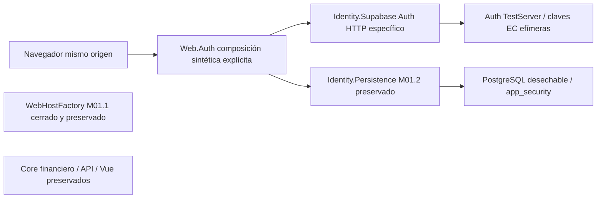
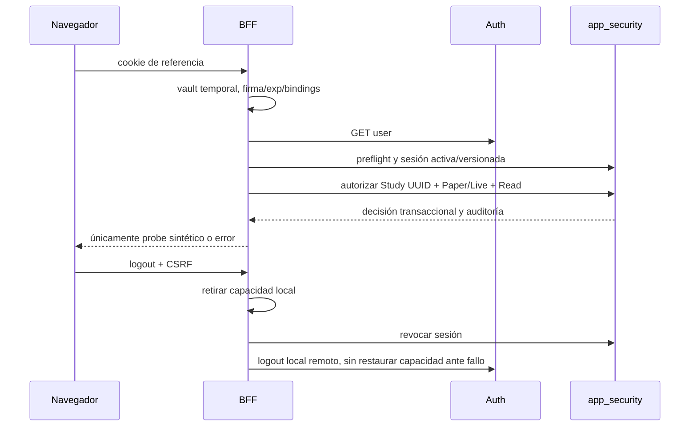

# M01.3A — Auth simulado, integración BFF y sesiones seguras

**OFFLINE / NO_TRADE.** Rama `codex/m01-3-supabase-auth`, base
`f4130ea9671da9b0990ac62bff40a9aa83f60e4d`, árbol base
`3c2a872570bfbde9e688b97a40007e267707c469`. El usuario declara M01.2 aprobado
tras auditoría independiente. Se contrastó la evidencia de su CI61+21; no se
aportó otro informe independiente legible en el workspace. Esta revisión interna
no sustituye la auditoría de M01.3A. M01.3B y M01.4 no están autorizados.

## Arquitectura y composición



Identity.Supabase referencia Identity.Persistence y Microsoft.IdentityModel8.23.0;
Web.Auth referencia esas bibliotecas y ASP.NET Core10. No hay dependencia del
core financiero, API histórica, SDK Supabase Data/Storage/Realtime, Python,
IBKR o modelos. No cambia Program.cs ni se introduce launcher operativo.
`IntegratedHostFactory.CreateSyntheticPilot` requiere configuración explícita,
dos credenciales SQL separadas y composición de host confiable. Rechaza la
configuración de un proyecto real. Las pruebas instalan TestServer; no Kestrel.
La composición M01.1 original sigue denegando por defecto y sus21 pruebas no
cambian. La composición nueva conserva default/fallback deny y añade una policy
de sesión para rutas concretas; roles/grants se consultan en PostgreSQL.

## Contraseña y MFA

```mermaid
sequenceDiagram
  participant N as Navegador
  participant B as BFF
  participant A as Auth simulado
  participant P as PostgreSQL
  N->>B: GET csrf, POST login + CSRF
  B->>A: password grant, validar JWT y GET user
  B-->>N: preauth opaca + factores permitidos
  N->>B: enroll si hace falta
  B->>A: TOTP enroll (unverified)
  B-->>N: secreto/URI de enrolamiento como texto
  N->>B: factorId, challenge, código
  B->>A: challenge y verify de un solo uso
  B->>B: firma AAL2, issuer/sub/session_id y AMR recientes
  B->>P: SessionIssuer con prueba verificada
  B-->>N: cookie opaca de sesión; nunca JWT/refresh
```

El password grant es distinto de PKCE; no se inventa un canje de código para ese
flujo. Login solo crea preauth, nunca sesión SQL autorizable. La respuesta lista
IDs de factores de ese usuario. Nuevos dispositivos pueden descubrir los factores
verificados usando exclusivamente BFF. Enroll no reemplaza MFA verificado; puede
eliminar inscripciones propias unverified y recrearlas para recuperar una
respuesta perdida. El simulador conserva ambos estados y los prueba.

Challenge se liga a preauth, sujeto, sesión del proveedor y factor propio. Solo
uno queda pendiente; se consume antes de verify, sin restauración tras error,
timeout o cancelación. La exclusión por preauth devuelve409 a un concurrente.
El JWT elevado debe mantener issuer/sub/session_id, ser AAL2 y contener evidencia
firmada del factor compatible con el instante del challenge. AMR admite los nombres
documentados `totp` y `mfa/totp`, con timestamp entero; no acepta una lista de
métodos sin timestamp como evidencia fresca. No se convierte una llamada online
en una nueva hora MFA. Un método desconocido no se usa para elevar autoridad.

Enrollment devuelve secreto/URI TOTP como texto JSON para una futura UI confiable;
no refleja SVG/HTML del proveedor. No se guarda QR, secreto ni código en SQL o
logs. El DTO de enrolamiento tiene ToString redactado. Verificar TOTP real contra
un proveedor alojado queda pendiente: el simulador comprueba flujo/bindings y
errores con códigos ficticios, no certifica el motor TOTP de Supabase.

## JWT, JWKS y transporte

El transporte usa HttpClientFactory tipado, timeout3s de operación y4s de cliente,
respuesta<=64KiB, JSON profundidad16 y rechazo de propiedades duplicadas. No sigue
redirects, no comparte CookieContainer, no usa proxy automático, limita conexiones
a8 y su vida a2min para renovar DNS incluso con cliente capturado por el piloto.
No hay retries de mutaciones. Solo se construyen rutas Auth cerradas; ningún
claim `iss`, `jku` o `x5u` selecciona un destino. Los logs de HttpClient se retiran.

El perfil real preparado exige origen HTTPS de proyecto `*.supabase.co`, puerto
predeterminado, sin path/query/userinfo/fragmento y clave `sb_publishable_` pública.
JWKS/issuer se derivan del origen confiable. Dominios personalizados o claves
legacy HS256 no están soportados por este perfil. El modo simulado permite solo
loopback HTTP y usa issuer HTTPS sintético distinto del transporte, para respetar
IdentityKey. Ninguna prueba contacta ese issuer ni un proyecto real.

JsonWebTokenHandler verifica firma ES256/P-256, issuer y audiencia authenticated,
exp/nbf sin skew, firma obligatoria y kid. También se exigen iat no futuro,
duración de emisión<=1h, sub/session_id UUID no vacíos, AAL conocido, contexto
humano no anónimo y role authenticated. role solo filtra tipo de token; jamás
concede un rol interno. Se rechazan claims/cabeceras duplicados, servicio,
alg=none/HS256, claves suministradas por cabecera, tokens>16KiB y formatos ambiguos.
Email, metadata y preferencias no conceden permisos.

JWKS permite1–10 claves públicas EC P-256 sig/ES256 sin componente privado y kid
único. Caché5min, edad máxima10min, refresco coordinado y mínimo30s entre intentos
globales, también ante kids aleatorios. No se crea caché negativa de cardinalidad
ilimitada. Sin clave válida se deniega. Durante fallo puede usarse una clave
conocida dentro de10min, pero cada acceso BFF exige además la consulta online.
No se promete revocación instantánea por rotación; se ensaya una rotación simulada.

## Sesiones, revocación y límites efectivos



El [ADR de sesiones](m01-3-session-adr.md) fija memoria temporal, sin refresh ni
vault durable/cifrado improvisado. Solo se retiene access token en memoria del
servidor, ligado por hash de referencia local, issuer, sujeto, provider session y
exp. Las respuestas Auth contienen refresh token en un buffer temporal acotado;
no se lee ni retiene ese campo. No se afirma borrado seguro de strings del GC.
Los slots SQL de tokens siguen NULL y sus restricciones no cambian.

La cookie `__Host-TradingAgent.Session` usa CSPRNG de M01.2, Secure, HttpOnly,
SameSite=Strict, Path=/ y sin Domain. Preauth tiene otra cookie. El piloto limita
la sesión al deadline inicial de preauth: máximo5min desde contraseña, también
acotado por expiración JWT/SQL. No se renueva. Una pérdida/reinicio de memoria
deniega referencias antiguas sin fallback SQL. El puente preauth→sesión emitida
se conserva hasta ese mismo deadline: logout con solo preauth también revoca una
cookie verify que aún esté en tránsito. Complete es atómico y no acepta un
preauth retirado mientras esperaba. Un fallo posterior a emisión puede dejar una
fila SQL inaccesible; se intenta compensar revocando, sin inventar éxito si el
commit es incierto. No se promete recuperación durable del vault.

Logout retira capacidad local y pide revocación SQL antes de intentar logout del
proveedor. Si SQL falla, responde503 y elimina la capacidad local, sin afirmar
revocación durable. Si solo falla Auth, la revocación local confirmada permanece.
También se solicita logout remoto de preauth. Una respuesta ya autorizada no se
retira retroactivamente; no hay streams, órdenes o lecturas financieras futuras.

**GET user no demuestra una sesión remota activa.** Los tests modelan rechazo del
proveedor y también un JWT que continúa aceptado tras logout remoto. El resultado
session indica `providerSessionConfirmedActive=false`. No hay introspección
privada ni acceso a auth.sessions del proveedor. Cambios de contraseña, cierre
desde otro dispositivo y revocación alojada son pendientes de M01.3B. No se expone
ninguna operación administrativa ni financiera sensible; quedan cerradas. El
probe es explícitamente sintético y no debe reutilizarse como guard operacional.

Hay128 preauth/puentes en conjunto,128 sesiones y256 presupuestos por identidad,
con expiración/pruning y rechazo al llenarse. Cada preauth admite5 operaciones MFA;
la cuenta mantiene15 operaciones/5min entre cookies distintas y el host20 POST/min
sin cola. Estos límites son conservadores para piloto de un proceso, no cuotas
distribuidas ni protección de disponibilidad para producción.

## Contrato HTTP

Host/origen del piloto: `https://tradingagent.test`, sin CORS. Futuro React será
del mismo origen; requiere obtener CSRF y conservar cookies, nunca SDK Auth en
navegador, JWT/localStorage ni acceso a PostgreSQL.

| Ruta | Entrada | Respuesta |
|---|---|---|
| GET /health | ninguna | liveness mínima |
| GET /bff/csrf | cookie de navegador | request token; cookie antiforgery Secure/HttpOnly |
| POST /bff/auth/login | email,password + CSRF | MFA_REQUIRED, factores y cookie preauth |
| POST /bff/auth/mfa/enroll | preauth + CSRF | factorId, secreto y URI TOTP textuales |
| POST /bff/auth/mfa/challenge | factorId + preauth/CSRF | id, expiresAt |
| POST /bff/auth/mfa/verify | challengeId,code + preauth/CSRF | SIGNED_IN, expiresAt, cookie opaca |
| GET /bff/session | sesión | AAL2, expiración, renewable=false, NO_TRADE |
| GET /bff/probe/{UUID}/{Paper o Live} | sesión y grant Study exacto | constante sintética, executionAuthorized=false |
| POST /bff/session/touch | rowVersion + sesión/CSRF |204 o conflicto409; no amplía el lease web |
| POST /bff/auth/logout | referencias presentes + CSRF |204 local confirmado o503; borra cookies |

Errores cerrados:400 entrada,401 sesión/login inválidos,403 CSRF o sin permiso,
409 conflicto,413 tamaño,429 límite,503 dependencia y500 inesperado. Incluyen
código fijo y correlación nueva; no mensajes del IdP/DB, cuentas ni infraestructura.
No existe registro público, Google OAuth, endpoint de órdenes ni proxy genérico.
Recovery, invitaciones, confirmación y logout-all no se exponen sin un flujo
demostrado. Sus futuras rutas de enlaces necesitarán PKCE, code/verifier de un
solo uso y redirect allowlist; no se conectan ni simulan como ya implementadas.

CSRF ASP.NET protege todos los POST, incluidos login/logout. Se usa DataProtection
efímero solo para antiforgery, sin claves persistentes. Los tokens CSRF quedan
ligados a la cookie aleatoria de navegador anónimo antes de autenticar; así puede
cerrarse sesión aun con IdP indisponible. Se exige Origin exacto y Fetch Metadata
same-origin/none cuando existe. HTTPS/Host exacto, no-store, no-cache, nosniff,
CSP sin scripts/frame/base, Referrer-Policy y HSTS. El lector limita cuerpos a4KiB
incluyendo longitud desconocida; un rate-limit previo puede rechazar429 antes de
leerlos. Timeout global15s y errores redactados. No hay logs de cuerpos, tokens,
cookies, contraseña, OTP o QR; el host integrado no registra providers de logging
por defecto. Se instrumenta un evento estructurado1301 con categoría cerrada y
status numérico; un sink de prueba verifica que no incluye credenciales/cookies/
OTP/tokens. Añadir observabilidad operacional requiere otra revisión de datos.

## Verificación, CI y preservación

`./build/auth/local-test.ps1` crea un cluster nuevo con binarios locales PG17,
puerto loopback aleatorio, marcador y contraseña ficticia CSPRNG. No usa ni
arranca servicios habituales. Ejecuta64 pruebas nuevas,61 M01.2 y21 M01.1 mediante
wrappers preservados; los checks usan SDK10.0.402, Release, warnings-as-errors,
restore locked y NuGet audit true/all/low. El reporte NuGet cubre paquetes
directos/transitivos conocidos, no el framework compartido. Se conserva cada
TRX y se exige nombre/ensamblado/conteo exactos sin fallos/omitidos.

Auth simulado usa HTTP TestServer en proceso y JWT firmados con claves EC
generadas en cada ejecución. No es una simulación de repositorios: todos los
roles, grants, sesiones, autorizaciones y auditoría recorren SQL real. El observer
de conexiones exige solo el endpoint PostgreSQL desechable durante el ciclo SQL;
TestServer no abre sockets HTTP. No acredita un firewall ni todas las operaciones
del runner. Los fixtures privilegiados son exclusivamente para ese cluster.

CI nueva: ubuntu-24.04, SDK10.0.402, imagen PG17.11-bookworm por digest probado en
M01.2, acciones oficiales por SHA, contents:read, sin caché/secretos operativos,
timeout15min, solo push de esta rama y artefactos allowlist14d aunque falle.
La contraseña bootstrap visible solo inicializa el contenedor efímero; los logins
de servicio se generan. Workflows M01.1/M01.2 quedan intactos. El artefacto de
cada ejecución incluye commit/árbol,64+61+21 casos, logs y auditorías. Un verde
no equivale a aprobación independiente.

Los764 archivos base se comparan por hashes locales y blobs Git; no se modifica
ninguno. La evidencia enumera hashes de Core, Market Analyst, M01.1/M01.2,
PostgreSQL histórico/once SQL, API, Vue, labs, framework y workflows. Los dos
documentos preexistentes untracked permanecen excluidos y con los mismos bytes.
No se ejecutaron suites cuantitativas/históricas ajenas a estos wrappers.

Se consultaron ingeniería senior, Graphify, seguridad/API, TDD, Git, CI y revisión
adversarial interna. Graphify histórico:424 nodos/1039 links; vocabulario postgres
token security risk, BFS184 encontrados,27 mostrados/157 truncados, presupuesto900;
no cubre módulos nuevos y se contrastó con fuentes. Tres ciclos internos:
JWT/budgets/bindings, logout demorado/factores/inscripciones, y sensibilidad del
test de cuota por cuenta. Se corrigieron con regresiones; no hubo cuarto ciclo.
El [paquete manual](m01-3-external-review.md) se prepara sin enviar código a terceros.

Fuentes: [claims Supabase](https://supabase.com/docs/guides/auth/jwt-fields),
[métodos AMR del SDK oficial](https://github.com/supabase/auth-js/blob/master/src/lib/types.ts),
[sesiones y límites de revocación](https://supabase.com/docs/guides/auth/sessions),
[OpenAPI Auth](https://github.com/supabase/auth/blob/master/openapi.yaml),
[TOTP](https://supabase.com/docs/guides/auth/auth-mfa/totp),
[IdentityModel](https://learn.microsoft.com/en-us/dotnet/api/microsoft.identitymodel.jsonwebtokens.jsonwebtokenhandler.validatetokenasync),
[CSRF ASP.NET10](https://learn.microsoft.com/en-us/aspnet/core/security/anti-request-forgery?view=aspnetcore-10.0).
