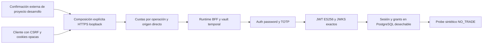

# M01.3B — B1: preparación del piloto alojado

Base obligatoria: `c15c49ac07bf2eec2c72d8987c1db52b18a04795`, árbol
`e21123607bf89ac98772646ea31b690a96eaa661`. Rama nueva
`codex/m01-3b-hosted-supabase-pilot`. OFFLINE / NO_TRADE.
El usuario declara auditoría independiente superada y aporta los hallazgos A–D;
no se recibió un informe independiente adicional. Se implementó B1 sin proyecto
confirmado inicialmente. El usuario lo identificó durante el cierre; su configuración
pública permanece local e ignorada. Después autorizó B2: el preflight público y
los intentos interactivos se describen en la validación alojada. B2 sigue parcial,
sin aprobación; HTTPS BFF espera un certificado Windows compatible.

Diseño previo: presupuestos acotados y atómicos por operación, dirección remota
del socket y cuenta de login normalizada/hash HMAC efímero. No se confía en
Forwarded/X-Forwarded-For. Primero se comprueba origen; rechazos no reservan
claves/capacidad de cuenta/global. Logout tiene almacenamiento y cuota separados.
La cuota MFA por cuenta autenticada y preauth de M01.3A continúa vigente. NAT
comparte cuota: esto no garantiza equidad entre navegadores del mismo origen.
Los límites globales siguen siendo una defensa necesaria ante múltiples orígenes.

Cookie obsoleta: CSRF precede cualquier recuperación. Referencia ausente del
vault, expirada o rechazada permite borrar cookie y reiniciar password+MFA;
sesión vigente devuelve409. Fallo de proveedor o SQL devuelve503 y conserva
cookie. Una consulta self_user en una conexión distingue fila ausente de fallo;
no se cambia M01.2 ni su contrato nullable. No se reutiliza la referencia vieja.

La composición alojada será una API explícita separada, solo Development,
proyecto/ref exactos confirmados externamente, publishable key y origen HTTPS
loopback. El listener se liga a127.0.0.1, con certificado aportado por el host;
sin builder callback público, autodetección de proyecto, flag de producción ni
entrypoint histórico. PostgreSQL continúa exigiendo el destino desechable de
M01.2. No se implementa un vault durable ni refresh; lease máximo5min.

GET user no acredita por sí solo vigencia remota. La documentación oficial
[sesiones](https://supabase.com/docs/guides/auth/sessions) y
[guía SSR](https://supabase.com/docs/guides/auth/server-side/advanced-guide)
describe comprobaciones con distinto contexto. La semántica del proyecto
alojado debe medirse, no inferirse de la simulación. Sin prueba suficiente,
las operaciones sensibles siguen cerradas. No se consulta auth.sessions.

## Resultado B1 y fronteras

Se implementa HostedPilotSettings como contrato tipado de valores externos
con confirmación de referencia exacta; issuer y JWKS se derivan del origen,
audiencia permanece authenticated. No se cambió la validación JWT, HS256 sigue
rechazado y solo se admite ES256. CreateHostedDevelopmentPilot usa
CreateEmptyBuilder/Development y Kestrel ligado a127.0.0.1 con certificado
aportado por el host. No recibe un builder callback público ni carga appsettings,
.local, variables operativas, secretos o proyectos automáticamente. Construir
la composición no inicia listener ni consulta al proveedor/SQL. El test lo
comprueba sin StartAsync. El host histórico y el modo sintético se conservan.

Este diagrama describe la composición preparada; el tramo alojado no se ejecutó.
La Suite A usa TestServer/HttpMessageHandler en proceso, incluidas las solicitudes
con URI HTTPS de forma alojada. No constituye TLS real ni compatibilidad probada
con un proyecto Supabase. El PostgreSQL de pruebas sí es real y nuevo.

Solo se modifican tres archivos previos de Web.Auth: IntegratedHostFactory.cs,
PilotEndpoints.cs y PilotRuntime.cs. Se añaden HostedPilotSettings y
PilotRequestBudgets. Las146 pruebas previas, sus helpers y manifests, wrappers,
workflows, M01.1/M01.2 y todos los componentes financieros se preservan por hash.

| Presupuesto por proceso | Por origen directo/min | Global/min | Adicional |
|---|---:|---:|---|
| Login |20|200|20 por email normalizado/min, hash HMAC efímero |
| MFA |40|400|5 por preauth y15 por subject/5min preservados |
| Logout |20|200|Reserva y diccionarios independientes |
| Otras mutaciones |20|200|Sin cola |

Cada bucket limita1024 orígenes y1024 claves de cuenta; ventanas vencidas se
eliminan antes de admitir. Rechazos no crean claves, no extienden ventanas ni
cargan otros presupuestos. La selección usa metadatos del endpoint después de
routing: mayúsculas y barra final comparten la cuota. Direcciones IPv4 mapeadas
se normalizan; sin dirección se usa una partición unknown conservadora. No hay
middleware de ForwardedHeaders. Cookies arbitrarias no cambian el origen.

Los límites no son distribuidos: un NAT puede afectar a varios usuarios y
varios orígenes pueden agotar la defensa global. Un proxy no configurado comparte
su IP y no debe desplegarse así; una futura configuración necesita allowlist
de proxies e identidad de red verificada, más almacén distribuido y revisión de
privacidad. No se atribuye identidad humana a la dirección IP ni se promete DoS
imposible. Logout independiente evita que login/MFA consuman su reserva, pero
una avalancha propia de logout todavía recibe429.

El recovery de cookie distingue401 de503 mediante lectura self_user en una sola
conexión. No degrada fallos de query a fila inexistente ni usa un preflight en
otra conexión. Una sesión válida impide login duplicado; vault perdido/expirado
o invalidado permite nueva autenticación. Las cookies obsoletas se borran incluso
si la contraseña nueva resulta inválida. No se promueven referencias antiguas.
CSRF, Origin, cookies Secure/HttpOnly/Strict y validaciones de identidad permanecen.

## Pruebas ejecutadas y pendientes

Local:44 pruebas nuevas y146 regresiones aprobadas, cero fallos/omitidas. Los TRX
se validan por nombre, ensamblado, total y duración. Build Release con SDK10.0.402,
cero advertencias/errores, restore locked y NuGet true/all/low sin vulnerabilidades
conocidas reportadas. PostgreSQL local17.5 en cluster nuevo, detenido al terminar.
CI fija PG17.11 por digest y acciones oficiales por SHA, sin caché ni secretos
alojados, contents:read, timeout15min, artefactos allowlist14d aunque falle.

La primera reproducción ejecutó7 casos y falló5 por409 incorrecto. El contrato
de configuración nuevo también falló compilación por tipo ausente antes de su
implementación. Una prueba inicial confundía una referencia aleatoria con una
sesión anterior aún legítima; otra adelantaba el reloj simulado del proveedor
sin adelantar SQL real. Se corrigieron los fixtures/asserts: la expiración prueba
recuperación AAL1, el reinicio/revocación comprueban también el flujo MFA completo.
No se debilitó la regla SQL de frescura para acomodar un reloj futuro simulado.

Revisión adversarial interna de contexto separado en tres ciclos: lectura SQL
con estado explícito, orden atómico de cuotas y loopback real; alias de routing;
revisión final sin violación concreta adicional. Paquete manual externo preparado
según preferencia previa del usuario; no se invocaron revisores externos.
Graphify:424 nodos/1039 enlaces, BFS184 encontrados,27 mostrados/157 truncados,
presupuesto900; reflect no-op. Grafo histórico contrastado con fuentes actuales.

Evidencia detallada/hashes: [JSON](m01-3b-evidence.json). Revisar además
[Suite B pendiente](m01-3b-hosted-validation.md), [ADR](m01-3b-session-renewal-adr.md)
y [paquete manual](m01-3b-external-review.md). No se ejecutaron suites financieras
cuantitativas, frontend o proyectos .NET históricos ajenos a los wrappers citados.
La conexión observada de tests se limita a PostgreSQL desechable; no es sandbox
de OS ni conteo de todo el tooling. No hubo IBKR, órdenes, PaperFeed, migraciones
financieras, OpenAI/Kronos, merge, despliegue o cambio de main. Los intentos B2
Auth autorizados se registran aparte; no forman parte del conteo de sockets
de Suite A ni un intento fallido se presenta como autenticación validada.

Al preparar B2 se reprodujo además un bypass de CSRF previo: routing acepta
post/pOsT, mientras el guard comparaba POST literalmente. Dos regresiones fallaron
antes de la corrección. El guard y las cuotas ahora usan HttpMethods.IsPost para
aplicar el mismo control independientemente del casing del método. No se modificó
ninguna prueba anterior y el total actual es190, incluyendo las dos nuevas.

Fuentes primarias contrastadas: [TOTP](https://supabase.com/docs/guides/auth/auth-mfa/totp),
[OpenAPI](https://github.com/supabase/auth/blob/master/openapi.yaml),
[rate limiting ASP.NET10](https://learn.microsoft.com/en-us/aspnet/core/performance/rate-limit?view=aspnetcore-10.0).
El auxiliar local B2 recibe credenciales fuera del chat y de CI. Su estado real
y los casos pendientes están documentados aparte; M01.4 no se inicia.

## CI verificada

Primera ejecución [39539401715](https://github.com/EngerING/TradingAgent/actions/runs/39539401715)
correcta sobre commit `9c059aaef2bc3e98a51f039430b4624769268f6e`, árbol
`a7e97919530e084b311def6712349a058eeb0a03`.
El [artefacto12319400228](https://github.com/EngerING/TradingAgent/actions/runs/39539401715/artifacts/12319400228)
se descargó y verificó: SHA-256
`8c265826912b5d90c78b405a51e90f0610c634973ee25dcb45fe71b5a1c3d909`.
Los cuatro TRX contienen42/64/61/21 casos esperados aprobados, cero fallos y
omitidas, ensamblados exactos y duraciones6.689393s/9.619035s/11.460974s/0.999633s.
Builds Release sin advertencias/errores, auditorías sin vulnerabilidades conocidas
reportadas, SDK10.0.402 y PostgreSQL17.11. Se observan cero conexiones fuera del
PostgreSQL desechable durante los ciclos de pruebas, sin afirmar sandbox del runner.
La entrega registra un commit posterior exclusivamente documental y vuelve a
ejecutar la misma CI: su identidad/árbol exactos y artefacto constan en la respuesta
final y en identity.json. No se introduce una autorreferencia de hash imposible
en este documento. B2 continúa parcial y la auditoría independiente de B1
sigue pendiente: un resultado verde no concede aprobación operacional.

La ejecución posterior [39540990956](https://github.com/EngerING/TradingAgent/actions/runs/39540990956)
verificó44+64+61+21=190 pruebas, cero fallos/omitidas, sobre commit
`245c456b0449ce4412ca555aafaf603d79f1d7f7`, árbol
`0b685463e1cf4ee0e435705e01f5390da13cb28c`. Se descargó el
[artefacto12319698153](https://github.com/EngerING/TradingAgent/actions/runs/39540990956/artifacts/12319698153),
SHA-256 `3d05b8a83a8ab4fe8a72a0dca698450bc821780a4e25079a43bbac7c5f2b3f9a`,
y se verificaron los cuatro TRX, identidad, SDK, builds, NuGet y aislamiento.
El auxiliar interactivo Windows posterior se compila y verifica localmente;
la CI Linux no lo ejecuta ni valida su integración real alojada.
