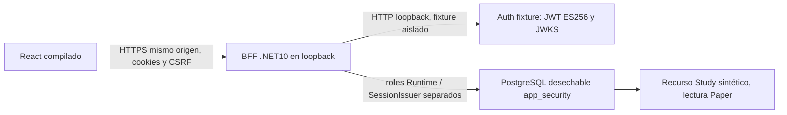

# M01.4B-B1 → React, BFF HTTPS y Auth HTTP aislado

Estado: OFFLINE / NO_TRADE. Base develop `efd13f6be8c3c720e24cd9921c2cf7f5b1db7bd5`,
CI posterior al PR1 confirmado success. Rama `feature/m01-4b-react-bff-integration`.
Entrega para auditoría independiente; B2 alojado no ejecutado ni autorizado por esta entrega.
No merge, Rulesets, despliegue, servicios financieros, IBKR o frontend Vue.

## Arquitectura y autoridad

`TradingAgent.Web.Browser` sirve únicamente archivos compilados permitidos y rutas UI
cerradas. El lector de assets está separado de Web.Auth: las barreras PE originales
siguen denegando referencias File/proceso/servicios financieros en ese ensamblado.
`BrowserHost.CreateSynthetic` exige configuración Auth Simulation y HTTPS localhost.
No hay composición alojada de React habilitada en B1, SDK Supabase en navegador,
proxy hacia API histórica, dashboard ni nuevos esquemas/migraciones.

El ejecutable de **pruebas** `build/react-bff/BrowserFixture` arranca Kestrel HTTPS,
un servidor Auth HTTP real, claves ES256 nuevas y una base aleatoria marcada. Se
reutilizan exclusivamente las migraciones de seguridad M01.2, intactas. Su control
HTTP es exclusivo de fixtures y nunca se registra en el BFF producto. El marcador
PostgreSQL se comprueba antes de DDL. El runner limpia su base/roles y detiene su
cluster propio; no toca servidores operativos. Las identidades/códigos son públicos,
sintéticos y sin autoridad; no prueban el algoritmo TOTP real de Supabase.

## HTTPS

Un único origen `https://localhost:<puerto efímero>` entrega HTML, assets y /bff.
La CA y leaf se generan para una ejecución, con SAN localhost/127.0.0.1, validez
limitada, EKU serverAuth. Solo el certificado **público** raíz se escribe en tmp.
En Linux las claves privadas quedan en memoria. Schannel Windows no admite la clave
efímera original para este listener: el fixture importa un PFX exclusivamente en
memoria con DefaultKeySet, borra el buffer y dispone el contenedor temporal al salir.
No se exporta archivo privado ni se cambia confianza del usuario. El smoke .NET usa
CustomRootTrust y verificación normal de nombre/cadena. En CI limpio se confía la CA
pública en OS/NSS antes de Chromium. No ignoreHTTPSErrors, callback permisivo,
ignore-certificate-errors, eliminación Secure ni CORS wildcard.

CI conserva keys/certificados privados, configuración temporal, logs del host y
credenciales de la base fuera de artefactos/Git. No instala confianza local para
navegadores del usuario. Playwright HTTPS completo se ejecuta en el runner limpio.

## Contratos React/BFF

| Ruta | Contrato y autoridad |
|---|---|
| GET /bff/config | Perfil cerrado SYNTHETIC_HTTP_FIXTURE, OFFLINE, NO_TRADE, executionAuthorized=false. |
| GET /bff/csrf | Token antiforgery; cookie __Host Secure/HttpOnly/Strict. |
| POST /bff/auth/login | Email/password acotados; respuesta MFA_REQUIRED y factores id/verified, nunca JWT. |
| POST /bff/auth/mfa/enroll | Solo inventario vacío; factorId, secret, uri para inscripción autorizada. |
| POST /bff/auth/mfa/challenge | factorId vigente; id/expiresAt de challenge de un solo uso. |
| POST /bff/auth/mfa/verify | challengeId y seis dígitos; firma/identidad/sesión/AAL2/frescura y SQL antes de cookie. |
| GET /bff/session | authenticated, aal2, expiresAt, renewable=false, providerSessionConfirmedActive=false y límites OFFLINE. |
| POST /bff/auth/logout | Cancelación local y revocación SQL; 204 solo si el resultado durable confirma. |
| GET /bff/probe/{id}/{entorno} | Sesión, usuario activo, rol, grant, recurso/entorno y capability Read comprobados en SQL. |

BffAuthAdapter usa fetch same-origin, redirect:error, sin caché, timeout10s,
AbortController, JSON de respuesta máximo16KiB, POST máximo4096bytes y esquema
cerrado por operación. Bootstrap máximo1024bytes/3s. Token CSRF se obtiene para cada
POST. No retries de operaciones, Axios, claves de proveedor, JWT, refresh token,
referencias de sesión, localStorage o sessionStorage. 401/403/409/429/503 son estados
normalizados; una respuesta 200 parcial falla cerrada. No se muestra éxito hasta
verify **y** GET session. Logout aborta solicitudes e invalida estado antes de I/O;
si falla, el mensaje conserva resultado no confirmado y nunca promete revocación.

Demo se selecciona exclusivamente con desarrollo y modo explícito `demo` (`npm run
dev`). Producción HTTP sin BFF válido queda Unavailable. Una caída del BFF no elige
Demo. La UI identifica siempre el proveedor sintético. Password y códigos se
limpian tras enviar; el secreto de enrollment existe solo en estado de esa pantalla,
se elimina al continuar/cancelar y nunca entra en URL/logs/artefactos. El QR se
reconstruye localmente con qrcode-generator2.0.4 mediante celdas SVG React; no se
renderiza SVG/HTML del proveedor ni se usa innerHTML. No se garantiza borrado físico
de strings del heap/GC. El nuevo paquete se fija con lockfile, scripts deshabilitados,
auditoría y firmas npm.

## Enrollment sin eliminación

Se elimina la ruta de retiro automático en PilotRuntime. Inventario existente,
incompleto o ambiguo bloquea enrollment; un factor verificado único sigue mediante
challenge. No existe endpoint browser de recuperación destructiva ni DELETE.
Una reserva por identidad issuer/subject, máximo128 entradas hasta el vencimiento
preauth, se toma **antes** del I/O. Evita otro enrollment desde un segundo login y
conserva incertidumbre si se perdió respuesta. La reserva es de un solo proceso;
no proporciona transacciones distribuidas con la API del proveedor. Tras enrollment
se vuelve a verificar identidad/inventario exacto antes de entregar el secreto.
Challenge y verify comprueban factor único; tras verify se exige además Verified
antes de emitir SQL/cookie. Ambigüedad observada detiene el flujo sin borrar factores.
Cambios posteriores al último GET del proveedor no pueden excluirse atómicamente.
B2 necesita revisión de estos límites; las operaciones sensibles siguen bloqueadas.

Dos pruebas previas cambian legítimamente, sin perder casos/aserciones de seguridad:
ReviewRegressionTests reemplaza la expectativa de eliminación automática por409 y
preservación (su identidad se actualiza en manifest); AdversarialBffTests conserva
su nombre y todas sus aserciones de challenge ajeno/vencido, preparando ahora un
factor verificado compartido en lugar de provocar un orphan en el segundo browser.
Las demás pruebas antiguas permanecen intactas. Manifiestos verifican nombres,
ensamblados, contadores, duración y cero omitidas; no basta exit_code0.

## Sesión y JWT

Máximo5min, sin refresh ni Remember Me. Poll coalescido cada5s y al volver al foco,
cancelación al salir/logout, validación BFF/SQL en cada acceso protegido. La pantalla
completa visitada directamente no acredita identidad. La preferencia Paper no se
envía como autoridad; Live/Google/registro público siguen bloqueados.
providerSessionConfirmedActive=false conserva el límite de revocación remota.

Se leyó únicamente diagnóstico redactado del intento histórico: PASSWORD_AND_JWT,
Password200, JWKS200, Unspecified, sin CheckUser. Los flags decodificados sin verificar
(incluido iat_is_future) **no demuestran** la causa. JwtVerifier/JwksCache/AuthClient
permanecen byte-idénticos a develop, incluidos ES256, firma, issuer/audience,
sub/session, role/AAL/amr/timestamps y skew cero. Sus pruebas adversariales previas
se reejecutan, y el browser prueba rechazo de HS256 y iat futuro firmados por fixture.
No se corrige una hipótesis concediendo tolerancia de reloj ni cambiando el sistema.

## Recuperación e invitación bloqueadas

B1 no dispone de contratos BFF de intercambio de recuperación/invitación ni un
vínculo administrativo durable de invitación a usuario SQL. Por eso se documenta
el bloqueo permitido por el alcance: no email, verifyOtp, cambio de contraseña,
aceptación real, alta pública, selección de rol o recursos. Inputs reales de estos
flujos están deshabilitados. Parámetros/fragmentos se descartan antes de montar
React y nunca se intercambian/almacenan. El servidor entrega la pantalla neutra sin
analítica y con Referrer-Policy no-referrer/no-store. La URL inicial puede ser vista
por el servidor: no deben usarse enlaces reales antes de configurar un callback BFF
sin request logging. Las pruebas de enlaces vencidos/reusados/manipulados/identidad
incorrecta/usuario deshabilitado/aceptados/sin permisos demuestran **bloqueo**, no un
flujo implementado de aceptación.

Propuesta para una aprobación posterior: callback BFF dedicado (no SPA), token_hash
+tipo cerrado recovery/invite o PKCE íntegramente gestionado por BFF; estado opaco
aleatorio one-use con TTL, propósito/identidad/origen exactos y consumo transaccional
contra replay/concurrencia. Verify proveedor solo desde BFF; redirección final fija
303 a URL limpia y cookie preliminar separada. Recovery no crea sesión AAL2 ni grants;
invitation debe coincidir con registro autorizado SQL y nunca concede rol.

Antes de B2 se requiere aprobación explícita de la URL HTTPS estable/puerto y certificado.
Solo entonces proponer cambiar Site URL actual http://localhost:3000 al origen HTTPS
exacto; Redirect URLs únicamente callbacks BFF exactos, sin wildcard; plantillas
Recovery/Invite apuntarían al callback BFF aprobado con TokenHash y tipo fijo, sin
access/refresh tokens ni redirectTo libre. Estas plantillas/callbacks todavía no
están implementadas ni aprobadas. No aplicar esa configuración a flujos bloqueados.
No se modificó ninguna configuración alojada, usuario ni factor real.

## CI, preservación y reproducción

`M01.4B React BFF Integration`: Ubuntu24.04 limpio, Node24.20.0/npm12.2.0,
SDK10.0.402, PostgreSQL17.11 con digest fijado. Acciones oficiales por SHA,
contents:read, checkout sin credenciales persistidas, sin cachés persistentes ni
secretos reales. Restore locked, NuGet audit all/low, Release/warnings-as-errors,
typecheck/lint, npm audit/signatures, xUnit y Chromium HTTPS sin bypass.
Los checks requeridos M01.4A conservan nombres y añaden el trigger de esta feature;
se sustituyó únicamente su guard por el allowlist explícito M01.4B cuando la base
nueva es ancestro. Toda ruta base fuera de ese allowlist se compara por blob Git;
Core, Market Analyst, API/Core/Infrastructure históricos, Vue, SQL y diseño quedan
protegidos. No se modifican Rulesets. Identidad commit/tree exacta en artifact.

299 casos originales +16 unit React +14 backend enrollment +24 E2E HTTPS =353
**casos distintos esperados**; la unidad React se ejecuta en dos jobs, no sumar
duplicados. Artefactos14d: TRX, XML/JSON, auditorías, identidad, aislamiento y capturas
limpias login/MFA/sesión. El observador del proceso fixture registra ConnectStart
(incluidos intentos IPv6 fallidos), solo permite endpoints efímeros declarados y
cuenta SQL/Auth/HTTPS; excluye procesos browser/tooling. No es firewall/sandbox OS.

Local: `npm --prefix frontend-react run verify`, `npm --prefix frontend-react run e2e`,
`./build/auth-pilot/local-test.ps1` para266, `./build/react-bff/local-test.ps1` para
suite nueva y smoke TLS con CA explícita sin cambiar confianza del usuario. La
prueba browser HTTPS completa y su resultado final se acreditan por CI/artifacts;
los resultados esperados de este documento no sustituyen la ejecución.

El primer arranque de CI rechazó runner.temp en el entorno del job; se corrigió su
ámbito al paso de build. La primera ejecución Chromium alcanzó22/24: el control
de caída SQL intentaba ALTER DATABASE desde la propia base y PostgreSQL lo rechazó;
ahora usa la conexión postgres del mismo cluster desechable, revalidando el marcador.
La otra comprobación comparaba el vencimiento ajustado por Chromium con Date.now.
Date de Kestrel también tiene caché y resolución por segundo: otra ejecución mostró
301s aparentes con ese reloj. El límite exacto300s se verifica contra el iat del JWT
que acuñó el propio fixture, expuesto solo al runner como metadato sintético sin
token/identidad/sesión, y se comprueba Expires/DTO por segundo RFC6265. No se introduce
tolerancia JWT ni se amplía la sesión. Este oráculo es exclusivo del ejecutable test.
El smoke local también comprueba rechazo503 durante la caída y recuperación SQL.

Se consultaron Graphify (grafo histórico424nodossinReact/BFF; corroboración en fuentes),
las diez skills solicitadas, Supabase, TDD y revisión adversarial de contexto separado.
Hubo RED de contrato inexistente frontend, eliminación TOTP, respuesta incierta,
reserva entre logins y ambigüedad durante verify, antes de sus correcciones. Revisión
interna no equivale a auditoría independiente. Paquete manual externo adjunto sin
transmisión ni CLIs externos. Los tres untracked previos se preservan sin publicarlos.

Fuentes primarias consultadas el21oct2026:
- https://supabase.com/changelog.md (lectura pública; SDK nuevo no incorporado).
- https://supabase.com/docs/guides/auth/auth-mfa/totp
- https://supabase.com/docs/guides/auth/server-side/advanced-guide
- https://supabase.com/docs/guides/auth/passwords
- https://supabase.com/docs/guides/auth/auth-email-templates
- https://learn.microsoft.com/en-us/aspnet/core/fundamentals/static-files?view=aspnetcore-10.0
- https://learn.microsoft.com/en-us/dotnet/api/system.security.cryptography.x509certificates.x509certificateloader.loadpkcs12?view=net-10.0
- https://github.com/dotnet/runtime/issues/23749
- https://github.com/kazuhikoarase/qrcode-generator

B2 alojado, recuperación/invitation real, configuración remota, M01.5, merge y despliegue
siguen pendientes de autorización y auditoría. OFFLINE / NO_TRADE.
