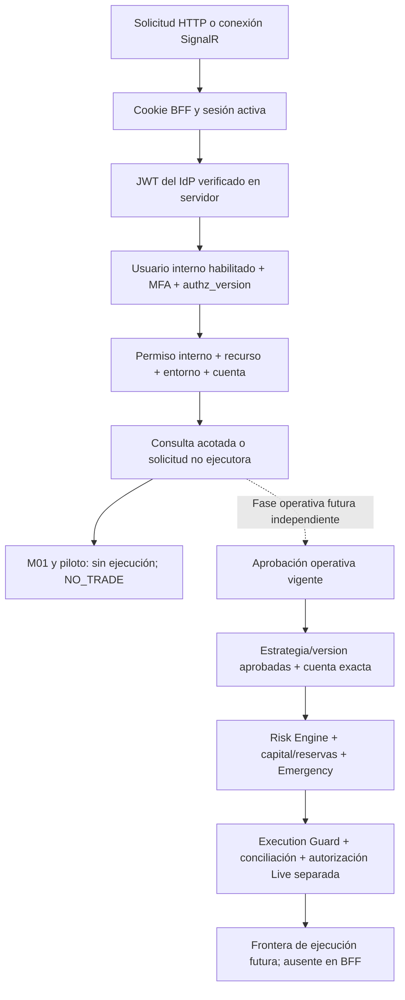

# M01 — propuesta Supabase Auth, BFF y permisos internos

Fecha: 2026-10-20, America/La_Paz. Diseño para aprobación; **OFFLINE / NO_TRADE**.
Complementa la [auditoría actual](m01-auth-audit.md) y su
[matriz de rutas](m01-auth-endpoints.csv). Nada de lo descrito como futuro está
implementado, provisionado, compilado o validado operativamente por M01.

## 1. Decisiones y fronteras

Recomiendo Supabase exclusivamente como proveedor de identidad y un BFF ASP.NET
Core de mismo origen que React. PostgreSQL actual conserva todos los datos
financieros y recibe únicamente un esquema adicional de identidad interna,
permisos y sesiones web. Python, IBKR, riesgo y ejecución conservan sus fronteras.
La base interna de Auth del proveedor no sustituye nuestra base financiera.
No se conectará el cliente al Data API, Storage o Realtime de Supabase.

Para reducir el impacto sobre el host actual, propongo un host ASP.NET Core
aditivo `TradingAgent.Web`, separado de la API operacional/local existente.
No inicia PaperFeedService, DashboardBroadcaster actual, proyecciones con procesos,
migraciones automáticas ni motores. No posee token admin legacy, credenciales
IBKR ni adaptador de órdenes. Accede a PostgreSQL con repositorios de lectura
acotada y al nuevo esquema de seguridad con permisos mínimos. Los DTO/proyectores
puros existentes podrán reutilizarse tras revisión; la fuente global actual y
su caché no se reutilizan directamente para aislar usuarios.

La API actual queda local y sin cambios. El nuevo BFF no será un proxy genérico
que reenvía peticiones con el bearer administrativo. Las rutas existentes que
mutan settlement/emergencia o evidencia no se «publican» simplemente añadiendo
un login. Su transición requiere contrato, pruebas y aprobación específicos.

| Decisión | Motivo / coste |
|---|---|
| BFF con cookie de referencia | El navegador no guarda access/refresh tokens; centraliza revocación, límites y auditoría. Añade estado de sesión, CSRF y un salto de red. |
| Supabase JWT validado por componentes .NET | Sin criptografía propia ni confianza en mera decodificación. El esquema de aplicación no usa roles financieros del JWT. |
| `(issuer, subject)` como identidad externa | `sub` UUID estable en su proyecto; email es dato de contacto mutable. Un proyecto distinto no hereda accesos. |
| Permisos en PostgreSQL propio | Roles y accesos revocables sin esperar a refrescar claims del IdP. Ninguna política de trading se almacena en user_metadata. |
| MFA TOTP en el primer piloto protegido | Todas las sesiones que ven datos requieren aal2; enrolamiento y recuperación limitados no ven datos de investigación/cuentas. |
| Invitaciones, sin registro público | Evita aprovisionar permisos por alta espontánea o por dominio de correo. Invitación de identidad no concede rol/recurso. |
| React nuevo en `frontend-react/` | Mantiene Vue y sus paquetes intactos; migración gradual de lectura, con origen/cookies independientes durante coexistencia. |

Una SPA con JWT bearer directo reduciría el estado del BFF y evitaría cookie
automática en la API, pero aumenta la exposición del token a XSS y complica
refresh/revocación coherente entre pestañas y SignalR. No se recomienda para
este primer producto financiero. HttpOnly reduce exfiltración, no impide a un
XSS actuar con la sesión abierta: CSP, escape de contenido y controles del
servidor siguen siendo necesarios. Son decisiones de diseño de M01.

## 2. Diagramas

```mermaid
sequenceDiagram
    actor U as Usuario
    participant R as React (mismo origen)
    participant B as BFF ASP.NET Core
    participant I as Supabase Auth
    participant V as Validador JWT/JWKS
    participant P as PostgreSQL existente
    U->>R: Email, contraseña y preferencia UI
    R->>B: Login con antiforgery sobre HTTPS
    B->>I: Autenticación de identidad (sin logs de contraseña)
    I-->>B: Tokens de identidad
    B->>V: Firma, iss, aud, tiempos, algoritmo, sub/session_id
    V-->>B: Identidad válida o rechazo
    B->>P: Buscar vínculo externo y estado interno
    B-->>R: Desafío/enrolamiento MFA limitado si hace falta
    R->>B: Verificar desafío MFA
    B->>I: Challenge/verify
    I-->>B: Sesión elevada
    B->>V: Revalidar JWT aal2 y vínculo
    B->>P: Crear sesión web; tokens cifrados en servidor
    B-->>R: Cookie HttpOnly Secure de referencia; SessionView sin tokens
```



Ninguna flecha desde el selector React, un claim de Supabase, Administrator o un
modelo puede saltar los controles financieros. M01 no crea la última frontera.

## 3. Autenticación y JWT/JWKS en .NET

Supabase publica claves asimétricas por JWKS y permite ES256/RS256. El endpoint
del proyecto es `/auth/v1/.well-known/jwks.json`; la documentación describe caché
de borde de10min y posibles cachés adicionales. Una rotación de clave no implica
revocación instantánea en un verificador externo con caché.
[Fuente: signing keys](https://supabase.com/docs/guides/auth/signing-keys).

Configuración propuesta, sin valores de un proyecto real:

| Control | Requisito |
|---|---|
| Issuer | URI HTTPS exacta del proyecto aprobado, habitualmente `https://<project-ref>.supabase.co/auth/v1`; configuración del host, nunca obtenida del token. |
| Audiencia | Valor exacto aprobado para access tokens de usuarios, inicialmente `authenticated`, confirmado en fixtures y después en proyecto de pruebas. No aceptar claves de servicio como sesiones humanas. |
| Firma | RequireSignedTokens y ValidateIssuerSigningKey; usar Microsoft.IdentityModel y AddJwtBearer para un esquema bearer cuando exista ese consumidor. |
| Algoritmo | ES256 como opción inicial; RS256 solo si se aprueba/configura. Rechazar none, HS256 y algoritmos ajenos al perfil; no inferir la lista desde `alg`. |
| Tiempo | RequireExpirationTime, ValidateLifetime; exp válido, nbf si existe, iat no futuro ni incoherente con el máximo de emisión. Skew propuesto30s, reloj UTC monitorizado. |
| Identidad | sub y session_id UUID válidos, issuer vinculado, usuario existente/habilitado; rechazar identidad anónima y sesión humana no permitida. |
| Claims | MapInboundClaims=false; no usar email, user_metadata, role=authenticated ni app_metadata como grants internos. AAL se usa solo tras validar firma. |
| Transporte | JWKS por HTTPS al host exacto aprobado, sin redirects ni URL suministrada por jku/x5u/iss del JWT. Límites de tiempo, bytes, número/tipo de claves y tamaño de token. |
| Descubrimiento | No asumir que configurar Authority descubre automáticamente metadata OIDC compatible. Verificar el discovery real en M02; si no procede, alimentar ConfigurationManager/TokenValidationParameters con JWKS fijado mediante adaptador estrecho, sin criptografía propia. |

El BFF valida la respuesta de Auth mediante `JsonWebTokenHandler` y el mismo
perfil de validación que usaría el esquema JwtBearer; no intenta interpretar
un login por contraseña como un callback OIDC genérico. Login de contraseña usa
la API Auth del proveedor; PKCE corresponde a los flujos de enlaces/códigos que
lo soportan. No se implementa un grant OAuth de contraseñas genérico ni Google.
La firma, emisor, audiencia y vigencia deben validarse en el servidor.
[Fuente: ASP.NET JWT bearer](https://learn.microsoft.com/en-us/aspnet/core/security/authentication/configure-jwt-bearer-authentication?view=aspnetcore-9.0),
[referencia JWT de Supabase](https://supabase.com/docs/guides/auth/jwts).

Orden por petición BFF: cookie protegida → cargar sesión por referencia opaca
(sin consultar grants todavía) → validar JWT retenido en servidor y el binding
de sesión → usuario habilitado/versión → permisos/recursos → consulta. El ticket
no contiene grants perpetuos. Cookie válida por sí sola no prolonga un JWT
vencido: hay que renovar online y validar la nueva respuesta antes de continuar.

### Caché y rotación

Propuesta acotada: refresco de JWKS cada5min, edad máxima local10min, timeout3s,
respuesta<=64KiB, hasta10claves. Valores de política a verificar en M02. Unknown
kid permite un refresco coordinado/rate-limited y falla cerrado si sigue ausente;
no produce descargas ilimitadas por cada JWT atacante. Arranque sin claves
válidas falla cerrado. Lecturas pueden usar una clave conocida dentro de su
edad máxima y JWT vigente; no se amplía la caché indefinidamente durante caída.
Acciones sensibles futuras requieren además verificación online de sesión.

Rotación planificada: publicar standby, esperar propagación/cachés y probarla,
rotar, mantener ventana de tokens válidos, revocar anterior y comprobar rechazo.
Un incidente requiere pausar nuevas sesiones/acciones, bloquear kid localmente,
invalidar cachés y sesiones afectadas y verificar la clave nueva; no confiar en
que vaciar una caché local vacíe el CDN del IdP. Conserva una política explícita
de recuperación; ninguna indisponibilidad reduce validaciones.

## 4. Sesión BFF, revocación y MFA

ASP.NET Cookie Authentication con `ITicketStore` permite enviar al cliente una
referencia de ticket y mantenerlo en servidor. Se propone un store durable de
sesión y validación por petición; las claves de Data Protection tendrán almacén
protegido, ACL, cifrado y rotación, separados del dashboard legacy.
[ITicketStore](https://learn.microsoft.com/en-us/dotnet/api/microsoft.aspnetcore.authentication.cookies.iticketstore?view=aspnetcore-9.0),
[cookies](https://learn.microsoft.com/en-us/aspnet/core/security/authentication/cookie?view=aspnetcore-9.0),
[protección de claves](https://learn.microsoft.com/en-us/aspnet/core/security/data-protection/implementation/key-encryption-at-rest?view=aspnetcore-9.0).

- Cookie `__Host-TradingAgent.Session`, Secure siempre, HttpOnly, Path=/, sin
  Domain, SameSite=Lax para enlaces legítimos; antiforgery explícito para cambios.
  Se prueba en HTTPS también en desarrollo. Cookie de preautenticación/MFA
  separada y de duración corta, sin acceso a datos.
- Access/refresh tokens cifrados solo en servidor, ligados a sesión/usuario/issuer;
  no en HTML, localStorage, sessionStorage, URL, logs o respuestas al navegador.
  No almacenar contraseñas ni hashes de contraseñas. Desactivar logging de bodies
  en login/MFA/recovery y de Authorization/Cookie/Set-Cookie.
- TTL propuesto: sesión web8h absoluta,15min de inactividad; recordar sesión
  desmarcado por defecto, persistiendo cookie como máximo hasta ese mismo límite,
  nunca ampliando autoridad ni MFA. JWT inicial5min, sujeto a pruebas de carga y
  soporte del proveedor; no reducir arbitrariamente por debajo de sus recomendaciones.
- Refresh serializado por sesión y con CAS/transacción para guardar el par nuevo;
  distintos requests/pestañas no pueden reutilizar tokens en paralelo. Si se pierde
  la respuesta del proveedor, estado incierto: acotar recuperación y exigir login
  antes de decisiones sensibles, sin reintentos o bucles ilimitados.
- Logout: revocar primero sesión local, emitir borrado de cookie, cortar streams
  y borrar cachés de UI. Solicitar signOut(scope local) al proveedor; «cerrar todas»
  es otra acción explícita con MFA reciente y revocación de todas las sesiones
  locales. Si el proveedor no responde, registrar revocación externa pendiente,
  sin reactivar la sesión ni ocultar el alcance pendiente.
- Si PostgreSQL no permite confirmar la revocación local, borrar la cookie y
  limpiar el cliente igualmente, pero devolver503/REVOCATION_UNCONFIRMED; no
  afirmar revocación durable de copias. Todas las peticiones protegidas fallan
  cerrado mientras la DB está caída. Reconciliar el logout idempotente al
  recuperarse y no reabrir la sesión por una respuesta atrasada. Destruir el
  material de tokens de sesiones revocadas según la política de retención;
  conservar solo auditoría sin secretos.

Un JWT no deja de ser válido criptográficamente solo por logout. Supabase vincula
session_id con auth.sessions; la guía de sesiones documenta comprobaciones de
existencia para garantías estrictas. No se consulta esa tabla desde nuestra DB
financiera ni se copia su esquema.
[Sesiones](https://supabase.com/docs/guides/auth/sessions),
[signOut](https://supabase.com/docs/reference/javascript/auth-signout).

La guía actual diferencia getClaims de una consulta online getUser donde importa
la revocación. Diseñar `IIdentitySessionVerifier`: comprobar online contra Auth
antes de administración/cambios sensibles y mediante lease corto propuesto60s
para lectura; ligar resultado al session_id/sub/issuer. En M02 debe demostrarse
que el canal elegido detecta logout externo, usuario eliminado/bloqueado y sesiones
revocadas. Si getUser en la versión elegida no garantiza una condición requerida,
no aprobar ese caso: hace falta un verificador de sesión del lado Auth, con
acceso estrictamente de identidad, o denegar la acción. No se inventa un endpoint
de introspección ni un webhook de revocación que no se haya comprobado.
[Guía avanzada](https://supabase.com/docs/guides/auth/server-side/advanced-guide).

La revocación local es inmediata en el siguiente control durable; para eventos
del proveedor existe la ventana de comprobación/caché declarada. No se promete
revocación global instantánea. Tras vencer el lease o durante fallo online se
deniegan nuevas peticiones protegidas; puede mostrarse el último estado visual
como desconectado, pero sin continuar descargando datos. PostgreSQL caído implica
503 y ninguna autorización a partir de claims o cachés de grants antiguos.

MFA: enrolar/verificar TOTP mediante Auth; emitir cookie completa únicamente
después de JWT validado aal2. aal1 o ausencia de aal permite solo completar MFA
o salir. Administración y recuperación de factores requieren MFA reciente
(propuesta5min, derivada de amr firmado y comprobación online). Cambiar/quitar
factor revoca sesiones y fuerza nueva comprobación. Pérdida del dispositivo:
procedimiento administrativo auditado y verificación humana independiente;
ninguna pregunta de seguridad o email por sí solo concede acceso financiero.
Los niveles aal1/aal2 y APIs MFA son de identidad, no permisos de la aplicación.
[MFA](https://supabase.com/docs/guides/auth/auth-mfa),
[TOTP](https://supabase.com/docs/guides/auth/auth-mfa/totp).

El BFF no usa el cliente Supabase del navegador ni el patrón SSR de compartir
JWT por cookies legibles por JavaScript: toda interacción Auth ocurre en servidor.
Una SPA React sigue consumiendo nuestro BFF con cookie opaca; no consume Supabase
directamente. No se comparte una instancia mutable de cliente Auth entre usuarios.

## 5. Roles, recursos y Paper/Live

Todos los grants se consultan en PostgreSQL propio, nunca desde campos de perfil
editables, cookies de preferencia o parámetros actor/user_id enviados por cliente.

| Facultad inicial | Viewer | Researcher | Operator | Administrator |
|---|---|---|---|---|
| Leer recursos concedidos | Sí | Sí | Sí | Solo con grant de recurso |
| Crear/gestionar investigación propia concedida | No | Sí | No automático | No automático |
| Supervisar ámbito operativo concedido | No | No | Sí | No automático |
| Solicitar acción para evaluación independiente | No | No | Sí, fase futura | No automático |
| Administrar identidades/roles de plataforma | No | No | No | Sí, MFA reciente + auditoría |
| Gastar en modelo externo | No por defecto | No por defecto | No por defecto | No por defecto |
| Aprobar Live u omitir riesgo/guard | Nunca | Nunca | Nunca | Nunca |

Un usuario puede tener varios roles explícitos; ninguno infiere acceso a todas
las cuentas. La operación requiere permiso de rol Y grant vigente del recurso,
no cualquiera de ambos. Administrator no se convierte en propietario de cuentas.
No hay autoalta como Viewer ni «primer usuario = admin». Bootstrap administrativo
es un procedimiento fuera de banda, revisado, con actor responsable y alcance
mínimo. Altas/invitaciones y grants son transacciones distintas auditadas.

`preferred_environment` del login es solo navegación. El servidor devuelve
`requestedEnvironment`, `accessibleEnvironments` y `executionAuthorized:false`.
Live sin grant da403/estado de acceso no concedido, sin abrir conexiones. Incluso
con grant de lectura Live, los datos siguen sujetos a procedencia, disponibilidad
y autorización de captura independiente. No cambiar configuración del broker al
cambiar React, ni tratar el puerto/prefijo de cuenta como prueba de entorno.

Toda solicitud operativa futura debe revalidar: identidad/sesión/MFA, grants y
versión, entorno, cuenta exacta vinculada por evidencia externa, permiso operativo
vigente, estrategia/version aprobadas, riesgo/capital/reservas, conciliación,
Emergency, Execution Guard y autorización Live independiente. Un rechazo o estado
UNKNOWN detiene nuevas acciones. La recuperación de posiciones/protecciones
existentes pertenece al supervisor financiero independiente; la caída del login
no debe cancelarlas ni parar un worker seguro. No se crea una excepción web anónima
para saltar autenticación en nombre de la emergencia.

## 6. Esquema adicional en PostgreSQL existente

Propuesta de esquema privado `app_security`; no se añade SQL ejecutable en M01.
No usar `auth.uid()` de Supabase en PostgreSQL ajeno al proveedor ni crear allí
usuarios con contraseñas duplicadas. Los usuarios finales no conectan a SQL.

| Tabla nueva | Claves/campos esenciales | Restricciones e índices |
|---|---|---|
| app_users | app_user_id UUID; identity_issuer; identity_subject UUID; status; authz_version; created_at; contact_email opcional | PK interna; UNIQUE(issuer,subject); vínculo inmutable; estado INVITED/ACTIVE/DISABLED; email no es PK ni permiso |
| user_roles | user_id, role_code, granted_by, granted_at, expires_at, revoked_at | Roles cerrados Viewer/Researcher/Operator/Administrator; FK interna; no otorgar grants por autoservicio; índice(user_id,revoked_at) |
| role_permissions | role_code, permission_code, policy_version | PK compuesta; catálogo cerrado/versionado; sin permiso genérico `execute_live`; cambios solo mediante gestión autorizada |
| resource_grants | grant_id, user_id, resource_kind, resource_id, environment, capabilities, expires_at, revoked_at | Sustituye user_account_access y cubre ACCOUNT/STUDY/EXPERIMENT/STRATEGY; UNIQUE aplicable; identidad de recurso resuelta por servidor; sin comodín por defecto |
| web_sessions | id de referencia aleatorio/hash; user_id; issuer/sub/session_id; tokens cifrados; authz_version; aal; tiempos; revoked_at; row_version | PK; índices por usuario/session_id/revocación; CAS para refresh; no token en texto; TTL; cliente no elige IDs |
| security_audit_events | event_id, actor_id, session_ref no secreta, action, resource_ref, outcome, occurred_at, correlation_id, policy_version | Append-only; no passwords/tokens/QR/secreto TOTP; eventos de permisos y su cambio se confirman juntos |

No se crea app_roles adicional mientras haya solo cuatro roles cerrados; resource_grants
evita duplicar una tabla por tipo de recurso. La definición física final exige
revisar cardinalidad, lifecycle y reglas de acceso en M02. Los grants no son FK a
auth.users de otro servidor. Una referencia a cuenta/estudio financiero existente
se comprueba por repositorio/registro del servidor, sin alterar tablas financieras
para agregar columnas de usuario ni reescribir sus triggers.

### Roles SQL propuestos

- `identity_migration_owner` NOLOGIN: propietario solo del esquema nuevo; ejecutor
  de despliegue puede asumirlo mediante proceso controlado. Sin propiedad de
  esquemas financieros, superuser ni BYPASSRLS.
- `web_security_runtime`: lookup de usuario/permisos, gestión acotada de sesiones
  y append de auditoría. No INSERT/UPDATE de roles/grants por conexión de lectura.
- `identity_access_admin`: camino separado para cambios de usuarios/grants con
  actor, MFA reciente, transacción, bump authz_version y revocación de sesiones.
  No pasar una conexión privilegiada a handlers de consulta. Una implementación
  con funciones de privilegio requiere allowlist, search_path fijo, ACL y revisión;
  no introducir SECURITY DEFINER para resolver errores de acceso por comodidad.
- `web_financial_reader`: SELECT mínimo sobre vistas/tablas aprobadas del PostgreSQL
  existente, sin escribir journals o invocar mutadores. Queries siempre con
  predicado de recursos autorizados. No reutilizar `paper_lab_app` por conveniencia.

En la migración nueva: revocar PUBLIC sobre esquema/funciones nuevas en la misma
transacción de creación; grants explícitos, sin GRANT ALL/WITH GRANT OPTION al
runtime. PostgreSQL distingue permisos y propiedad; el propietario conserva
facultades que no se eliminan solo con REVOKE.
[PostgreSQL privileges](https://www.postgresql.org/docs/current/ddl-priv.html).
RLS puede reforzar las tablas nuevas, pero no se presume presente ni sustituye
políticas de API; si se usa contexto de usuario, es SET LOCAL desde identidad
validada, con reset al devolver la conexión al pool y prueba de aislamiento.
No se aplica RLS ni migración a tablas financieras en esta fase.

### Migraciones y recuperación

Migraciones de seguridad en bundle versionado independiente (V001 esquema/sesiones,
V002 catálogo/grants/ACL, V003 índices/retención de sesiones según mediciones).
No colocar SQL nuevo entre los recursos que Program actual ejecuta automáticamente.
Ledger/checksum, advisory lock, transacción, timeout de locks y verificación de
versión antes de servir. Probar primero en DB desechable; backup/restore de
seguridad y claves probado antes del piloto. El runtime de Web no tiene DDL y
se limita a comprobar versión; esquema ausente produce fallo cerrado.

El runner actual aporta un patrón de checksums/transacción reutilizable como
concepto, no permiso para ejecutar Migrate al iniciar el nuevo servicio.
Cambiar Program.cs:56 en el host histórico requiere aprobación y pruebas propias.

Rollback de aplicación: bloquear nuevas sesiones del BFF, revocarlas, parar solo
el host nuevo, volver a versión compatible y conservar tablas/auditoría/claves.
No borrar auditoría ni reabrir tickets viejos. Vue/local puede mantenerse para
uso local autorizado, nunca como fallback público que evite MFA. Una migración
de datos posterior incompatible necesita expand/contract y plan de restauración;
no se ofrece «down» destructivo de tablas con evidencia.

## 7. Contratos y flujos del futuro React

La referencia visual aprobada guía composición: panel de marca a la izquierda,
formulario a la derecha, fondo claro, azul sobrio, tipografía y espacio similares;
en móvil queda una columna con el formulario prioritario. No copiar el botón
Google ni Register a una funcionalidad habilitada: Google no autorizado y alta
solo por invitación. Sustituir mensajes que prometen ejecución/riesgo cero por
texto congruente con el estado real de investigación y permisos.

Pantallas: Login; contraseña olvidada/enlace enviado; confirmación de correo;
aceptación de invitación; enrolamiento TOTP; desafío MFA; restablecimiento;
sesión expirada; acceso denegado; proveedor temporalmente no disponible;
seguridad de cuenta/cierre de sesiones. Nunca mostrar detalles de infra, puertos,
stack traces, credenciales de bróker, factor secreto o tokens en errores.

| Ruta React propuesta | Acceso / transición |
|---|---|
| /login | Pública; destino relativo permitido; no redirect externo |
| /forgot-password, /auth/check-email | Públicas; respuesta genérica, sin enumerar usuarios |
| /auth/callback, /invite/accept, /reset-password | Solo flujo de código válido, único, con correlación/PKCE cuando aplique; contexto limitado, no sesión operativa |
| /mfa/enroll, /mfa/challenge | Sesión de identidad previa verificada; sin datos de cuentas |
| /session-expired, /access-denied | Públicas sin datos sensibles; reautenticar y limpiar estado |
| /app/* | Cookie activa + MFA + permiso/recurso en backend; guard React solo UX |
| /admin/* | Administrator efectivo + MFA reciente, sin ejecución financiera |

Contratos futuros (no endpoints creados):

| HTTP BFF | Entrada | Resultado / regla |
|---|---|---|
| GET /bff/csrf | Ninguna | Request-token antiforgery; cookie de correlación; no-store |
| POST /bff/auth/login | email,password,rememberSession,preferredEnvironment | SessionView o MFA_REQUIRED; jamás tokens; límite/rate/CSRF |
| POST /bff/auth/mfa/enroll | factor TOTP permitido | Material de enrolamiento solo en contexto limitado y sin logs; no filtrar tras verificación |
| POST /bff/auth/mfa/verify | challengeId,code | JWT elevado revalidado, nueva referencia de sesión; challenge ligado al usuario |
| POST /bff/auth/password/forgot | email |202 genérico sin enumeración; redirect configurado en servidor |
| GET /bff/auth/callback | code y correlación del flujo | Canje una vez en servidor; limpiar URL; redirect relativo de allowlist |
| POST /bff/auth/password/reset | password y referencia limitada | Confirmar reset, revocar sesiones anteriores, exigir login/MFA; no elevar por recovery |
| GET /bff/session | Cookie | SessionView verificada,401/403/503 diferenciados |
| POST /bff/auth/logout | Cookie + CSRF |204, revocación durable y cierre local aunque Auth esté caído |
| POST /bff/auth/logout-all | Sesión + MFA reciente + CSRF | Revocación de sesiones del propio usuario; no de otro user_id del body |
| PUT /bff/session/preference | Paper/Live | Solo preferencia; comprobar acceso para navegación, ejecución=false |

SessionView: `schemaVersion`, identidad interna y nombre de presentación mínimo,
`sessionState`, `expiresAt`, `assuranceLevel`, capacidades de UI derivadas del
servidor, `requestedEnvironment`, `accessibleEnvironments`,
`executionAuthorized:false`, `mode:OFFLINE`. No JWT, refresh token, rol SQL ni
claims financieros. Claims de UI son una vista informativa, no un permiso reutilizable.

Errores: `{code,correlationId,retryAfterSeconds?}`;401 → limpiar caché sensible,
parar SignalR y enviar a login con destino interno;403 → acceso denegado sin
relogin infinito;409 → conflicto de sesión/refresh;429 → espera visible;
503 → indisponibilidad, sin convertirla en contraseña incorrecta. Normalizar
respuestas vacías204. Cancelar requests en vuelo y usar una generación de sesión
para ignorar respuestas anteriores después de logout/cambio de usuario.

Antiforgery se valida en servidor para JSON, login/logout y cambios de preferencia;
no asumir protección automática de formularios para cualquier endpoint JSON.
Comprobar Origin/Referer permitido y Fetch Metadata como defensa adicional;
sin CORS wildcard con credenciales. Cache-Control private,no-store en identidad,
datos privados y respuestas Set-Cookie; no cache CDN de esas rutas.
[Antiforgery ASP.NET](https://learn.microsoft.com/en-us/aspnet/core/security/anti-request-forgery?view=aspnetcore-9.0).

Enlaces email/invitación usan redirects exactos sin wildcard de producción,
código de uso único y canje en servidor. PKCE requiere conservar el verifier
del flujo; un enlace abierto en otro dispositivo puede necesitar reiniciar el
flujo, no eliminar la validación. Probar invitación y recuperación explícitamente:
no asumir que los helpers de invitación tienen idéntica semántica PKCE.
[Passwords](https://supabase.com/docs/guides/auth/passwords),
[inviteUserByEmail](https://supabase.com/docs/reference/javascript/auth-admin-inviteuserbyemail),
[configuración](https://supabase.com/docs/guides/auth/general-configuration).

Accesibilidad: labels reales, autocomplete email/current-password/new-password/
one-time-code, mostrar contraseña con botón anunciado y estado pressed, errores
asociados al input y región live sin repetir códigos, foco en título/error/MFA,
radio group Paper/Live operable por teclado con explicación de alcance. Contraste
AA, zoom200%,320/768/1024/1440px, reduced motion, password managers/paste permitidos.
No usar color como única indicación de Live bloqueado. «Recordar» no preseleccionado.

## 8. SignalR y autorización continua

Nuevo Hub de lectura del host Web: política AppSession + aal2 + read-resource.
El cliente solicita recursos por identificador, nunca grupos/usuario/rol arbitrarios.
Servidor resuelve permisos antes de unirse a grupos y antes de enviar proyecciones;
grupos por recurso/entorno y versión de grants. No Clients.All con datos financieros.
Negotiate, WebSockets y long polling tienen el mismo control; Origin exacto en
handshake, límites de conexiones/mensajes y ninguna llamada mutadora de trading.

CloseOnAuthenticationExpiration permanece, pero revocación o cambio de permisos
requieren además invalidar la conexión y dejar de enviar inmediatamente desde
el servidor; comprobar la sesión en heartbeat acotado y versión por publicación.
Un evento «logout» al cliente no basta. No poner access_token en query para este
modelo cookie. Desactivar logs de query/cookies y datos privados; no confiar en
CORS para proteger WebSockets.
[SignalR security](https://learn.microsoft.com/en-us/aspnet/core/signalr/security?view=aspnetcore-9.0).

## 9. Amenazas, controles y pruebas que deben aprobarse

| Riesgo | Control propuesto | Prueba obligatoria posterior |
|---|---|---|
| Robo/fijación de sesión | Referencia rotada al login/MFA, HttpOnly/Secure, store y revocación | Reusar cookie previa/robada tras logout, password reset o deshabilitar usuario: denegar |
| XSS | Escape React, CSP sin scripts arbitrarios, sin tokens en JS | Payloads en nombres/reportes/modelos no ejecutan código ni extraen tokens |
| CSRF/login CSRF | Antiforgery + origen exacto + SameSite | Login/logout/preferencia JSON sin token o desde otro origen fallan |
| Fuerza bruta/DoS | Límites por identidad normalizada/origen y global; límites IdP |429 durable entre nodos; un atacante no bloquea indefinidamente a todos |
| Escalada de privilegios | Grants DB; catálogo cerrado; no metadata cliente | Editar user_metadata/email/role/body user_id no cambia rol ni actor auditado |
| JWT vencido/futuro/falso | Firma/iss/aud/exp/nbf/iat/alg y límites | Token alterado, none/HS256, exp faltante/vencido y nbf futuro rechazados |
| Token de otro proyecto | Issuer exacto + claves fijadas + binding | Mismo sub/email con otra clave/issuer no entra |
| Rotación/unknown kid | Caché acotada y refresh coordinado | Nueva standby, solapamiento, revocada, caída JWKS y tormenta de kids |
| Acceso entre cuentas | Grants antes de SQL/proyección/caché | Alice solicita URL/ID/cursor/reporte de Bob:403/404 sin datos; cachés separadas |
| Cambio Paper/Live | Preferencia sin autoridad + grant entorno | Alterar React/localStorage/request no cambia sesión broker ni habilita acción |
| Endpoint directo | Policies backend y fallback deny | curl/cliente directo sin cookie/MFA/grant no evita el guard de UI |
| SignalR | Grupos autorizados, handshake/origen/lease/TTL | Anónimo, cookie revocada, join ajeno y cross-origin fallan; ningún broadcast cruzado |
| Fuga de secretos | Redacción y cuerpos no registrados | Logs/telemetría/build/HTML/storage/sourcemaps sin passwords/tokens/QR/keys |
| Revocación remota incompleta | Verificador online y semántica probada | Mismo JWT tras signOut local/global; getClaims solo no basta; caída de verificador deniega |
| Supabase indisponible | Timeouts/circuit breaker, lease acotado | Sin login/refresh/cambio sensible; no degradar validación ni abrir acceso anónimo |
| PostgreSQL indisponible | Fallo cerrado en store/grants/auditoría |503, sin permisos por claims ni cambios parciales; no afectar recuperación financiera independiente |
| Refresh concurrente/respuesta perdida | Serialización/CAS, estado incierto explícito | Dos pestañas/nodos no duplican refresh ni recuperan sesión revocada por fallback |
| MFA/recovery/invitación | Contexto limitado, aal2, códigos únicos | Código erróneo/repetido, factor ajeno, sesión aal1, callback sin verifier/returnUrl externo fallan |
| Autorización financiera | BFF sin adaptador/tokens de órdenes | Espías/guards:0 órdenes,0 sockets IBKR,0 escrituras de journals financieros |

Unitarias: validador con claves efímeras de prueba, reloj explícito, policy handlers,
vínculo issuer/sub, resolver recursos, normalización de returnUrl y estados React.
Integración: TestServer y Auth/JWKS HTTP handler falso sin red externa, PostgreSQL
solo desechable, permisos SQL reales por rol, migraciones transaccionales, cifrado
y recovery de sesiones. Ningún host de prueba registra PaperFeed o un modelo real.
Adversariales: todos los renglones de la tabla, corrupción de cache/store, IDs y
tokens grandes, fallo entre actualizar grants/auditar y cambio de usuario en vuelo.
E2E: React y BFF aislados con Auth falso, email capturado localmente, TOTP de fixture,
teclado/lector de pantalla/responsive, expiración/cierre todas/pérdida de conectividad.

Una fase posterior expresamente autorizada puede usar un proyecto Auth de pruebas
y usuarios ficticios para comprobar emails/MFA/rotación/revocación reales. Nunca
cuentas del broker o secretos de producción. Repetir regresiones financieras
offline preservadas y verificar hashes; no contar una suite omitida como aprobada.

## 10. Plan de archivos, transición y gates

Todos los nombres siguientes son propuestas: M01 no crea código/SQL ni instala paquetes.

| Fase / orden | Archivos futuros principales | Dependencias / salida verificable |
|---|---|---|
| M02a contratos y pruebas | contracts/identity/session-v1.json; tests/TradingAgent.Identity.Tests/* | Aprobar M01 y la superficie BFF; threat cases y fixtures JWT/AAL antes de handlers |
| M02b esquema privado | src/TradingAgent.Identity.Migrations/*; docs/runbooks/identity-migrations.md | DB desechable, roles SQL mínimos, ledger/checksums, rollback probado; sin autostart |
| M02c identidad .NET | src/TradingAgent.Web/Program.cs; Authentication/{SupabaseIdentityClient,SupabaseJwtValidator,JwksConfiguration,IdentitySessionVerifier}.cs | Host nuevo sin referencias operativas; HttpClient soloAuth; validar paquetes/versiones/runtime vigentes |
| M02d sesión/ACL | Bff/{AuthEndpoints,SessionEndpoints}.cs; Security/{WebSessionStore,ResourceAuthorizationHandler,SecurityAuditStore}.cs | Cookies/CSRF/refresh/revocación; grants ligados a sub/issuer; tests cruzados |
| M02e lectura acotada | ReadModel/{AuthorizedDashboardRepository,ScopedDashboardHub}.cs | Proyección filtrada antes de cache; sin token admin; no métodos de órdenes |
| M02f React | frontend-react/src/{auth,api,app,pages}/*; tests/*; e2e/* | Login visual de referencia, MFA/recovery/session UI; sin SDK Auth en browser ni Google |
| M03 piloto autorizado | configuración no secreta y runbook de despliegue | Auth de pruebas, invitaciones ficticias, aceptación independiente, TLS/secrets/backups medidos |
| Fase financiera independiente | Sin archivos autorizados por M01 | Cualquier acción Paper/Live y cambio de Core/guard requiere especificación y aprobación nuevas |

No actualizar automáticamente paquetes del frontend Vue ni framework net9.0;
confirmar soporte y parches del runtime objetivo y fijar versiones/lockfiles en
su fase. El .NET SDK Supabase no es requisito: un adaptador Auth-only mediante
HttpClient y modelos cerrados evita dependencias sobre datos financieros. Si se
elige SDK, revisar su contrato, mantenimiento y dependencias antes de incorporarlo.

Coexistencia: Vue/5080 y ConfigurationLab/5182 permanecen locales, con sus cookies,
claves y permisos actuales; React/Web usa otro origen de piloto y otro almacén.
No importar tickets legacy como sesiones Supabase ni mapear config-admin a
Administrator. Migrar primero vistas autorizadas; verificar paridad/null/UNKNOWN,
aislamiento y0 efectos financieros. No importar usuarios por coincidencia de email.
Cambiar origen/puertos/proxy/CSP solo en el host nuevo aprobado, sin desactivar
los guards del host histórico. Para abandonar Vue o retirar los códigos locales
habrá aceptación separada y reversión al uso local anterior, sin exponerlo a Internet.

### Condiciones pendientes antes de implementar

1. Aprobar BFF separado, invitaciones y política MFA; fijar tiempos de sesión/lease
   según riesgos y carga. Son recomendaciones, no autorizaciones implícitas.
2. Resolver/probar semántica de revocación remota y flujos de invitación/recovery
   con el cliente/versiones seleccionados; no basta un JWT decodificado.
3. Aprobar catálogo de recursos/grants y bootstrap de administradores; impedir
   autoasignación, sustitución de sub y acceso financiero implícito.
4. Definir despliegue HTTPS, administrador de claves, presupuesto y plan Auth/SMTP
   de pruebas. Ninguna cuenta/proyecto se crea por este documento.
5. Superar las pruebas descritas y revisión independiente antes del piloto.

## 11. Vigencia de fuentes

Se consultó el índice oficial [changelog.md](https://supabase.com/changelog.md),
primero mediante web (no admitió text/markdown) y después por HTTPS de lectura.
La entrada relevante del12 de octubre anuncia retirada de ciertos cifrados TLS1.2
en APIs el10 de noviembre de2026: comprobar el stack TLS de futuros clientes,
sin permitir protocolos débiles como fallback.
[Cambio TLS](https://supabase.com/changelog/cbc-tls-ciphers-deprecated).
Los cambios de self-hosting/DB no se aplican automáticamente a este diseño
Auth alojado y PostgreSQL financiero separado. Se consultó también search_docs
del conector Supabase; no se accedió a proyectos, usuarios o datos de una cuenta.

La propuesta usa fuentes primarias enlazadas junto a las decisiones. No presume
configuración, plan contratado, autenticidad de una sesión ni disponibilidad de
un proyecto real. **M01 termina aquí, con auditoría y plan; la implementación
de autenticación, PostgreSQL y frontend requiere aprobación explícita posterior.**
