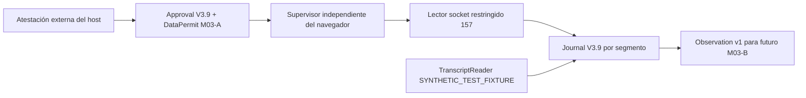

# M03-A — colector TWS exclusivamente de datos

Alcance: 2026-10-23, America/La_Paz. Base `develop`:
`363e40985fbd3533992c70dfbe2aa05f6774ba9f`. Rama
`feature/m03a-tws-market-data-only`. **OFFLINE / NO_TRADE** al entregar.
Lectura auténtica Paper y Live: **PENDIENTE DE VALIDACIÓN SUPERVISADA**.
No se modifica ni integra el PR #11. No hay aprobación de trading o despliegue.
La única modificación de un archivo previo es build/react-bff/preservation.mjs:
despacha a la allowlist M03-A desde la base integrada y mantiene las suites antiguas.
Los primeros checks React rechazaron estas nuevas rutas como fuera del alcance
M01.4B/M02, antes de ejecutar tests; no fue un fallo de componentes financieros.

## Arquitectura y reutilización

El paquete hermano `python/trading_agent/market_data/` tiene nueve módulos. No
importa TWS histórico, EClient, broker, BFF, Supabase, motores de investigación,
Market Analyst ni proveedores de IA. No instala servicios de Windows.



| Componente | Responsabilidad y reutilización |
|---|---|
| contracts.py | Configuración acotada, Bar y Observation; Record, Decimal y contrato EUR/CASH/USD/IDEALPRO de Core. |
| authorization.py | DataPermit firmado liga configuración, histórico y grant de captura V3.9; no emite grants. |
| reader.py | Hereda únicamente el lector restringido V3.9; reutiliza `_Epoch`, `_send`, autorización y cancelación de quotes. No hereda EClient. |
| wire.py | Encoder explícito de histórico MIDPOINT y su cancelación; parser acotado 157. |
| calendar.py | Calendario finito del frame Contract Details, sin plantillas semanales ni festivos inferidos. |
| archive.py | Journal, transacciones, veredictos, integridad, paths y hashchain V3.9; añade segmentos enlazados y exclusión de escritores. |
| supervisor.py | Reconexión, esperas cancelables, cierre, cuotas y salud; no depende de sesiones web. |
| __main__.py | Entrada de consola inerte por defecto; requiere evidencia externa firmada para crear un socket. |

Graphify: consulta `broker paper quote market data tws`, presupuesto 1000,
424 nodos históricos; encontró136, mostró34 y truncó102. Se contrastaron
PaperDataBroker, tws.py, paper_calendar.py, research_calendar.py, V3.9 y Market
Analyst actuales. El grafo no contiene estos módulos modernos y no acredita
ausencia de dependencias. No se reconstruyó ni se instalaron herramientas Graphify.
Los calendarios históricos mezclan normalización float y contratos de laboratorio;
se conserva su comportamiento y se usa un parser cerrado propio para esta frontera.
No se reutilizan Candle, SyntheticFixture ni SyntheticDataset.

## Autoridad y protocolo

Se configura exactamente un endpoint `127.0.0.1` por aprobación. No se escanean
puertos ni se infiere el entorno de un puerto o prefijo de cuenta. El handshake
debe negociar157; después START, managedAccounts, hora y detalles de EUR/USD.
La comparación HMAC usa el conjunto completo exacto de identidades conectadas;
ni cuentas ni mensajes sensibles entran en el journal o en errores públicos.

La evidencia externa del propietario debe verificar modo Paper/Live, read-only,
permisos de mercado, endpoint y clientId antes de firmar el Grant V3.9. El protocolo
157 no demuestra automáticamente el ajuste read-only ni el modo de TWS. Desconocido
o no atestado bloquea la activación. El DataPermit adicional liga el hash de ese
grant y todos los límites de CollectorConfig, con scope cerrado a quotes,
calendario e histórico MIDPOINT 15/60/240. Ambos permisos se verifican antes del
socket, las solicitudes y durante/después de recibir. Revocación detiene lectura.
Las cancelaciones propias de datos siguen permitidas durante limpieza.
El grant queda fijado a la conexión: incluso otra aprobación firmada válida para
Live no puede reemplazar una conexión Paper activa; exige una época nueva.

La lista total de opcodes de salida es71,17,49,9,59,1,2,20,25. Los dos nuevos son
reqHistoricalData y cancelHistoricalData; no existe encoder por nombre arbitrario.
Se fija keepUpToDate=false, formatDate=2, duración1D, useRTH=0 y contrato CASH.
No hay placeOrder, cancelOrder, reqGlobalCancel, posiciones, permisos o estrategias.
Las pruebas comparan los dos mensajes nuevos y las tres temporalidades con el SDK
oficial local10.50.2, interceptando sendMsg sin connect/run. El producto no importa
el SDK. El perfil aún requiere recertificación contra TWS auténtico.

## Datos, causalidad y continuidad

Quotes reutilizan el fold V3.9: ambos lados, minTick, spread, saltos, UTC y
monotónico, tipo confirmado y épocas. Solicitar LIVE no demuestra LIVE. DELAYED,
FROZEN y DELAYED_FROZEN conservan su tipo. Sin timestamp fuente permanece null y
SOURCE_TIME_NOT_PROVIDED; no se calcula latencia de mercado a partir de recepción.

Las barras retienen timestamp epoch original, OHLC Decimal, recepción disponible,
cierre efectivo, timeframe y digest de bytes originales. No se inventa volumen,
tamaño, liquidez ni spread MIDPOINT. Los límites temporal y de cierre se verifican
contra la solicitud y la recepción; una respuesta tardía no convierte una barra
parcial en definitiva. Se excluyen barras sin calendario, incompletas o recortadas
por una interrupción. No se impone una rejilla UTC distinta de la barra nativa.
El cutoff se extrae del mensaje original enviado; available_at de la barra
normalizada incluye la validación y disponibilidad acumulada de su prefijo.
Discontinuidades y duplicados se declaran; conflictos de OHLC conservados en la
historia excluyen la barra afectada. No se rellenan ni reordenan datos.

El callback de tipo de quotes no acredita el tipo del histórico: Observation de
barras usa UNKNOWN y HISTORICAL_FEED_TYPE_NOT_CONFIRMED. Su frescura es STALE de
forma conservadora; estar disponible no significa actualidad del mercado.

TradingCalendar interpreta tradingHours y timezone del contrato. Exige UTC o una
zona IANA explícita; rechaza abreviaturas ambiguas, horas DST inexistentes/ambiguas,
solapamientos, vacíos y cobertura desconocida. No extrapola aperturas. La evidencia
caduca a las24h aunque declare días posteriores. Fuera de apertura se cancela y
cierra el socket, se conserva historia y se espera con interrupción por parada,
vigencia de permisos o deadline. Una nueva apertura exige preflight completo.

Cada desconexión o rotación añade GAP, cancela suscripciones y vacía quotes; una
conexión nueva no hereda lados ni barras de otro contrato/época. En reinicio se
verifica la cadena y, antes de rotar, se agrega COLLECTOR_RESTART_GAP si faltaba el
cierre. Un proceso caído no puede escribir su propia caída en ese momento.
No se prometen ticks no recibidos ni continuidad con TWS cerrada, PC suspendido o
red caída. La rotación puede perder ticks, identificados mediante discontinuidad.
Los callbacks1100/1101/1102/1300/2103/2108 también fuerzan reconexión acotada,
aunque TCP siga abierto. Identidad, permisos o perfil rechazados detienen el flujo.

## Custodia y cuotas

El archivo nuevo tiene identity.json inmutable por convención, writer.lock con
exclusión del SO y hasta16 journals. Los nombres enlazan ordinal y head anterior;
se detectan pérdida intermedia, reordenamiento y cambio de prefijos. Cada SQLite
reutiliza los controles V3.9 sin modificar ese paquete: commit antes de exposición,
idempotencia, conflicto de clave, triggers, hashchain, head, quick_check y límites.
No se recrea silenciosamente un segmento ausente. Los rollback journals propios
pueden recuperarse con los controles existentes; no se admite WAL/SHM.

ArchiveCheckpoint incluye metadata, segmento, secuencia y digest del prefijo.
Puede conservarse externamente y exigirse al abrir, incluso si hubo commits
posteriores. Sin ancla externa no se detecta restaurar una copia histórica íntegra
o retirar una cola completa. No hay backup automático ni borrado/rotación destructiva.

Máximos M03-A:512 eventos por segmento,16 segmentos/8192 eventos,256MiB totales,
3600s por ejecución y hasta5 fallos. Defaults:16 segmentos,128MiB,3600s,3 fallos y
backoff2s exponencial limitado a30s. CapturePolicy V3.9 conserva sus topes de300s,
16 solicitudes y16384 bytes por frame; se exige reservar capacidad de limpieza.
Solo hay una solicitud histórica pendiente, al menos20s entre ellas por UTC y
monotónico, y600s conservadores tras cualquier intención durable en un reinicio.
El presupuesto es propio de este cliente, no limita otros clientes de la cuenta.

Frames históricos:128 barras máximo; documentos131072 bytes; calendario4096 bytes,
16 fechas y64 intervalos. Se reserva crecimiento de SQLite antes de cada append
y se comprueban bytes después. Son límites lógicos, no cuotas de filesystem/RSS.
El journal hace verificación completa por append y observe recorre historia
acotada: no se acredita rendimiento continuo de producción ni HFT. Al agotar
cuota se detiene; archivar y renovar autoridad exige actuación explícita posterior.

## Contrato para M03-B y límites de seguridad

Observation usa schema `trading.m03a.market_observation`, versión1 y JSON cerrado:
instrumento, ContractIdentity, origen, entorno atestado, conexión, as_of, timeframe,
quote o barras completas, feed_type, freshness, quality y evidence_sha256.
Siempre decision=NO_TRADE y execution_authorized=false. Fixtures son OFFLINE;
el camino socket observado declara IBKR_DATA_ONLY. Es procedencia local declarada,
no firma criptográfica de IBKR. La referencia de evidencia permite revisar los
frames y referencias de grant/atestación de RawEvent en el archivo.

| Amenaza | Control y límite |
|---|---|
| Host/account suplantados | Firma HMAC externa, identidad completa, contrato y perfil exactos; host/propietario Python malicioso queda fuera del aislamiento. |
| Mutadores IBKR | Encoder de lectura cerrado; sin SDK de producto ni puente financiero. |
| Datos viejos/delayed como LIVE | Tipo confirmado, frescura, calendario finito y caché por época. |
| Escritura perdida/lookahead | Journal antes de exponer y cutoff de recepción/validación/solicitud. |
| Mezclar Paper/Live/fixtures | Identidad del archivo y del supervisor exactas; cambios exigen otra captura aprobada. |
| Disco, memoria y reconexiones | Cuotas, frames, una petición histórica y backoff limitado; no defensa frente a dueño malicioso del directorio. |
| Exposición de cuentas/secretos | Cuentas y errores redactados; autoridad solo en carpeta privada externa, sin credenciales IBKR. |

No se altera Risk Engine, Execution Guard, AccountBinding financiero, EmergencyStop,
separación de entornos, presupuesto acumulado US$20 ni aprobación de estrategias.
No se conecta el contrato nuevo a los indicadores de Market Analyst. No M03-B/C/D,
login, Supabase, React, Vue, PostgreSQL operativo ni migraciones.

## Ejecución y validación supervisada futura (Windows)

Comandos offline desde raíz:

```powershell
.venv/Scripts/python.exe -B python/tests/core_v39_offline_check.py
.venv/Scripts/python.exe -B python/tests/market_analyst_offline_check.py
.venv/Scripts/python.exe -B python/tests/m03a_offline_check.py
./build/market-data/run-approved.ps1
```

El último comando solo muestra OFFLINE / NO_TRADE. No abre socket ni lee permisos.
Para una prueba auténtica se necesita una autorización específica posterior:

1. En TWS/IB Gateway verificar localmente sesión, entorno, API de solo lectura y
   permisos de EUR/USD; no deducirlos del puerto. No copiar identidades al chat.
2. El host confiable del propietario debe producir una carpeta privada con
   config.json, capture-grant.json, data-permit.json, signatures.json y
   verification.key. Son los contratos tipados del paquete y V3.9; las firmas
   HMAC-SHA256 cubren sus bytes canónicos. No hay emisor automático ni autoridad
   auténtica provisionada en esta entrega. Las claves públicas de tests carecen
   de autoridad. El registro y la firma del host requieren revisión supervisada.
3. El grant identifica endpoint/clientId, conjunto completo de cuentas mediante
   HMAC, Paper/Live, política, atestación read-only/permisos y vigencia <=1h; el
   permiso M03-A liga ese grant y config. Mantener Paper y Live en carpetas distintas.
4. Una vez aprobada esa evidencia, ejecutar en terminal dedicada (rutas locales
   proporcionadas por el host; nunca colocar claves en argumentos):

```powershell
./build/market-data/run-approved.ps1 -ApprovedDataOnly `
  -ApprovalDirectory "$env:LOCALAPPDATA/TradingAgent/M03A/approval" `
  -ArchiveDirectory "$env:LOCALAPPDATA/TradingAgent/M03A/capture-paper-001"
```

El padre de la captura debe existir. El launcher comprueba ACL de los archivos
de autoridad: solo propietario actual, SYSTEM y Administradores. No cambia ACL,
TWS, servicios o permisos del sistema. Valida firmas antes de crear la captura o
socket. Errores públicos usan códigos cerrados sin contenidos de entrada.

5. Verificar salud/NO_TRADE, identidad local, quote y recepción, feed confirmado,
   barras y checkpoint mediante las APIs Archive/Supervisor. Revisar opcodes y
   ausencia de órdenes también en auditoría local de TWS. El test offline de
   opcodes no sustituye esa verificación externa.
6. Ctrl+C solicita cierre y cancelación propia. Verificar cierre y guardar ancla
   fuera del archivo. Conservar la captura para auditoría; no borrar journals.
   Cerrar la terminal o suspender el equipo impide recopilar. No instalar servicio.

La guía es preparación; no se ejecutó ningún paso auténtico ni se inspeccionaron
secretos/.local. Las condiciones y resultados están en m03a-evidence.json y el
paquete manual [m03a-review.md](m03a-review.md).

Fuentes primarias: [barras históricas](https://www.interactivebrokers.com/docs/tws-api/doc/md/historical-bars),
[ContractDetails y tradingHours](https://interactivebrokers.github.io/tws-api/classIBApi_1_1ContractDetails.html),
[limitaciones históricas](https://interactivebrokers.github.io/tws-api/historical_limitations.html),
y client.py/decoder.py/server_versions.py del SDK oficial10.50.2 instalado.
Las páginas históricas de GitHub están deprecadas; se contrastaron con documentación
actual y SDK. Se eligió un pacing conservador aun para barras >=1min.
