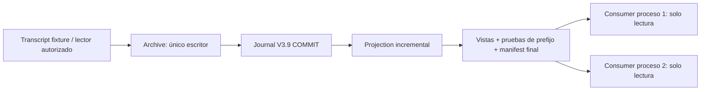

# M03-A.1 — consumo concurrente de observaciones confirmadas

Corrección sobre `524c23f6629f46750a52c4b6da31c78252ffe5be`, en la rama
`feature/m03a-tws-market-data-only`, PR #15 hacia develop, siempre Draft.
**OFFLINE / NO_TRADE; auditoría independiente pendiente.** No implementa M03-B.
La evidencia de ejecución y preservación está en [m03a1-evidence.json](m03a1-evidence.json).

## Causa y decisión

`Archive.__init__` adquiere incondicionalmente `writer.lock` mediante
`msvcrt.LK_NBLCK` en Windows. Otro proceso que construya Archive, incluso para
consultar, compite por ese mismo bloqueo exclusivo. Este comportamiento protege
al escritor, pero no constituía una interfaz para lectores independientes.
Además, `observe()` recorría todos los journals y reconstruía su estado por quote.

No se usa el constructor Journal como lector: abre SQLite con capacidad de
escritura, verifica y puede recuperar su rollback journal. SQLite necesita
locks y recuperación al encontrar un hot journal; `mode=ro` no convierte ese
constructor en una frontera inocua. `immutable=1` omite cambios y locks y no es
apropiado para una base que cambia. Se conserva Journal V3.9 sin editarlo.
Fuentes: [locking y recuperación SQLite](https://www.sqlite.org/lockingv3.html),
[parámetros URI SQLite](https://www.sqlite.org/uri.html).

Se añade publicación de vistas después de COMMIT, mediante archivos acotados.
Un único escritor conserva el lock original. Varios `Consumer` leen archivos
con `rb`, sin conectar SQLite, recuperar journals, crear archivos o activar
transportes. No tienen métodos de captura ni ejecución. Esta separación es de
API y de caminos verificados: Python no es un sandbox contra el dueño del host.
Un consumidor malicioso con permisos de escritura del sistema sigue fuera del
aislamiento; el host debe aplicar ACL de lectura si necesita imponerlo al proceso.



## Orden, consistencia y recursos

1. Journal recalcula el veredicto y confirma original/head en su transacción.
2. Projection incorpora una vez la nueva fila confirmada. Duplicados idempotentes
   no avanzan la proyección. Rotación incorpora el GAP confirmado antes de abrir
   otro segmento. Reinicio reconstruye una vez y empieza sin quote vigente.
3. Publisher verifica el journal activo, calcula SHA-256 de sus bytes y conserva
   referencias a los segmentos sellados. Publica `prefix-NNNN.json`, las cuatro
   vistas `view-0/15/60/240.json` y finalmente `consumer.json`.
4. Cada archivo se escribe en su `.tmp`, hace flush/fsync, y se sustituye con
   `os.replace` en el mismo directorio. Compartición Windows: hasta cinco intentos,
   separados por 2 ms, exclusivamente ante PermissionError. Un fallo no permite
   publicar bytes parciales. [Semántica os.replace](https://docs.python.org/3.13/library/os.html#os.replace).
5. Consumer verifica identidad, esquema cerrado, origen, entorno, presupuesto,
   nombres, cadena de segmentos, hashes de bytes, prueba de cursor y vista.
   Relee manifest/owner y comprueba fingerprints al finalizar. Si coincide con
   una escritura, puede devolver UNAVAILABLE; nunca una mezcla aceptada.

No hay una transacción atómica entre SQLite y la publicación. Es deliberadamente
unidireccional: puede existir un commit aún no publicado, nunca una fila sin
commit publicada. La lectura puede coalescer versiones intermedias. Si se requiere
cada tick, el journal conserva el original y permite replay explícito; este API
es de última observación, no una cola con garantía de entrega por tick.

Los temporales hacen la lectura no disponible. Solo un nuevo escritor, después
de verificar identidad y adquirir exclusión, descarta staging conocido,
regular, sin links y de hasta 131072 bytes. No borra journals ni documentos del
usuario. Un temporal sobredimensionado o una ruta desconocida bloquea la apertura.
El prefijo se conserva fuera del directorio si se necesita detectar restauración
de una copia anterior; sin esa ancla externa no se promete detectar rollback íntegro.
La época anterior se invalida antes de la verificación prolongada de journals:
un nuevo proceso que mantiene el lock no acredita la vigencia del proceso anterior.
Una regresión pausa exactamente esa apertura antes de escanear SQLite.

La publicación no aumenta cuotas de CollectorConfig/CapturePolicy. Comparte el
presupuesto del archivo: cada documento <=131072 bytes, <=16 segmentos, <=512
eventos por segmento y <=8192 identidades de barras en la proyección. Se cuenta
el staging antes de escribir y se conserva la reserva de disco. Si una vista o
el espacio exceden el límite, la captura se detiene; no se descartan barras o
evidencia para hacerla pasar. Supervisor cierra transporte y archivo ante fallo
de persistencia/publicación, liberando el lock que el lector comprueba.

Los hashes enlazan bytes locales y no autentican criptográficamente a IBKR.
La publicación es evidencia del escritor local confiable, no una segunda
validación independiente del proveedor. SQLite sigue siendo la autoridad durable.
La durabilidad de rename tras corte de energía depende del sistema de archivos;
el reinicio vuelve a verificar SQLite y regenera publicaciones con época nueva.

## Contrato y vigencia

Se conserva `trading.m03a.market_observation`, schema_version=1, sin editar
Observation, Quote ni contratos de Core. Conserva instrumento, conId, entorno,
origen, conexión, BID/ASK, recepciones por lado, `as_of` de disponibilidad, barras
completas nativas 15/60/240, tipo confirmado, calidad e incertidumbre fuente,
referencia SHA-256, NO_TRADE y execution_authorized=false.
Histórico mantiene UNKNOWN y STALE; no se inventa tipo LIVE de las barras.

`Consumer.poll(as_of, minutes=0)` devuelve `ReadResult(code, cursor, observation)`.
Código OK: publicación nueva; UNCHANGED: mismo prefijo/publicación conocido;
UNAVAILABLE: evidencia ausente, alterada o en transición, observation=None.
**UNCHANGED no implica frescura:** cada poll recalcula vigencia y su Observation
puede pasar a UNAVAILABLE. El llamador debe comprobar siempre esa observación.
Un Observation retenido es histórico, no una autorización permanente.

Cursor v1 liga metadata, segmento, secuencia y hash de prefijo. Se puede
serializar con `to_json()` y reconstruir con `Cursor.from_json()`. El consumidor
no escribe el cursor: su host lo guarda en una ubicación propia. Un reinicio
lee la publicación actual y la prueba de su ancla, sin reconstruir los eventos.

Para presentar quote FRESH se exige escritor bloqueando realmente `writer.lock`,
owner/época coherente, publicación activa, LIVE confirmado y plazo vigente. El
plazo es el mínimo de frescura de ambos lados, cierre del intervalo del calendario
y vencimiento de evidencia de calendario. Se comprueba UTC y tiempo monotónico
transcurrido de la publicación del mismo host. Un reloj hacia atrás o ambiguo
invalida. Un cuelgue conservando el lock no prolonga ese plazo. Desconexión/GAP,
reinicio, cierre y FROZEN/DELAYED/UNKNOWN no generan una quote LIVE válida.
La sonda del lock usa un handle rb y un lock compartido no bloqueante; si no hay
escritor, lo libera inmediatamente y devuelve vista sin cotización.

## Costo y límites de las mediciones

Projection elimina el replay completo en el camino de nueva quote. Persistencia
V3.9 y publicación siguen verificando el segmento activo, de tamaño acotado;
no se afirma O(1) para el escritor ni capacidad HFT. Los cutoffs históricos
anteriores al estado actual siguen usando replay explícito y causal.

Consumer recorre metadata de <=16 segmentos. Hash inicial verifica sus bytes;
polls posteriores reutilizan hashes solo cuando dev/inode/tamaño/mtime_ns/ctime_ns
coinciden, y los vuelven a comprobar al finalizar. Una nueva quote vuelve a
hashear el archivo activo, no los segmentos sellados. La caché de fingerprints
no protege frente a un propietario malicioso capaz de falsificar metadata del
sistema de archivos. No se hacen promesas contra ese atacante.

La suite mide 25 polls calientes sin rehash y una quote con tres segmentos:
una fila plegada y solo bytes del segmento activo rehechos. La suite de procesos
mide latencia IPC+poll en Windows, registra muestras/media/máximo en el artefacto.
Son fixtures pequeñas y almacenamiento local, no mediciones de latencia de mercado
ni una calificación de producción. Los valores exactos están en la evidencia.

## Pruebas y auditoría manual

Las 47 pruebas M03-A originales son exigidas por sus IDs extraídos del commit
auditado; se conservan los 394 casos Core y38 Analyst bajo sus wrappers intactos.
Se añaden15 pruebas unitarias y3 escenarios con procesos reales en Windows:
dos lectores, exclusión de segundo escritor, commit pausado, rotación pausada,
terminación forzada con transacción pendiente, reinicio y cierre de handles.
El reader worker deniega apertura para escritura y toda conexión SQLite.

Los wrappers antiguos siguen denegando cualquier subprocess/socket. El harness
separado permite únicamente el comando exacto del intérprete actual + worker
fijo + rol cerrado + raíz temporal registrada. No hay shell ni broker. Cada hijo
activa el guard V3.8 intacto, limita SQLite/escritura al fixture propio y prohíbe
red/subprocesos/.local. El controlador tampoco puede abrir SQLite ni sockets.
Esta evidencia no constituye un sandbox del sistema operativo.

Para revisión independiente: contrastar orden COMMIT/publicación, lectura
durante mutación de archivos, ancla de prefijo, caducidad UTC/monotónica, identidad
Paper/Live, permisos del consumidor y límites. Revisar los tres módulos nuevos,
los hooks de Archive/Supervisor, ambas suites nuevas y la extensión exacta de CI.
La revisión interna de cinco ejes y mutación puntual no equivale a esa auditoría.

Procedimiento offline desde la raíz, sin abrir TWS:

```powershell
.venv/Scripts/python.exe -B python/tests/core_v39_offline_check.py
.venv/Scripts/python.exe -B python/tests/market_analyst_offline_check.py
.venv/Scripts/python.exe -B python/tests/m03a_offline_check.py
.venv/Scripts/python.exe -B build/market-data/concurrency-check.py
```

CI hace las mismas ejecuciones en windows-2025, Python3.13.5, y exige cero
fallos/omisiones/violaciones, descubrimiento no vacío, 47 IDs antiguos y procesos
Windows. El artefacto14 días contiene logs, identidades, resultados, mediciones y
preservación. No incorpora capturas auténticas, cuentas ni autorizaciones reales.

## Futura prueba auténtica, todavía bloqueada

TWS abierto no constituye autorización de lectura. Antes de cualquier conexión
falta una autoridad externa confiable del host que aporte la clave de verificación
y firme Grant V3.9 más DataPermit M03-A ligados a sesión, configuración, endpoint
loopback/clientId, conjunto exacto de cuentas por HMAC y vigencia. Debe atestar
Paper/Live, TWS read-only y permisos de mercado, y proporcionar revocación y
reloj confiables. Ningún secreto ni cuenta completa se imprime o sube a Git.
No se genera ese permiso aquí, ni se reutilizan claves de fixtures.

Además se requiere recertificar perfil157 con TWS real, confirmar contrato y
calendario, tipo por callback, límites y procedimiento supervisado de cierre.
No se infiere Paper/Live por puerto/prefijo. Sin atestación y permiso válidos el
lector auténtico sigue bloqueado. No se ha intentado conectarlo en M03-A.1.
No hay orden, activación financiera, servicio Windows, modificación del PR #11,
merge, despliegue ni autorización para integrar develop.
