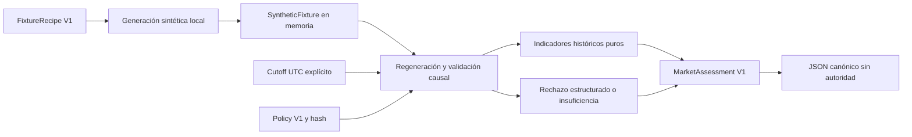

# Market Analyst V1 — diseño y registro de entrega

Base: `f67fa92086d10b9562df214f4e869344bf0753d8`. Fecha: 2026-10-20,
America/La_Paz. Rama: `codex/market-analyst-v1`. Estado: **OFFLINE / NO_TRADE**.
La especificación de alcance es la solicitud del usuario; no se cambia Core V3.

## Diseño previo a implementación

Paquete hermano `python/trading_agent/market_analyst/`, sin imports de Core V3.
Contrato frozen/slots, esquema cerrado V1, JSON canónico, Decimal como texto,
UTC explícito, límites de recursos y errores con códigos fijos.

| Módulo | Responsabilidad | Dependencia |
|---|---|---|
| contracts | Identidad, política, indicadores, calidad, procedencia y evaluación | biblioteca estándar |
| fixtures | Recetas sintéticas declaradas; generación local y verificación por regeneración | contracts |
| evaluator | Selección causal, validación, indicadores y clasificación | fixtures, research_indicators, market.Candle |

Orden: contrato → fixtures/evaluación → causalidad/adversarios → regresión/evidencia.
No habrá importador de OHLC externos ni método para convertir datos reales en
fixtures. Una marca JSON o un hash no autentican una fuente. Las recetas se
generan en memoria y se contrastan de nuevo antes de calcular indicadores.
El propietario del proceso puede alterar Python; esto no es un sandbox.

Se consideran solo barras cerradas y disponibles al cutoff; los datos futuros
quedan fuera de indicadores, hashes, períodos y contadores del resultado.
Se preserva el orden, sin sort, fill ni agregación. Un gap o duplicado rechaza
la evaluación; no se reinicia warmup silenciosamente. El calendario sintético
es continuo 24x7 y no acredita sesiones Forex. Temporalidades: 15, 60 y 240 min.
Inicialmente se admiten identidades sintéticas EUR/USD y GBP/USD, con identidad
esperada explícita; no se inventan conId ni detalles de contrato IBKR.

Indicadores reutilizados: EMA con semilla SMA, RSI/ATR Wilder, MACD, pendientes,
desviación poblacional de retornos logarítmicos, rango y ATR/precio.
El motor histórico usa float; se valida entrada Decimal, se convierte solo para
ese cálculo y se serializa el resultado finito mediante Decimal(str(value)).
No se afirma aritmética financiera exacta ni reproducibilidad binaria entre
distintas plataformas/libm. Versión del motor y hash de política acompañan la salida.
Warmup explícito por medida. No hay tamaños, liquidez, señales, P&L ni probabilidad.

Estados: COMPLETE, INSUFFICIENT_DATA, STALE_DATA, SOURCE_UNAVAILABLE,
UNVERIFIED_PROVENANCE y VALIDATION_ERROR. Todos conservan autoridad nula;
una salida serializada puede leerse como documento, nunca como fuente aceptada.
Kronos/Sol tienen solo un descriptor futuro de evidencia, sin ejecución ni consumo.

## Inspección y matriz de compatibilidad

Graphify primero: grafo histórico de 424 nodos, 1039 links, sin V3.x/R20/Kronos.
Vocabulario consultado: market, candle, ema, rsi, atr, indicators, validate.
La consulta BFS con presupuesto 1800 orientó a market.py/test_quant.py.
Las ubicaciones del grafo son históricas: se contrastaron con fuentes actuales.
reflect --if-stale no requirió regeneración; se leyeron las lecciones existentes.
No se reconstruye el grafo ni se consulta un proveedor remoto.

| Fuente inspeccionada | Capacidad | Dependencias / incompatibilidad / decisión |
|---|---|---|
| research_indicators.py + test_research.py | Indicadores, warmup y regímenes causales | market.py puro; reutilizar calculate/settings después de validar |
| market.py + test_quant.py | Candle, EMA/RSI/ATR | float y sin available_at/identidad; adaptar solo tras validación nueva |
| r20_market.py + test_r20_v2_market.py | Calidad de lectura y cierres 1H/4H | imports diferidos de transporte, configuración y señales; no importar ni ejecutar |
| Core V3.9 market_observation + tests V39 | Quotes por lado, journal, autorización separada | BID/ASK sin barras; no conectar ni inferir régimen OHLC |
| Core V3.8 historical_ingestion + tests V38 | Custodia, calidad, calendario y evidencia | contratos protegidos y formato real pendiente; no convertir ni modificar |
| strategy_indicators_v2.py | Snapshots y alineación con anterior | Candle float, falta disponibilidad/identidad; reutilizar primitivas inferiores |
| kronos/r20_source.py; test_kronos.py | Validación del request, contrato 1H/4H | metadatos de proceso confiable; JSON no autentica; no importar |
| kronos/r20_bridge.py | Aislamiento y límites de worker | broker, subprocess y modelos al ejecutar; excluido |

No se localizaron pruebas dedicadas de r20_source/r20_bridge en python/tests.
Se inspeccionaron sus fuentes y las pruebas del contrato Kronos, pero no se
ejecutó Kronos ni su suite. strategy_indicators_v2 contiene comprobaciones
ejecutables bajo __main__: se inspeccionaron sin ejecutar ese launcher.

## Amenazas y pruebas previstas

Procedencia falsa → tipos exactos, sello de creación y regeneración de receta;
lookahead → cierre Y disponibilidad <= cutoff, hash solo del prefijo;
identidad cruzada → instrumento/contrato/temporalidad por barra;
datos malos → OHLC positivo/finito, orden, alineación, duplicados, gaps;
reloj implícito → cutoff obligatorio, sin datetime.now;
recursos ilimitados → hasta 4096 barras y documentos JSON acotados;
promoción accidental → flags de autoridad siempre false y ausencia de acciones.

Pruebas nuevas por `python/tests/market_analyst_offline_check.py`, que compondrá
los guards históricos sin editarlos y añadirá barreras de escritura/DB/imports.
Regresión requerida, sin alterar selecciones:
`.venv/Scripts/python.exe -B python/tests/core_v39_offline_check.py`.
Los 394 resultados previos no se atribuyen a esta ejecución.

Se preservan los 691 archivos tracked de la base y los dos documentos untracked.
El inventario SHA-256 inicial queda en artifacts/market-analyst-v1/before.json
(artefacto local ignorado). No habrá push, merge, migración ni despliegue.

## API y flujo entregado



No hay arista hacia broker, catálogo, backtester, selector ni proveedor de IA.
El hash de datos comprende únicamente las barras cerradas/disponibles evaluadas,
incluida su identidad y disponibilidad. evidence_ref liga los parámetros de la
receta excluyendo su longitud total; el sufijo futuro no altera la evaluación.
El límite de entrada se aplica al contenedor entero, incluidos futuros: la
invariancia por extensión se garantiza dentro del presupuesto de entrada.

| Contrato | Semántica |
|---|---|
| Instrument | Identidad sintética esperada, contrato de fixture, representación y unidad de precio |
| Policy | Versión y parámetros acotados; hash de todos los parámetros, sin política financiera |
| Indicator | Valor Decimal/null, unidad, warmup, barras observadas y READY/WARMUP/UNAVAILABLE |
| Provenance | SYNTHETIC_TEST_FIXTURE o UNKNOWN; evidencia/hash; proveedor nunca autenticado |
| Quality | Faltantes contra receta, duplicados, discontinuidades, edad desde cierre, motivos |
| MarketAssessment | Identidad, cutoff, período, última vela, disponibilidad máxima, medidas y régimen |
| Authority | OFFLINE, NO_TRADE, ejecución/Paper/Live siempre false |
| SupplementaryEvidenceRef | Referencia futura a proveedor/modelo/hash/tiempos/calibración; no inferencia ni probabilidad |

Los JSON tienen schema y schema_version=1; cada tipo rechaza extras y claves
duplicadas. from_json verifica estructura y coherencia, **no autentica el
contenido**. Una evaluación deserializada no puede usarse como fuente de evaluate.
SyntheticFixture no ofrece from_json ni importación de barras. El sello local
solo prueba el camino de creación en este proceso; no resiste a su propietario.

Warmup por defecto: EMA rápida20, lenta50, RSI15, MACD26, señal/histograma34,
ATR14, pendientes21/51, retornos21, rango1 y ATR/precio14. La evaluación queda
completa a partir de51 barras. Una serie plana válida produce RSI50 y desviación0;
eso no sustituye datos desconocidos. Edad y disponibilidad se expresan aparte.
El régimen exige las condiciones de EMA/ATR/pendientes del motor histórico;
los umbrales son heurísticos declarados, sin validación estadística o económica.

Ejemplo completo en memoria, desde un proceso con `python/` en PYTHONPATH:

```python
from datetime import datetime, timedelta, timezone
from trading_agent.market_analyst.fixtures import FixtureRecipe, make_fixture
from trading_agent.market_analyst.evaluator import evaluate

start = datetime(2026, 1, 5, tzinfo=timezone.utc)
fixture = make_fixture(FixtureRecipe(start=start, count=80, pattern='RISING'))
result = evaluate(fixture, cutoff=start + timedelta(hours=80))
assert result.status == 'COMPLETE'
assert result.authority.decision == 'NO_TRADE'
document = result.to_json()
assessment_sha256 = result.sha256()
```

Errores de contexto (cutoff sin UTC, política o identidad inválida) lanzan
AnalystError con código fijo. Errores de la fuente devuelven una evaluación con
motivos. Sin fuente se usa SOURCE_UNAVAILABLE; un dict, JSON u objeto externo
se clasifica UNVERIFIED_PROVENANCE. En rechazo no se publican indicadores;
en warmup se conservan las medidas ya disponibles, con régimen UNKNOWN.
STALE_DATA puede conservar indicadores descriptivos antiguos, con régimen UNKNOWN.

## Revisión, pruebas y límites

Revisión interna de corrección, arquitectura, seguridad, claridad y recursos;
no es auditoría externa. Se añadieron regresiones que fallaron antes de corregir
faltantes iniciales/finales, fechas extremas, contexto Decimal con traps,
coherencia de unidades/rangos y estados COMPLETE inconsistentes. El decodificador
rechaza también Unicode inválido con código fijo. No se cambiaron pruebas base.

El primer intento del runner estricto bloqueó la sonda temporal de tempfile
durante la preparación del harness. Ahora esa preparación estándar ocurre bajo
el guard histórico antes de instalar la barrera adicional que prohíbe escrituras;
las pruebas y el analista se importan después. Ningún guard histórico se editó.
Otra corrección fue en el fixture de un test: una serie de1 barra al cutoff de80h
era obsoleta además de insuficiente; ahora prueba insuficiencia a su propio cierre.

Los tests nuevos usan los guards históricos y una barrera adicional contra
sockets, procesos, cualquier SQLite, escrituras, imports de brokers/Core/modelos
y lectura de bases por extensión. La inspección AST recorre el paquete y sus dos
dependencias puras. Es evidencia del proceso de prueba; no sandbox de producción.
La suite histórica conserva su permiso de SQLite temporal para sus propios tests.

Límites:4096 barras, períodos1–1000, tres temporalidades, hasta32 motivos,
131072 bytes por documento, fechas de recetas2000–2090, máximo86400s de lag/edad.
La regeneración es O(n); las métricas móviles históricas cuestan O(n×ventana).
No hay rotación, servicio ni persistencia propios. No se promete capacidad HFT.

Pendientes para Strategy Engine/Selector: especificar un consumidor sin autoridad,
ligar hashes de evaluación/política/estrategia, tratar explícitamente estados
inconclusos, definir comparabilidad entre instrumentos y temporalidades y evaluar
los umbrales. Datos reales requieren una frontera nueva de custodia, calendario,
disponibilidad y autenticación; no se habilitan ampliando etiquetas de este paquete.
El enlace con Core protegido o contratos Python/.NET necesita una fase propia.
Kronos/Sol requieren procedencia, calibración y aprobación de integración futuras.
**Este módulo no está listo para operar en IBKR.**

## Resultados reales y preservación

| Ejecución desde la raíz | Pasadas | Tiempo | Exit |
|---|---:|---:|---:|
| `.venv/Scripts/python.exe -B python/tests/market_analyst_offline_check.py` |38|1.051s|0|
| `.venv/Scripts/python.exe -B python/tests/core_v39_offline_check.py` |394|264.959s|0|
| `.venv/Scripts/python.exe -B python/tests/core_v39_offline_check.py test_quant.py test_research.py` |36|0.077s|0|
| Total de pruebas distintas ejecutadas |**468**| | |

Nuevas:6 de contrato,10 de evaluación,19 adversariales y3 de aislamiento.
OFFLINE_BARRIER_VIOLATIONS, V39_OFFLINE_BARRIER_VIOLATIONS,
MARKET_ANALYST_BARRIER_VIOLATIONS e HISTORICAL_BARRIER_VIOLATIONS: **0**
en las ejecuciones finales correspondientes. La regresión de394 es una nueva
ejecución, no un resultado heredado. No se ejecutaron otras suites históricas
ajenas a esas selecciones, pruebas .NET ni frontend. No se instalaron dependencias.

El [inventario de evidencia](market-analyst-v1-evidence.json) contiene SHA-256,
bytes y líneas de los10 archivos Python nuevos, hashes de dependencias/guards,
resultados y huella del inventario inicial. Los hashes son de los bytes locales;
Git puede normalizar CRLF/LF al almacenar blobs. No son firmas del proveedor.

Git inicial: `main...origin/main`, HEAD `f67fa92`, con solo los dos documentos
preexistentes sin seguimiento. Git final: rama `codex/market-analyst-v1`, commits
locales `b0ae3ce` (contratos), `af777f2` (motor) y `129309b` (regresiones/barreras),
más un commit de cierre documental. `main` y `origin/main` conservan `f67fa92`.

Diff frente a la base: **12 rutas añadidas**:5 módulos,5 archivos de pruebas/runner
y2 documentos. Cero modificaciones, eliminaciones o renombres de archivos base.
Se contrastaron nuevamente los SHA-256 de los **691 archivos tracked iniciales**:
cero diferencias. Los dos documentos untracked mantienen sus hashes iniciales.
El diff por archivo y las comprobaciones Git finales quedan también en
`artifacts/market-analyst-v1/` como evidencia local ignorada. `git diff --check` pasa.

No hubo reset/clean/stash, push, merge ni despliegue. No se abrieron brokers,
servicios, secretos, modelos ni bases operativas. Las pruebas históricas usan
sus journals temporales bajo los guards originales. No se creó almacenamiento
de mercado persistente ni se tocó ningún journal del proyecto.

**Entrega de investigación OFFLINE / NO_TRADE.** La revisión es interna y no
confiere aprobación operativa, estadística, económica ni de lectura auténtica.
