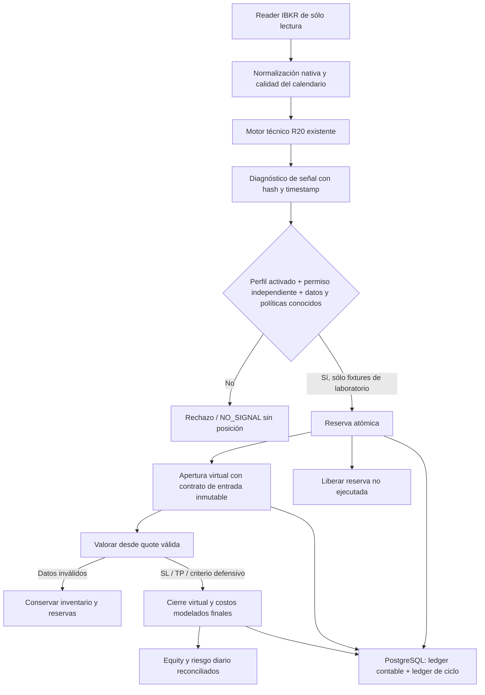

# R20 V2 — ciclo Shadow en laboratorio aislado

13/oct/2026. Implementación sólo en PostgreSQL55432 con identidad de pruebas
7692346685552779632 y bases `r20_v2_test_<UUID>`. No runner operativo, cohorte,
orden, migración Paper ni permiso de trading. V1 y journal011 permanecen separados.

## Arquitectura y estados



`ShadowCycle.reserve_engine` llama a `aggressive_growth.signal` sin cambiar sus
reglas: EMA20/50, ruptura de20 barras anteriores, ATR14 Wilder, stop1.5ATR y
target2×distancia. La configuración técnica V1 sólo se lee; no se invocan Prepare,
Run ni consume de V1. Cada candidato registra decisión, timeframe, timestamp de
cierre y hashes de motor/fuente. La identidad de señal depende de estrategia,
timeframe y cierre, **no** del archivo de barras: añadir barras futuras o cambiar
el archivo fuente no permite consumir de nuevo la misma señal.

El caso exactamente en el stop se deriva de ATR; se conservan todos los escenarios
de gaps y sus buffers, usando los más conservadores para el caso derivado. Debe
seguir existiendo un shock adverso mayor que el stop. No se inventa un porcentaje
de holgura ni se reduce una hipótesis para admitir una operación.

La función de diagnóstico y el coordinador de laboratorio sólo admiten fuentes
explícitamente sintéticas. Las observaciones auténticas de esta fase permanecen
en artefactos de lectura independientes: no son posiciones, fills o rentabilidad
operativa. No se instaló un bucle ni un arranque automático.

## Atomicidad y recuperación

La reserva conserva el mecanismo anterior: CAS de configuración y contabilidad,
advisory lock por scope, presupuesto neto y recibo idempotente. El inventario
abierto ahora procede del ledger completo: cantidades, direcciones, exposición,
margen y precio de valoración no son campos proporcionados por el frontend.
No se trata la ausencia de datos de posición como exposición cero.

La apertura necesita además permiso TEST explícito emitido por el bootstrap,
perfil exacto aún vigente, misma decisión económica y precio reservado. Cambio
de precio o perfil exige reevaluación; una reserva puede liberarse sin fabricar
un fill ni comisión de apertura. Cada posición conserva contrato de entrada:
cantidad, side, precio, SL/TP, perfil completo, modelo de costos, margen y hashes.

`r20_v2_shadow.commit_event` confirma Snapshot contable y evento de ciclo en una
transacción y con el mismo lock. Valida CAS, datos de quote, inventario,
protecciones, conservación de costos, PnL y certificados de salida. El ledger es
append-only. Lecturas de ambos ledgers comparten REPEATABLE READ para evitar una
vista mezclada mientras otro proceso confirma una transición.

La clave de request identifica una transición y su hash identifica el contenido.
Respuesta perdida después de commit: se recupera el resultado antes de comprobar
caducidad o permiso nuevo. Mismo request con otro contenido se rechaza. Una
conexión perdida antes del commit revierte ambos registros. CAS perdido exige
recargar, no repetir una cantidad antigua a ciegas. No es exactly-once de órdenes
IBKR; no existe transporte de órdenes en este módulo.

## Costos y contabilidad

```text
Equity = capital inicial + PnL bruto realizado − costos SETTLED
         + PnL bruto abierto − costos ACCRUED − costos RESERVED

Costos RT = fee apertura + fee cierre
            + q(spread entrada + spread salida)/2
            + q(slippage entrada + slippage salida)
            + financiación fija + q·financiación por unidad

Al reservar: RESERVED = estimación RT; riesgo pendiente = pérdida de estrés − RT.
Al abrir: entrada -> SETTLED/MODELED; cierre/financiación -> RESERVED/ESTIMATED.
Al cerrar: PnL abierto -> realizado; reservas restantes -> SETTLED/MODELED.
```

Cada componente tiene un ID exacto por posición. El gestor usa ese conjunto, no
prefijos de texto que podrían coincidir con otra posición. La conversión conserva
el total, y no resta nuevamente una reserva al saldar el costo. El riesgo abierto
es pérdida adicional desde la valoración actual al estrés; los costos ya
descontados en equity no se vuelven a añadir al presupuesto diario. Una comisión
confirmada externa tiene su propio ID y tratamiento; no se sustituye por una
estimación duplicada. Ningún costo virtual se etiqueta BROKER_CONFIRMED.

Los costos de salida del ensayo son los del contrato estimado congelado. No hay
calibración de financiación por duración ni aplicación real de tasas; por ello
no se habilitan entradas normales auténticas. Los fixtures económicos con
fees1+1 y otros costos cero son exclusivamente casos técnicos, nunca la política
EUR/USD propuesta ni una recomendación económica.

## Salidas y cambios de perfil

El modelo de salida implementado usa **quote fresca**, midpoint y timestamp de
recepción: LONG sale por precio≤SL o ≥TP; SHORT por precio≥SL o ≤TP. En un gap se
usa el precio disponible, no se promete fill en el nivel protector. Quote
caducada, futura, cruzada, mercado cerrado o desconexión no valoran ni cierran.
Los diagnósticos conservan la última valoración válida.

Un perfil nuevo afecta admisión y límites diarios, pero no cantidad, SL/TP ni
costos de posiciones existentes. El máximo administrativo de apalancamiento no
es una condición de liquidación. Se conservan salidas defensivas modeladas por
déficit de mantenimiento, exposición dura y EmergencyStop sintético; una quote
inválida nunca basta para fabricar el cierre. Esto no demuestra protección ni
margen real IBKR. No se limpian bloqueos de emergencia o recuperación.

El gestor aún no reconstruye cruces intrabar desde high/low históricos. Una
cotización posterior puede no revelar un SL/TP tocado entre observaciones. Esa
limitación del contrato de simulación debe revisarse antes del runner operativo;
el ensayo no afirma protección continua ni aceptación de brackets del bróker.

## Medianoche y límites diarios

UTC persistido; día económico America/Santo_Domingo,04:00UTC→04:00UTC. No hay
perfil predeterminado ni reutilización automática del anterior para entradas.
La transición de gestión conserva el perfil caducado sólo como contrato contable,
con `entry_profile_valid=false`. El inventario se revalida antes de admisión.

Una frontera verificada puede establecer referencia económica nueva; sólo cambia
el latch diario. EmergencyStop, órdenes inciertas, recovery y demás bloqueos
persisten. El porcentaje anterior sirve únicamente para informar un presupuesto
conservador de gestión, no para activar entradas en el día nuevo.

Si falta valoración de frontera, se arrastran referencia, presupuesto y latch
anteriores, con `ECONOMIC_BOUNDARY_UNVERIFIED` persistente. Se siguen gestionando
posiciones con quotes válidas. El laboratorio no tiene una vía para borrar ese
bloqueo: hace falta una recuperación revisada de frontera, no otro perfil.
No se inventa una cotización de medianoche a partir de una recepción posterior.

Dentro del día los perfiles sólo pueden reducir el presupuesto efectivo:
`budget=min(budget previo, presupuestos activados del día)`. La persistencia
admite estrechamiento adicional, nunca aumento. Cambiar perfil, rebotar equity o
reiniciar no levanta el latch. La contabilidad suma términos excluyentes:
`pérdida actual + riesgo adicional abierto + riesgo pendiente`; no dos veces
costos, pérdidas abiertas y pérdida total al stop.

## Autoridad y despliegue

Lectura, administración de perfiles, ejecutor Shadow y Paper deshabilitado
continúan separados por roles DB. Sólo Shadow puede invocar el ciclo virtual;
ningún rol aplicativo inserta/borra directamente tablas o crea permisos TEST.
Activar un perfil no crea ese permiso. No hay endpoint HTTP de apertura/cierre.
El bootstrap local sigue siendo propietario y usa trust loopback; no constituye
el modelo de credenciales de producción.

Próxima integración: store operativo distinto y schema V2 aditivo autorizado,
contrato de fuente auténtica, gestión de frontera económica, API de lectura y
panel dentro de la página existente. Credenciales individuales y permisos de
ejecutor no derivados del perfil. Mantener todo detenido hasta nueva autorización
y evidencia acotada de costos/margen. No eliminar el guard de TestStore para
redirigirlo a Paper, ni usar journal011 para V2.
