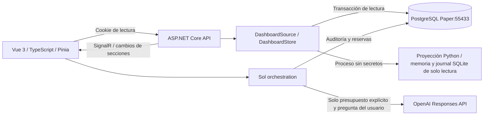

# TradingAgent: dashboard de investigación

Implementación funcional del 7 de octubre de 2026. El navegador consulta el estudio persistido `eurusd-shadow-3786f123021b41e491fc1c9a0b29e6fd`; no inicia el observador, ninguna investigación ni un runner de ejecución. R1/R5/R10 tienen US$100 virtuales **cada uno**, permanecen pausados y contienen cero operaciones. No se suman como una cartera de US$300. EmergencyStop permanece activo y Live bloqueado.

## Arquitectura y archivos



El grafo Graphify existente se consultó antes de abrir los componentes del repositorio. Su índice es anterior a los últimos módulos shadow y devolvió una consulta truncada; las relaciones faltantes se localizaron mediante búsquedas dirigidas. Se reutilizan PostgreSQL, migraciones, evidencia con hashes, memoria de investigación, indicadores y journals existentes. No se modifican las estrategias, RiskEngine, ExecutionGuard, AccountBinding ni autorizaciones operativas.

| Ubicación | Responsabilidad |
|---|---|
| `frontend/` | Vue 3, Composition API, TypeScript estricto, Vite 7, Pinia, Router, Tailwind 4, ECharts 6, iconos `@lucide/vue` |
| `frontend/src/types.ts`, `api.ts`, `stores.ts`, `realtime.ts` | Contratos, cliente tipado, stores separados y recuperación de conexión |
| `frontend/src/components/` | Sidebar, header, badges, tarjetas, gráficos, cotizaciones, señal, tablas, notificaciones y chat estructurado |
| `frontend/src/pages/WorkspaceView.vue` | Dashboard, Experimentos, Operaciones, Mercado, Sol, Research, Reportes y Configuración |
| `src/TradingAgent.Api/DashboardService.cs` | Proyección, caché por revisión y calidad de datos |
| `src/TradingAgent.Api/DashboardEndpoints.cs` | API de lectura, sesión local y comandos bloqueados |
| `src/TradingAgent.Api/DashboardRealtime.cs` | Hub, diferencias por sección y publicación |
| `src/TradingAgent.Api/SolChat.cs` | Contexto mínimo, respuestas deterministas, proveedor OpenAI y presupuesto |
| `src/TradingAgent.Infrastructure/DashboardStore.cs` | Lectura consistente y auditoría append-only del chat |
| `src/TradingAgent.Infrastructure/Migrations/007_dashboard_chat.sql` | Nuevo journal de chat, permisos e índice de observaciones |
| `python/trading_agent/dashboard_projection.py` | Lectura/verificación de evidencia y transformación sin autoridad de ejecución |
| `scripts/start-dashboard.ps1`, `verify-dashboard.ps1` | Arranque local y comprobación E2E controlada |

También se modifican `src/TradingAgent.Api/Program.cs`, el proyecto de pruebas C# y `.gitignore`. Nuevas pruebas en `python/tests/test_dashboard_projection.py`, `tests/TradingAgent.Tests/DashboardTests.cs`, `frontend/src/__tests__/` y `frontend/e2e/`. No hay datos MOCK importados por código productivo: las fixtures se limitan a pruebas.

## Arranque exacto

Desde la raíz del repositorio, con Python del proyecto y Node **20.19 o superior compatible con Vite**:

```powershell
dotnet build TradingAgent.sln
Push-Location frontend
npm ci
npm run build
Pop-Location
.\scripts\paper-lab-database.ps1 -Action Prepare
.\scripts\start-dashboard.ps1 -CopyAccessCode
```

`Prepare` usa el mecanismo existente para iniciar PostgreSQL Paper local, aplicar las migraciones versionadas con el rol de migración y preparar el rol del laboratorio. El backend del dashboard arranca después con roles restringidos y verifica el esquema. No cambia autorizaciones de trading. Abrir **http://127.0.0.1:5080**, pegar el código de lectura copiado al portapapeles y pulsar «Abrir TradingAgent». Ese código no es la API Key ni el token administrativo. No pegar ninguna clave OpenAI en el navegador. No utilizar `localhost`: las restricciones de Host/Origin aceptan las direcciones de loopback indicadas.

El script mantiene el backend en primer plano. **Ctrl+C** lo detiene. «Cerrar sesión» elimina la cookie del navegador y desconecta SignalR. El arranque no inicia el observador ni conecta un segundo recolector IBKR. Mientras no haya observaciones auténticas, Mercado y Señal muestran `MISSING`/`DATA_UNAVAILABLE`/`INSUFFICIENT_EVIDENCE`.

Para desarrollo, dejar el backend anterior abierto y ejecutar en otra terminal desde la raíz:

```powershell
Set-Location frontend
npm ci
npm run dev
```

Frontend de desarrollo: **http://127.0.0.1:5173**. Vite dirige API y WebSocket al backend :5080. El código de acceso es el mismo; el navegador no conecta con PostgreSQL ni con OpenAI.

El observador shadow existente conserva su preregistro y procedimiento de revisión en `eurusd-shadow-research.md`. Es una operación independiente; no se inicia automáticamente al abrir el dashboard. La interfaz representa las observaciones persistidas que ese servicio produzca, sin fabricar ticks para mantener actividad.

## API y SignalR

Todos los nuevos recursos de lectura se agrupan bajo `/api/ui` para conservar sin duplicación funcional los endpoints administrativos/broker existentes y su autenticación Bearer independiente.

| Método / recurso | Resultado |
|---|---|
| `POST /api/ui/session` | Código local → cookie HttpOnly de lectura |
| `GET /api/ui/session`, `DELETE /api/ui/session` | Consultar/cerrar sesión |
| `GET /api/ui/dashboard` | Snapshot consistente de las secciones |
| `GET /api/ui/system/status` | Fuente, emergencia, Live y capacidad de la UI |
| `GET /api/ui/experiments` | R1/R5/R10 y métricas |
| `GET /api/ui/experiments/{id}` | Perfil individual |
| `GET /api/ui/experiments/{id}/equity` | Curva registrada |
| `GET /api/ui/trades`, `GET /api/ui/trades/open` | Historial e inventario simulado |
| `GET /api/ui/market/eurusd` | Cotizaciones, calidad, antigüedad y features |
| `GET /api/ui/predictions/current` | Decisión y evidencia probabilística |
| `GET /api/ui/calibration` | Buckets de calibración |
| `GET /api/ui/research` | Memoria verificada, DEFER_RESEARCH y auditoría H40 |
| `POST /api/ui/sol/chat` | Consulta estructurada, métricas y gráficos |
| `POST /api/ui/commands/preview` | Intención interpretada y bloqueada/auditada |
| `POST /api/ui/commands/confirm` | Siempre 403 en esta fase sin ejecutor de comandos |
| `/hubs/dashboard` | SignalR autenticado; sin métodos de modificación invocables |

Se conservan los endpoints existentes `/api/broker/status`, `/api/broker/account`, `/api/broker/positions` y `/api/market/eurusd/*`. La cookie de UI no concede acceso a rutas administrativas ni puede utilizarse como Bearer.

El servidor compara snapshots cada dos segundos y publica únicamente las secciones que cambian: `connection.updated`, `study.updated`, `experiment.updated`, `market.quote.updated`, `prediction.updated`, `position.updated`, `trade.completed`, `research.updated`, `journal.updated`, `notification.updated`; los fallos de fuente emiten `source.unavailable`. Apertura/cierre se representan por reemplazo del inventario y movimiento al historial, sin inventar una ejecución broker. Los análisis de chat crean notificaciones tras su respuesta. No se emiten señales u operaciones que no estén en el journal.

El cliente no hace polling continuo de endpoints. SignalR usa reconexión exponencial de 1, 2, 4…30 segundos, snapshot al reconectar y control de secuencia para descartar duplicados/detectar huecos. Un evento de navegador offline muestra desconexión inmediatamente. Los stores de sistema, mercado, experimentos, operaciones, predicción, Sol y notificaciones reciben únicamente las secciones afectadas. Se conservan como máximo 500 cotizaciones, 500 operaciones cerradas y curvas agregadas de hasta 2.000 puntos; no se exporta toda la base.

## Evidencia y visualización

PostgreSQL suministra la cabecera persistida y la última oportunidad común bajo `REPEATABLE READ` / `READ ONLY`. La proyección Python abre SQLite en modo de lectura, verifica la cadena de hashes y exige coincidencia con la cabecera PostgreSQL. Un journal ausente o divergente bloquea la proyección; no se reemplaza por métricas ficticias.

Los tres perfiles muestran capital, riesgo, equity, P&L y drawdown registrados. Win rate, profit factor, expectativa y calibración permanecen nulos cuando no existe muestra. Las tarjetas amplían riesgo/costos/evidencia en «Riesgo y evidencia». El comparador ofrece series de equity/P&L/drawdown, selección de líneas y vistas adicionales de profit factor, expectativa, acierto, comisiones y retorno. Los tooltips incluyen UTC, equity/métrica, P&L, drawdown y número de operación disponibles. Con cero trades existe solamente el punto inicial preregistrado, sin una curva de rentabilidad ficticia.

Los rangos 1D/7D/30D se anclan al último punto persistido; «Sesión» muestra actualmente las últimas 24 horas de esa serie. Este filtro visual no decide calendario ni admisión de entradas. Los gráficos no rellenan intervalos sin cotizaciones.

Las tablas separan `SIMULATED_SHADOW` de `BROKER_EXECUTION`, entorno, inventario pendiente y resultado cerrado. El detalle muestra campos originales, entrada/salida, costos y motivos. No hay ejecución broker nueva que representar. Las posiciones abiertas no cuentan como ganadoras; su P&L neto es una valoración estimada identificada como tal.

El módulo Mercado conserva timestamps UTC y muestra hora local de America/Santo_Domingo. BID/ASK y midpoint proceden del callback persistido; el midpoint no se presenta como último trade. Se distinguen LIVE, DELAYED, STALE y MISSING; una cotización de más de 30 segundos se marca STALE. Volumen/liquidez, EMA20/EMA50 u otros datos sin fuente específica permanecen UNKNOWN/DATA_UNAVAILABLE. No se renombra una EMA con parámetros distintos para aparentar disponibilidad.

La probabilidad calibrada representa **TP antes de SL**, no certeza ni garantía de ganancia neta. Se muestran muestra, intervalo, EV, costos y rechazos disponibles. Los siete buckets pedidos (50–55, 55–60, 60–65, 65–70, 70–75, 75–80, 80%+) muestran predicción/tasa observada/muestra/error o ausencia de evidencia. Sharpe, Sortino y riesgo de ruina son DATA_UNAVAILABLE cuando no existe un cálculo validado suficiente.

Research reutiliza la carga de memoria de solo lectura: conserva DEFER_RESEARCH de research-openai-003, hipótesis, conclusiones, evidencia, parámetros, limitaciones y resultados walk-forward; los resultados H40 auditados sustituyen los resúmenes obsoletos sin borrar sus fuentes. La prueba final sigue sellada y no se evalúa desde el frontend. No hay promoción automática.

## Sol: consultas, presupuesto y seguridad

Sol está disponible en página completa y panel lateral. «Dame los resultados de R5», «Compara R1, R5 y R10», «Grafica el drawdown de R5», «Muéstrame las operaciones perdedoras de R10», «Analiza las últimas 20 operaciones» y preguntas de señales/posiciones generan texto, métricas, tabla, gráfico y advertencias desde datos del agente. Vue renderiza componentes predefinidos; no ejecuta código ni HTML del modelo.

**Por defecto, presupuesto US$0:** se responde `LOCAL_EVIDENCE_ONLY` / `DETERMINISTIC_JOURNAL`, con cero tokens/costo OpenAI. Es una consulta al journal, no una interpretación realizada por GPT. La ausencia de una clave o de presupuesto se muestra expresamente.

Cuando el operador decida habilitar interpretación facturable, desde una terminal con `OPENAI_API_KEY` ya configurada, detener primero el backend anterior y ejecutar:

```powershell
.\scripts\start-dashboard.ps1 -CopyAccessCode -SolBudget 0.25
```

Esta configuración permite como máximo US$0.25 **reservados por sesión del backend** y solamente llama al modelo al enviar una pregunta. No inicia investigación autónoma. La clave permanece en el backend; nunca se imprime, persiste en el repositorio ni llega al navegador/proceso de proyección Python. La disponibilidad real del modelo no se ha probado durante esta implementación: `CONFIGURED_NOT_VERIFIED` indica únicamente configuración presente.

El proveedor fijo usa Responses API, `gpt-6.1-sol`, esquema JSON estricto, salida máxima de 600 tokens, timeout de 20 segundos, sin herramientas, redirecciones ni reintentos. Se envía contexto relevante acotado (máximo 6.000 bytes), no toda la base. El texto interpretativo del modelo queda marcado como interpretación no verificada; las métricas y los gráficos siguen siendo deterministas. Se reservan US$0.054 antes de cada llamada con tasas de cálculo conservadoras US$5/M entrada y US$15/M salida, distintas de una factura real. Se registran tokens/costo estimado observados y reserva; un fallo conserva la reserva y abre el circuito de la sesión. Máximo diez llamadas y presupuesto hasta US$1 configurable; el mismo ID de petición no se reenvía. Un nuevo arranque crea una sesión nueva, por lo que el presupuesto es por sesión, no un límite mensual del proyecto.

El journal de chat es append-only en PostgreSQL, con hashes e IDs de sesión/petición. La reserva toma un bloqueo transaccional para evitar gasto concurrente, exige el mismo presupuesto y conserva bloqueos/errores/respuestas. UPDATE/DELETE están prohibidos por permisos y trigger. Se utiliza exclusivamente PostgreSQL local Paper; la proyección de trading permanece de solo lectura.

«Pausa R10», «Reanuda R5», «Detén el experimento», «Inicia investigación» y órdenes de compra/venta se interpretan como intenciones **sin autorización de ejecución**. Se auditan y permanecen bloqueadas. La ruta de confirmación no ejecuta acciones. No existe transmisión de órdenes desde el chat. Live, limpieza de emergencia, secretos, AccountBinding y omisión de RiskEngine/ExecutionGuard son prohibiciones explícitas. La IA no puede conceder PaperAuto ni modificar parámetros productivos.

Acceso local con credencial de lectura independiente del token administrativo, DPAPI, cookie HttpOnly/SameSite=Strict de ocho horas sin renovación deslizante, protección Host/Origin, rate limit de login y CSP. La clave OpenAI no forma parte del payload. Configuración muestra capacidad de lectura, no pretende verificar identidad completa IBKR, permisos, margen o tarifas por la mera existencia de AccountBinding.

## Verificación y límites prácticos

Resultados: **1.492 pruebas aprobadas, ninguna omitida**: 1.047 Python, 416 C#, 22 Vitest/Vue Test Utils y 7 Playwright E2E. Se agregaron 84 pruebas respecto de las 1.408 anteriores. Compilación .NET sin errores ni advertencias, typecheck/build de producción Vue aprobado y auditoría npm de dependencias productivas sin vulnerabilidades conocidas. Vite advierte que el chunk de gráficos supera 500 kB minificados (aprox. 197 kB gzip); la aplicación funciona y el módulo está separado, pero una próxima optimización puede cargar gráficos por ruta.

Pruebas nuevas cubren read models, hashes/tampering, UNKNOWN, costos/inventario, memoria DEFER/H40, autenticación y aislamiento del Bearer, endpoints, hub real mediante TestServer, diferencias por sección, Sol local/proveedor controlado, presupuesto persistente/concurrente, JSON inválido, errores/circuito, contratos TypeScript, stores, componentes y desconexión/reconexión. Las fixtures del proveedor no hacen llamadas reales. Los siete E2E usan la API real y PostgreSQL Paper local, sin crear trades ni alterar el estudio: dashboard, chat R5, comparación, comandos bloqueados, reconexión, móvil y Research.

El ciclo posición abierta→actualización→historial se verifica con fixtures explícitas de prueba; no se fabricó una operación en el journal real para probarlo en el navegador. La publicación SignalR y sus secuencias se prueban con fuente controlada en C#; el E2E real verifica reconexión y recuperación del snapshot. No se afirma haber observado un fill IBKR o una nueva señal real durante estas pruebas.

Evidencias, logs de compilación, suites, auditoría, conciliación y capturas: `artifacts/frontend-preparation/`. Se revisaron capturas desktop, chat R5 y móvil. El estudio continúa PREPARED_NOT_RUNNING, cero órdenes nuevas, ninguna llamada facturable, ninguna nueva autorización y ninguna modificación de los 70 archivos protegidos comparados con la preparación anterior.

Comando para repetir los flujos del navegador, con builds y PostgreSQL preparados:

```powershell
.\scripts\verify-dashboard.ps1
```

El script arranca únicamente su backend temporal con presupuesto cero, credenciales distintas generadas localmente y feed IBKR deshabilitado; al terminar detiene ese proceso. No se deja un servidor de pruebas anónimo funcionando.

Referencias del contrato: [OpenAI Structured Outputs](https://developers.openai.com/api/docs/guides/structured-outputs), [modelo GPT-6.1 Sol](https://developers.openai.com/api/docs/models/gpt-6.1-sol) y [cliente JavaScript SignalR](https://learn.microsoft.com/en-us/aspnet/core/signalr/javascript-client?tabs=visual-studio&view=aspnetcore-9.0). Estos enlaces documentan la integración; no prueban acceso efectivo del proyecto a OpenAI ni capacidades del broker.
