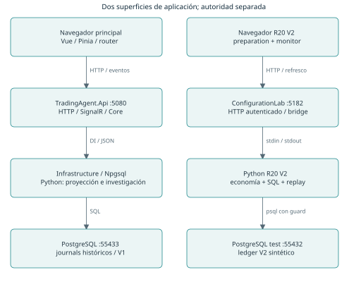
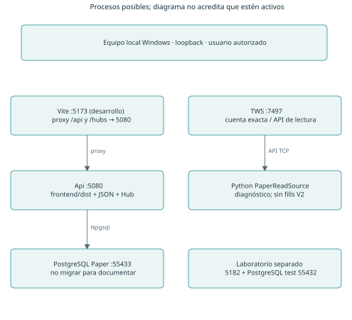
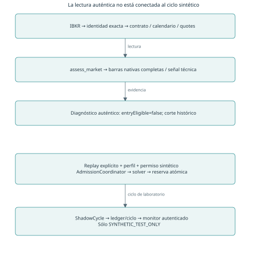
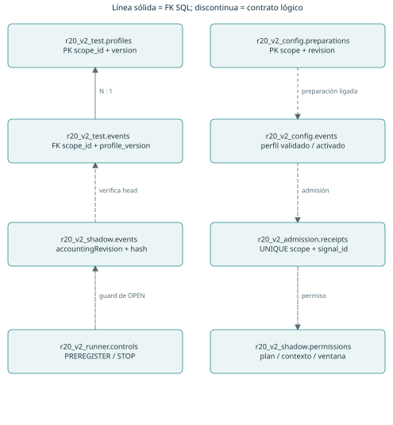
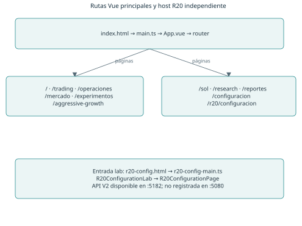
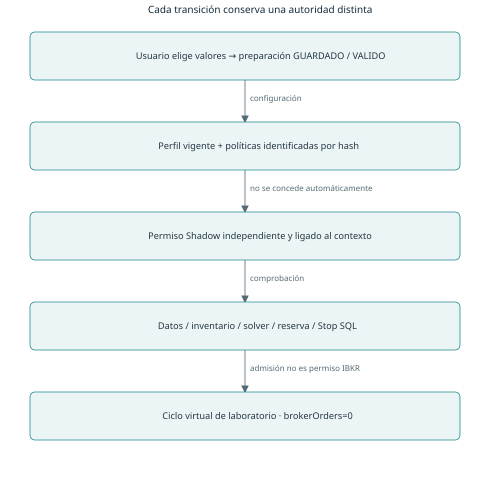
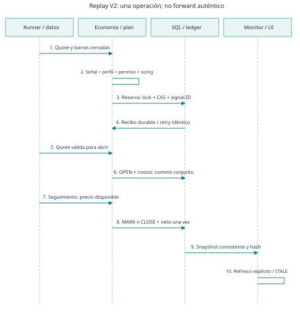
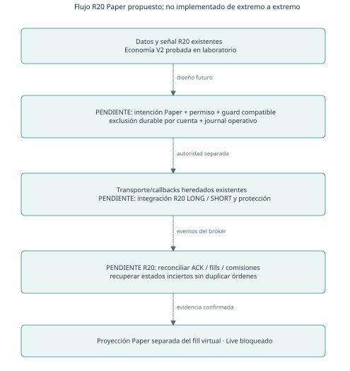

# TRADINGAGENT — MANUAL TÉCNICO INTEGRAL

Arquitectura, funcionamiento, despliegue y mantenimiento

Versión documental 1.0 · 14 de octubre de 2026 · Español

Documento de estudio y navegación del código. Corte de fuente posterior a R20 V2 fase 3. La descripción no concede autorización de ejecución. Fase 3B y fase 4 permanecen pendientes.

**Lectura recomendada:** capítulos 1–3 para orientarse; 6–7 para comprender R20; 9 antes de ejecutar comandos; 11 y 14 antes de planificar un despliegue. El capítulo 15 organiza la revisión conjunta. Los apéndices relacionan archivos, capítulos y evidencia.

## Alcance y método de esta edición

Se consultó primero Graphify: grafo de 424 nodos, recorrido desde RiskEngine, Program.cs y official_wire. Su cobertura es anterior a R20 V2; sirve para localizar el núcleo C#, PostgreSQL y el transporte, pero no certifica las relaciones nuevas. Se contrastaron los puntos de entrada actuales mediante lecturas dirigidas y un inventario estático de 425 archivos de código, contratos y configuración. Inventariar símbolos no equivale a auditar semánticamente cada línea: el apéndice distingue los componentes leídos en detalle de las familias localizadas.

Se inspeccionaron código y scripts sin iniciar servicios, ejecutar suites que escriben en bases, consultar cuentas IBKR ni modificar aplicaciones. Sólo se generaron documentos, diagramas, inventarios y herramientas locales de publicación. Las bibliotecas de PDF se instalaron en `tmp/manual-tools`, separadas de `.venv`.

La evidencia dinámica citada pertenece a informes fechados. El informe de preparación del 13/oct no es el último estado del código: existen fases 2 y 3 posteriores. El último informe completo utilizado es `artifacts/aggressive-growth-r20-20261010/r20-v2-phase3-20261014/report.md`. Cuando el manual dice «verificado en laboratorio», se refiere a esa evidencia o a la fase explícitamente indicada; no a una repetición de pruebas durante esta documentación.

**Convenciones.** Una ruta sin prefijo absoluto es relativa a la raíz del proyecto. «Operativo» identifica el destino previsto o histórico, no prueba que el proceso esté encendido. `UNKNOWN` significa falta de evidencia; no significa cero. Un valor `null` se conserva. Los ejemplos numéricos no son perfiles seleccionados por el propietario. Las flechas discontinuas de los diagramas indican vínculos conceptuales o propuestas, nunca una conexión de ejecución ya habilitada.

# 1. Introducción al proyecto

## 1.1 Finalidad y problemas que aborda

TradingAgent es un sistema local de investigación financiera, observación de mercado, simulación de decisiones y preparación de ejecución Paper controlada. Su interés arquitectónico no reside sólo en generar señales: intenta demostrar qué datos originaron una decisión, qué versión de estrategia y política se aplicó, qué presupuesto estaba disponible y cómo se recupera el estado después de una interrupción.

Combina un dominio determinista en C#, motores e investigación en Python, persistencia PostgreSQL y una interfaz Vue. La IA interpretativa de Sol y los pronósticos Kronos son consumidores/productores de evidencia de investigación; no sustituyen los controles de riesgo ni conceden autoridad de órdenes. Las capacidades históricas de ejecución Paper están separadas del ciclo R20 V2, que aún sólo admite posiciones en el laboratorio sintético.

El problema económico que originó V2 fue visible en V1: una operación podía tener un target bruto positivo y, después de comisiones y reservas, un target neto negativo. Además, el límite administrativo de apalancamiento se reutilizaba como condición de liquidación virtual. V2 separa dimensionamiento, contabilidad, reservas, pérdidas diarias y gestión de posiciones. Véase capítulo 6.

## 1.2 Modos que no deben confundirse

| Modo | Fuente y efectos | Qué no demuestra |
|---|---|---|
| Research | Análisis de archivos, observaciones y modelos; puede persistir evidencia. | Permiso para abrir una posición o enviar una orden. |
| Replay | Reproducción causal con reloj y datos explícitos; los ensayos R20 V2 usan clasificación sintética. | Rendimiento forward ni latencia real de ejecución. |
| Shadow | Posiciones y fills virtuales; V1 tuvo observación auténtica, V2 sólo ciclo de laboratorio. | Una orden stop alojada en el bróker. |
| IBKR Paper | Órdenes enviadas a una cuenta de simulación de IBKR, con callbacks y reconciliación. | Equivalencia con fills, liquidez o riesgo Live. |
| Live | Cuenta y ejecución con dinero real. | No está habilitado ni incluido en esta fase. |

`LIVE` en `market_data_type=1` describe datos de mercado en tiempo real. No identifica el tipo de cuenta. Tampoco `ordersSupported=false` del host principal implica que no exista código histórico de órdenes en otros módulos: describe la capacidad publicada por ese host.

## 1.3 Tecnologías y estado resumido

| Tecnología | Uso real | Situación |
|---|---|---|
| .NET 9 / ASP.NET Core | API local, DI, autenticación, SignalR, comandos de journal y proyecciones. | Implementado; no se arrancó para este manual. |
| C# Core / Infrastructure | Riesgo, capital virtual, contratos y persistencia con Npgsql. | Código y pruebas históricas disponibles. |
| Python 3.11+ | Mercado, estrategia, cálculos Decimal, runners, investigación y bridges JSON. | Entorno anterior verificado con 3.13.5. |
| PostgreSQL 17 | Journals y ledgers; clústeres separados por propósito. | Operativo histórico y laboratorio no intercambiables. |
| Vue 3 / TypeScript / Pinia | Páginas, formularios, stores y validación de respuestas. | Dashboard principal y entrada de laboratorio distintas. |
| Vite / Vitest / Playwright | Desarrollo, build y verificación de interfaz. | Configuraciones específicas por host y fase. |
| IBKR TWS / SDK ibapi | Lectura y transporte Paper protegido. | Lectura R20 auténtica acreditada por cortes históricos. |
| Kronos / herramientas IA | Pronóstico, evaluación, memoria y explicación. | Investigación; no autoridad R20 de ejecución. |

La solución no debe describirse como un único bot autónomo listo para desplegar: tiene subsistemas de distintas generaciones y fronteras de autoridad. La clasificación detallada está en el capítulo 14.

# 2. Arquitectura general

## 2.1 Componentes y responsabilidades



`TradingAgent.Api` es tanto host HTTP como contenedor de comandos de consola. `Program.cs` evalúa argumentos de journal/investigación antes de construir el servidor. Un proceso lanzado con `--aggressive-growth-journal` no es un segundo servidor HTTP: consume una solicitud y devuelve JSON.

`TradingAgent.Core` contiene tipos y reglas deterministas sin depender de Vue. `TradingAgent.Infrastructure` referencia Core y usa Npgsql; las migraciones SQL se incluyen como recursos del ensamblado. Api referencia Infrastructure. ResearchLab es un ejecutable de simulación por stdin/stdout. ConfigurationLab es un host independiente; no referencia el transporte de órdenes ni usa la API operativa como ejecutor.

Python concentra acceso al SDK, estrategia y ciclo de investigación. La separación entre economía pura y coordinación con I/O es visible en los docstrings e imports: `r20_economics.py`, `r20_profiles.py` y `r20_sizing.py` no obtienen cotizaciones ni transmiten órdenes. `r20_admission.py` y `r20_shadow.py` coordinan decisiones con SQL, mientras `r20_market.py` sólo acredita una lectura.

La elección técnica se explica por las responsabilidades actuales, no por una supuesta necesidad universal: C# organiza el servicio y los contratos de riesgo; Python integra el ecosistema analítico/SDK; PostgreSQL arbitra estado concurrente; TypeScript permite validar y presentar contratos. El costo es mantener varias fronteras de serialización y evitar divergencias entre validaciones Python y SQL.

## 2.2 Procesos y comunicaciones



| Origen → destino | Protocolo / contrato | Dirección y consecuencia |
|---|---|---|
| Navegador → Api 5080 | HTTP JSON `/api/ui/*`, cookie de lectura. | Consulta; chat puede persistir evidencia y consumir presupuesto explícito. |
| Api → navegador | SignalR `/hubs/dashboard`, eventos secuenciados. | Deltas; la recuperación exige snapshot completo. |
| Api → PostgreSQL | Npgsql, transacciones y parámetros SQL. | Lectura o escritura según comando/rol. |
| Api → Python | Proceso hijo, JSON por stdin/stdout. | Proyección o investigación; no es un servidor Python REST. |
| Python V1 → Api CLI | Ejecución `dotnet ... --aggressive-growth-journal`. | CAS y append de journal; no HTTP. |
| ConfigurationLab → Python V2 | Proceso hijo `-m trading_agent.r20_configuration`. | Acciones permitidas, entorno reducido y timeout de 45 s. |
| Python V2 → PostgreSQL test | `psql` por subprocess con guard en la misma conexión. | Laboratorio 55432; nunca fallback al operativo. |
| PaperReadSource → TWS | TCP API oficial, cliente diagnóstico. | Lectura con identidad exacta; desconecta al terminar. |
| Vite 5173 → Api 5080 | Proxy `/api` y `/hubs`; WebSocket habilitado en proxy. | Desarrollo; no proxy V2 hacia 5182. |

Los procesos conceptuales «motor», «riesgo» y «gestión» no son necesariamente servicios persistentes distintos. En V2 gran parte son funciones ejecutadas dentro del runner de replay o del bridge de configuración. No se encontró un servicio Windows instalado por los scripts inspeccionados ni un reverse proxy operativo en el código revisado. Su ausencia global en la máquina no se certifica mediante este manual.

## 2.3 Flujo de evidencia y confianza



El transporte entrega quote y barras; el normalizador determina cuáles son nativas, completas y esperables según calendario. La estrategia calcula una propuesta. El coordinador necesita además perfil vigente, contexto, permiso, inventario y capacidad económica. El solver devuelve admisibilidad, no permiso de ejecución. La reserva atómica impide que dos señales consuman el mismo presupuesto.

Para V2 auténtico la conexión entre lectura y ciclo está deliberadamente ausente: `Quote.validate` exige `SYNTHETIC_TEST_ONLY`, y `ShadowCycle` exige un contexto del mismo tipo. El diagrama no debe leerse como una ruta ya habilitada de TWS a fills virtuales V2.

La persistencia es la fuente de recuperación, y la UI una proyección. Un error de red en el navegador no vuelve segura una posición ni elimina su reserva. Un hash acredita igualdad de material frente a una referencia; no es una firma externa ni protege por sí solo contra un administrador capaz de sustituir todo el historial y sus referencias.

# 3. Estructura de directorios y mapa del código

## 3.1 Árbol relevante

```text
TradingAgent.sln / Directory.Build.props / README.md
src/
  TradingAgent.Core/                  dominio C# y riesgo protegido
  TradingAgent.Infrastructure/        stores y Migrations/001...011
  TradingAgent.Api/                   host 5080 y comandos de consola
  TradingAgent.ResearchLab/           simulación C# por JSON
  TradingAgent.ConfigurationLab/      host R20 V2 de laboratorio 5182
python/
  trading_agent/                     motores, lectores, runners y SQL V2
    kronos/                          pronóstico, calibración, worker
    ai_strategy_researcher/          investigación IA y memorias
  tests/                             unittest puro e integración
frontend/
  src/app/                           rutas, navegación y estilos
  src/modules/                       páginas por dominio
  src/stores/                        estado de presentación y R20
  src/components/                    componentes y gráficos compartidos
  src/__tests__/ / e2e/               Vitest y Playwright
scripts/                             entradas PowerShell explícitas
config/                              políticas versionadas y sesiones
contracts/                           ai-proposal.schema.json
docs/architecture/ / docs/skills/     decisiones y referencias previas
docs/manual/                         esta edición y fuentes de diagramas
tasks/                               puntos de continuación
graphify-out/                        grafo previo; cobertura incompleta
artifacts/                           evidencias históricas y builds de lab
tests/TradingAgent.Tests/             xUnit y WebApplicationFactory
.local/                              datos, locks y secretos; NO publicar
.venv/                               dependencias Python generadas
```

`frontend/node_modules`, `frontend/dist`, `src/*/bin`, `src/*/obj`, cachés y resultados de pruebas se generan. No deben confundirse con la fuente ni borrarse para «resolver» un problema operativo. Los binarios pueden ser distintos de la fuente actual: un build correcto no acredita qué DLL está usando un proceso existente.

## 3.2 Responsabilidad, consumidores e impacto

| Ruta | Consumidor / dependencia | Impacto y estado |
|---|---|---|
| `src/TradingAgent.Core` | Infrastructure, Api, ResearchLab, tests. | Cambiar contratos/riesgo afecta múltiples modos; incluye protegidos. |
| `src/TradingAgent.Infrastructure` | Api y comandos Python vía CLI. | Persistencia y validación histórica; alto riesgo de incompatibilidad. |
| `src/TradingAgent.Api` | Navegador, scripts y bridges. | HTTP local y comandos; no es sólo presentación. |
| `src/TradingAgent.ConfigurationLab` | UI V2 y Python configuration. | Laboratorio; no desplegado como API V2 de 5080. |
| `python/trading_agent/r20_*` | V2 puro, SQL, coordinador y replay. | Núcleo y laboratorio; ninguna cohorte operativa V2. |
| `python/trading_agent/aggressive_growth*` | V1 y señal reutilizada por V2. | V1 histórico; cambios alteran hashes y contratos. |
| `python/trading_agent/paper_*` | SDK, laboratorios Paper y recuperación. | Rutas con distintos permisos; no llamar sin identificar efectos. |
| `frontend/src/modules` | Router principal y entrada lab. | Presentación; no incorporar aquí fórmulas decisorias de trading. |
| `config` | Motores/lectores/estudios. | No todos los JSON están activos; consultar clasificación y hash. |
| `scripts` | Operador local. | Algunos arrancan, migran, autorizan o ejecutan; leer `param` y flujo. |
| `artifacts` | Auditoría y documentación. | Mezcla evidencia auténtica, fixtures, informes y builds; conservar procedencia. |
| `.local` | Procesos autorizados del usuario Windows. | Secretos DPAPI, clústeres, latches y locks; fuera del manual publicable. |

## 3.3 Dónde debo ir si quiero modificar...

| Cambio deseado | Archivo / función inicial | Usado por / riesgo |
|---|---|---|
| Estrategia R20, EMA o ruptura | `python/trading_agent/aggressive_growth.py` → `signal` | V1 y V2; muy alto, versionar sin reescribir V1. |
| SL o TP | Mismo archivo → `signal`; V2 `r20_shadow.py` → gestión | Geometría y salidas son contratos distintos; muy alto. |
| Asignación USD o multiplicador | `r20_sizing.py` → `AllocationRequest`, `size`; `r20_preparation.py` | No confundir con cap agregado; alto. |
| Cap de apalancamiento | `r20_profiles.py` → `EconomicProfile.max_leverage` | Nuevas entradas; no liquidación administrativa automática. |
| Comisiones/costos | `r20_cost_policy.py`, `r20_sizing.py` → `CostModel` | Política con procedencia, no rellenar UNKNOWN. |
| Día y pérdida diaria | `r20_economics.py` → `DailyState` | SQL equivalente y recuperación; muy alto. |
| Conexión IBKR | `ibkr_session.py`, `paper_execution_wire.py`, `r20_market.py` | Transporte protegido; lectura no autoriza mutación. |
| Dashboard general | `frontend/src/app/routes.ts`, `src/TradingAgent.Api/DashboardEndpoints.cs` | Contratos HTTP y SignalR. |
| Página R20 | `frontend/src/modules/r20-configuration/R20ConfigurationPage.vue` | Usa preparation/monitor; backend V2 sólo lab. |
| Endpoint V2 | `src/TradingAgent.ConfigurationLab/Program.cs` | Autorización servidor y bridge; no confiar en controles UI. |
| Permisos Shadow | `r20_shadow_plan.py`, `r20_shadow_schema.sql` | Perfil y permiso independientes; muy alto. |
| Esquema V2 | Los seis `r20_*schema.sql` | Sólo clúster de test; no son migraciones operativas. |
| Journal V1 | `AggressiveGrowthStore.cs`, `011_aggressive_growth.sql` | Conservación histórica; no editar 011 aplicada. |
| Inicio V2 | `r20_runner.py` → `main`, `ReplayRunner` | No hay Run forward; no añadir implícitamente. |
| Órdenes Paper | `paper_lab.py`, `paper_execution_wire.py` | Heredado BUY/SELL de cierre; no adaptador R20 SHORT. |
| Recuperación | `r20_shadow.py` → `_state`, `_replay`; `r20_runner.py` → `step` | Releer ledger antes de actuar; alto. |

Los nombres Python abreviados de esta tabla viven en `python/trading_agent/`. Las rutas y símbolos completos están indexados en el apéndice A y en `source-audit.json`.

# 4. Backend ASP.NET Core

## 4.1 Proyectos y arranque

`Directory.Build.props` fija `net9.0`, nullable e implicit usings, trata warnings como errores y desactiva compilación compartida. También contiene `NuGetAudit=false`: una compilación exitosa no es un análisis de vulnerabilidades NuGet. Infrastructure usa Npgsql 9.0.3 y embebe `Migrations/*.sql`. Tests usa xUnit 2.9.3, Microsoft.NET.Test.Sdk 17.14.1 y WebApplicationFactory 9.0.10.

El orden de `src/TradingAgent.Api/Program.cs` importa:

1. Rechaza Live por variables/configuración incompatibles.
2. Carga RiskPolicy y deriva los comandos especiales de consola.
3. Permite `--demo` sintético antes de necesitar PostgreSQL.
4. Exige `TRADING_DB`; llama `Migrate` salvo que `TRADING_DB_AUTO_MIGRATE` sea exactamente `false`, o cuando se pide `--migrate`.
5. Valida token administrativo y separación de token de lectura.
6. Fija Kestrel a loopback 5080; rechaza configuración externa de endpoints.
7. Registra servicios, autenticación, middleware y rutas; ejecuta el servidor.

No existe un proyecto separado llamado TradingAgent.Dashboard: el servidor principal del Dashboard es TradingAgent.Api. La UI Vue es una aplicación compilada o servida por Vite.

## 4.2 DI y servicios

PostgresStore y RiskPolicy son singleton de configuración/servicio; cada operación de store abre su conexión. `IResearchAi` se registra como `DisabledResearchAi`. PaperFeedConfiguration controla si el BackgroundService PaperFeedService inicia un colector Python. El wrapper de Dashboard fija `IBKR_DATA_ENABLED=false`, por lo que observar el Dashboard no arranca un segundo colector.

`DashboardEndpoints.AddDashboard` registra DashboardStore, IDashboardSource, SolChatService, HttpClient interpretativo, SignalR y DashboardBroadcaster. DashboardSource serializa su proyección con SemaphoreSlim, obtiene un envelope DB y ejecuta `trading_agent.dashboard_projection`. Cachea por identidad de fuentes, pero vuelve a evaluar frescura en cada lectura. El broadcaster consulta cada dos segundos; la conexión WebSocket activa no garantiza una quote fresca.

## 4.3 Autenticación, errores y efectos

El host principal sólo acepta IP local y Host/Origin permitidos. API administrativa usa Bearer comparado por hash en tiempo constante. Las rutas `/api/ui` permiten cookie con claim `scope=dashboard-readonly`; el Hub exige el esquema Dashboard. Cookie HttpOnly, SameSite Strict, ocho horas sin renovación deslizante; claves locales de DataProtection, protegidas con DPAPI en Windows. No hay OIDC/MFA de despliegue público.

La UI tiene sesión propia; no recibe el token administrativo. Login tiene limitación de intentos. CSP restringe scripts a origen propio; no habilita unsafe-eval para resolver bibliotecas. Las excepciones esperables del host se convierten en 400 con mensaje; excepciones generales devuelven 503 y registran sólo tipo. Esto no equivale a un catálogo uniforme de errores para todos los hosts: ConfigurationLab usa también 409, 422 y 429.

## 4.4 Catálogo HTTP principal

Leyenda de autoridad: **P** pública local; **L** cookie Dashboard o Bearer donde aplica el middleware; **A** Bearer administrativo. El Hub exige además autenticación Dashboard. Todas las rutas siguen sujetas a Host/Origin/IP local. El catálogo describe código, no una prueba HTTP actual.

| Método y ruta | Responsable / finalidad | Autoridad, efectos y estado |
|---|---|---|
| GET `/health` | Program; capacidades del host. | P; lectura, no prueba integral DB/TWS. |
| GET `/policy` | Program; RiskPolicy. | A; lectura. |
| POST `/api/ui/session` | DashboardEndpoints; login. | P con credencial de lectura; crea cookie. |
| GET / DELETE `/api/ui/session` | Consulta / logout. | Frontera de sesión; DELETE borra cookie local. |
| GET `/api/ui/dashboard` | DashboardSource; snapshot agregado. | L; lectura y proyección. |
| GET `/api/ui/system/status` | Campo system. | L; lectura. |
| GET `/api/ui/experiments` | Lista de experimentos. | L; lectura histórica. |
| GET `/api/ui/experiments/{id}` | Un experimento o 404. | L; lectura. |
| GET `/api/ui/experiments/{id}/equity` | Curva persistida. | L; no fabrica puntos. |
| GET `/api/ui/trades`, `/trades/open` | Trades e inventario dentro del prefijo `/api/ui`. | L; lectura. |
| GET `/api/ui/market/eurusd` | Proyección de mercado. | L; comprobar timestamp/calidad. |
| GET `/api/ui/predictions/current` | Predicción actual de la fuente. | L; no señal autorizada. |
| GET `/api/ui/calibration`, `/research`, `/kronos` | Campos de investigación bajo `/api/ui`. | L; lectura. |
| POST `/api/ui/sol/chat` | SolChatService; explicación estructurada. | L; puede escribir journal de chat y usar presupuesto. |
| POST `/api/ui/commands/preview` | Parser de intención. | L; executionEnabled=false. |
| POST `/api/ui/commands/confirm` | Denegación explícita. | L; 403 COMMAND_EXECUTION_DISABLED. |
| HUB `/hubs/dashboard` | DashboardHub/Broadcaster. | Cookie Dashboard; sin métodos mutadores. |
| GET `/api/broker/status` | PaperFeedService. | A; estado lector, no permiso. |
| GET `/api/broker/account`, `/positions` | Última observación bajo `/api/broker`. | A; saldo/inventario, puede estar stale. |
| GET `/api/market/eurusd/quote`, `/contract` | Datos persistidos. | A; executable=false. |
| GET `/api/market/eurusd/candles?timeframe=1h` | Serie 15m/1h/4h. | A; MIDPOINT, sin relleno. |
| POST `/simulation/accounts`, `/strategies`, `/decisions` | Handlers permanecen en Program. | A, pero middleware de retirada responde 410. |
| GET `/simulation/accounts/{account}` | State. | A; lectura histórica. |
| GET `/simulation/decisions/{id}` | StoredDecision. | A; lectura. |
| POST `/simulation/settle`, `/mark`, `/valuation` | Actualización simulada y recuperación. | A; escrituras; no usar como diagnóstico de lectura. |
| POST `/safety/stop/{account}` | EmergencyStop persistente. | A; mutación de seguridad, no cancela órdenes protectoras. |
| GET `/experiences/{account}` | Episodios. | A; lectura. |
| POST `/experiences/{account}/similar` | Similitud estadística. | A; consulta, no probabilidad predictiva. |
| POST `/experiences/rejected-observation` | Evolución de señal rechazada. | A; append de evidencia. |
| POST `/research/backtests` | Archivo de reporte Python. | A; escritura offline-research-unverified. |

Las rutas abreviadas en una celda conservan el prefijo indicado; no existe una ruta raíz `/positions` o `/research` equivalente a su subruta UI. El código exacto está en Program.cs y DashboardEndpoints.cs.

## 4.5 Catálogo V2 de ConfigurationLab

Host exclusivo `http://127.0.0.1:5182`. Sesión R20Lab de una hora y claves efímeras: reiniciar el host invalida cookies. POST exige Origin exacto y `X-R20-Configuration: 1`. Login tiene 20 intentos por ventana de 15 minutos. `config-reader` y `config-admin` son roles de sesión de laboratorio, no cuentas productivas individualizadas.

| Método / sufijo bajo `/api/r20-v2` | Acción Python | Permiso / efecto |
|---|---|---|
| POST / GET `/session`; POST `/logout` | Login, consulta, logout. | Sesión; executionEnabled=false. |
| GET `/configuration`, `/configuration/history` | `view` | Sesión; historial y perfil de laboratorio. |
| POST `/configuration/preview` | `preview` | Sesión; cálculo, no activación. |
| POST `/configuration/draft` | `draft` | ConfigAdmin; persistencia de borrador. |
| POST `/configuration/validate` | `validate` | ConfigAdmin; transición validada. |
| POST `/configuration/activate` | `activate` | ConfigAdmin; perfil de laboratorio, sin permiso de órdenes. |
| GET `/preparation` | `preparation-view` | Sesión; preparación con asignación USD. |
| POST `/preparation/preview` | `preparation-preview` | Sesión; simulación económica. |
| POST `/preparation/save`, `/preparation/validate` | Comandos PreparationService. | ConfigAdmin; documento versionado. |
| POST `/preparation/start`, `/stop`, `/switch`, `/activate` | Ninguna ejecución. | ConfigAdmin; siempre 409 OPERATIONAL_CONTROL_DISABLED. |
| GET `/shadow` | `monitor` | Sesión; proyección consistente del replay. |

El bridge impone un máximo de cuatro procesos simultáneos, 45 s de timeout y 2 MB de respuesta. Borra el entorno heredado y añade únicamente variables permitidas. Escoge el rol DB desde la identidad autenticada del servidor. El cuerpo HTTP no elige rol ni archivo de evidencia. Las tablas siguen protegidas por SQL aun cuando se intente omitir el frontend.

# 5. Motor Python

## 5.1 Entradas y familias

No hay un único `main` que arranque todos los módulos. `python/trading_agent/__main__.py` expone análisis/backtest/demo. Los runners se invocan con `python -m trading_agent.<módulo>` y un wrapper específico. El `PYTHONPATH` debe incluir `python`; los tests que importan otros tests también necesitan `python/tests`.

| Familia | Archivos principales | Responsabilidad y consumidor |
|---|---|---|
| Mercado básico | `market.py`, `broker.py`, `tws.py` | Contratos, análisis y lector oficial opcional. |
| Datos Paper | `paper_feed.py`, `paper_calendar.py`, `paper_data_diagnostics.py` | Colector y evidencia consumida por Api/Postgres. |
| Identidad/transporte | `ibkr_session.py`, `paper_identity.py`, `paper_execution_wire.py` | Sesión exacta y protección de métodos SDK. |
| Investigación histórica | `research_calendar.py`, `research_indicators.py`, `research_analysis.py`, `backtest.py` | Normalización, causalidad y análisis offline. |
| V1 | `aggressive_growth.py`, `aggressive_growth_runner.py`, `aggressive_growth_projection.py` | Dominio, observador y proyección histórica. |
| V2 puro | `r20_profiles.py`, `r20_economics.py`, `r20_sizing.py`, `r20_cost_policy.py` | Contratos, ecuaciones y políticas con procedencia. |
| V2 transaccional | `r20_persistence.py`, `r20_configuration.py`, `r20_preparation.py`, `r20_admission.py` | Ledger, perfiles y reservas de laboratorio. |
| V2 ciclo | `r20_shadow_plan.py`, `r20_shadow.py`, `r20_runner.py` | Vínculo de permiso, posiciones y replay. |
| V2 observación | `r20_market.py`, `r20_monitor.py` | Lectura auténtica separada y proyección. |
| Paper heredado | `paper_lab.py`, `paper_lab_runner.py`, `paper_strategy.py`, `paper_recovery_close.py` | Intenciones, transporte autorizado y recuperación específica. |
| Investigación adicional | `kronos/`, `ai_strategy_researcher/`, familias equity/exposure/eurusd | Pronóstico, simulación y comparación; no dependencia de permiso R20. |

## 5.2 Datos y estrategia

`PaperReadSource.poll` obtiene identidad, contrato, calendario, históricos 1H/4H y quote, valida y siempre desconecta en `finally`. `assess_market` no reconstruye velas faltantes: usa `research_calendar.normalize`, selecciona `INCLUDED_NATIVE`, exige al menos 50 barras, cero aperturas esperadas faltantes y último cierre completo esperado. También exige quote LIVE/OPEN, edad entre cero y 30 segundos y bid positivo con ask ≥ bid.

`aggressive_growth.signal` llama `closed_bars`, calcula EMA y ATR y evalúa ruptura del intervalo precedente. No abre posiciones. La misma función es reutilizada por V2 para que la transición económica no cambie silenciosamente la estrategia. La edad de señal se comprueba además en admisión; que una señal histórica sea SHORT no habilita llenarla al precio antiguo.

## 5.3 Dominio puro y coordinación

`EconomicProfile` es frozen e incluye versiones, hashes de políticas y vigencia. `strict_json` rechaza claves duplicadas y constantes no finitas; `decimal_text` exige cadenas decimales, no float. La precisión de cálculo económico se fija localmente a 96 dígitos mediante `exact`. Se evita depender del contexto Decimal ambiental del proceso.

El solver enumera cantidades en una grilla descendente. Una prueba aislada de `size` sólo acredita un cálculo sobre entradas proporcionadas: la procedencia de mercado, inventario y políticas debe ser validada por el coordinador. Un dict de costos con números positivos no constituye calibración IBKR.

AdmissionCoordinator deriva propuestas del motor técnico y reconstituye posiciones/reservas. SQL reserva bajo el mismo lock usado por configuración y control. ShadowCycle convierte una reserva en posición sólo tras comprobar precio, vigencia, permiso y estado. El capítulo 12 detalla la secuencia.

## 5.4 Persistencia, recuperación y límites

TestStore llama al `psql.exe` configurado en el módulo, con ambiente reducido, timeout de sentencia/lock y guard de identidad antes del SQL. Snapshot verifica consistencia entre perfil, equity, costos, PnL y términos diarios. Los hashes encadenan contenido canónico, revisión y anterior. `ShadowCycle._state` lee contabilidad y ciclo en una transacción REPEATABLE READ READ ONLY y verifica que el inventario coincida.

`ReplayRunner.step` recarga estado; si hay Stop libera reservas y conserva gestión de posiciones. Una reserva sobreviviente a interrupción no es un fill: se libera tras observación válida, manteniendo la señal consumida. `ReadOnlyObserver` es otra capacidad sin store ni fills. La CLI admite Status, Stop, Replay y ReadOnly, pero no Run forward.

## 5.5 Investigación y modelos

`kronos/` separa bootstrap, configuración, features, adapter, predictor, worker, persistencia, evaluación y calibración. `config/kronos/upstream-lock.json` fija commit y hashes de código/pesos. Instalar o ejecutar Kronos puede descargar dependencias/pesos y consumir recursos; no es necesario para documentar o probar las funciones puras R20. Un forecast RAW_ONLY o una frecuencia de trayectorias no debe mostrarse como probabilidad calibrada.

`ai_strategy_researcher/` tiene proveedores, herramientas, journal, simulación y memorias de simulación/ejecución. La proyección principal consulta su journal SQLite de artefactos. Este dato complementa PostgreSQL: no toda persistencia del proyecto es relacional centralizada. No se inspeccionaron datos personales ni contenido de conversaciones almacenadas.

# 6. R20 V1 y R20 V2

## 6.1 V1: contrato histórico

V1 usa dos carteras virtuales independientes de US$100: R20 y BASELINE_1X. Su configuración validada fija EMA20/50, breakout20, ATR14, máximo una posición por cartera, quote 30 s, señal 180 s y polling 15 s. El presupuesto por precio es hasta 20% del equity; el máximo de apalancamiento R20 es 10×. Baseline usa 1×, pero no comparte su capital con R20.

El tamaño mínimo entre presupuesto de stop, exposición y margen/costos puede utilizar mucho menos que el 20%. V1 permitía investigación aun con `economically_viable=false`. Al valorar, computaba liquidación modelada si el nominal superaba equity neta × límite, además de los controles de equity y mantenimiento. La reserva de costos colocaba una entrada cerca del umbral administrativo, generando salidas prematuras frente al SL técnico.

La cohorte retirada es `aggressive-r20-b6675940304348228168514f1409c173`. La última evidencia completada la deja STOPPED, revisión 3858, stop_requested=true, sin inventario. Equity R20 US$87.68945520 y baseline US$91.10183185. Cada cartera tiene dos cierres; los cuatro fueron MODELED_LIQUIDATION_RISK antes del Stop del operador. No son liquidaciones confirmadas por IBKR.

## 6.2 Estrategia técnica común

EMA se inicializa con la media del primer período y se actualiza con alfa = 2/(período+1). ATR usa true range y suavizado Wilder de 14 barras. El intervalo de ruptura toma las 20 barras anteriores, excluyendo la que se evalúa. LONG requiere EMA20 > EMA50 y cierre por encima del máximo precedente; SHORT requiere EMA20 < EMA50 y cierre por debajo del mínimo precedente. Si no hay ruptura se registra NO_BREAKOUT.

Con distancia `d = 1.5 × ATR14`, precio virtual de entrada `P` y signo `s=+1 LONG / -1 SHORT`:

```text
SL = P - s*d
TP = P + s*2*d
PnL_bruto(q, precio_salida) = s*q*(precio_salida - P)
Riesgo_por_precio = q*d
```

Se excluyen barras no cerradas, duplicadas, desordenadas o no alineadas. La normalización del calendario precede a la señal para datos auténticos. La existencia de una función compartida no autoriza a cambiarla: la identidad histórica V1 debe preservarse.

## 6.3 V2: separación de responsabilidades

V2 no crea BASELINE_1X operativa. Conserva V1 y sus datos. La unidad de ejecución de laboratorio es un scope V2 con un perfil versionado, estado contable, configuración, recibos de reserva, permisos y eventos de ciclo. La preparación visual añade asignación en USD y multiplicador solicitado; el cap agregado sigue siendo un límite independiente del contexto/perfil.

| Concepto | Significado | No equivale a |
|---|---|---|
| Capital base | Aporte lógico inicial del ledger. | Equity congelada para siempre. |
| Equity económica | Capital + PnL realizado/abierto − costos únicos. | Saldo de efectivo IBKR. |
| Equity elegible | Equity disponible, con techo explícito opcional. | Capital inicial obligado como techo. |
| Asignación USD | Recursos máximos comprometidos por entrada. | Pérdida máxima autorizada. |
| Multiplicador de asignación | Genera nominal objetivo asignación × multiplicador. | Cap agregado de cuenta. |
| Apalancamiento agregado | Exposición total / equity neta pertinente. | Margen efectivo del bróker. |
| Riesgo por precio | Cantidad × distancia al stop. | Pérdida garantizada incluyendo gaps/costos. |
| Margen inicial/mantenimiento | Requisitos modelados o acreditados con evidencia. | Permiso Forex o capacidad por estar conectado. |

## 6.4 Equity y costos sin descuento duplicado

En `r20_economics.equity`, cada Cost tiene ID único, estado SETTLED/ACCRUED/RESERVED y procedencia ESTIMATED/MODELED/BROKER_CONFIRMED. Una estimación sólo puede estar RESERVED. Las cantidades se agrupan por estado, no se suman como versiones paralelas del mismo cargo.

```text
cash = capital_inicial + PnL_bruto_realizado - costos_SETTLED
E = cash + PnL_bruto_abierto - costos_ACCRUED - costos_RESERVED
E_elegible = max(0, E - reservas_pendientes_no_incluidas)
si existe techo explícito: E_elegible = min(E_elegible, techo)
```

Al reservar una nueva señal se provisiona su costo RT. Al abrir se transfiere a componentes de entrada modelados saldados y salida estimada reservada. Al cerrar, el PnL bruto pasa de abierto a realizado y se saldan los componentes restantes. No se vuelve a restar todo del equity anterior ni se mantiene el PnL abierto después de realizarlo. La conciliación exige igualdad entre inventario del ciclo y PnL abierto del ledger.

Ejemplo contable abstracto, no tarifa: capital 100, PnL realizado 5, comisión de entrada SETTLED 2, PnL abierto 1 y reserva de salida 2 producen cash 103 y equity 102. Si se cierra con bruto 1 y se transfiere la reserva 2 a SETTLED, cash/equity quedan en 102. No se descuentan otros 4 ni se suma otra vez el PnL 1.

## 6.5 Fórmulas del dimensionamiento actual

Sea `q` cantidad de EUR, `P` USD/EUR, `d` distancia al stop, `E` equity económica, `C_p` reservas de costos pendientes fuera de la equity, `N_0` exposición existente, `M_0` margen comprometido, `F` margen disponible y `L` cap administrativo agregado. La implementación usa `available=E-C_p`; el techo opcional limita la base elegible de riesgo/asignación, no reescribe la contabilidad.

```text
B_riesgo = E_elegible * riesgo_pct / 100
A = min(E_elegible, asignacion_USD)       [plan USD]
N_objetivo = A * multiplicador_asignacion
q_techo = min(B_riesgo/d, N_objetivo/P, liquidez_cantidad)
q = min_quantity + k*quantity_step       [grilla discreta]
```

Sin AllocationRequest se conserva el contrato anterior: A es el porcentaje de capital del perfil y el multiplicador es su max_leverage. No se reinterpretan hashes de perfiles antiguos. La grilla recorre desde el mayor candidato al menor y retorna el primero que satisface **todas** las restricciones. Si excede `max_grid_points`, devuelve SIZING_UNRESOLVED; no aproxima favorablemente.

```text
C(q) = max(open_min, q*open_per_unit)
     + max(close_min, q*close_per_unit)
     + q*(spread_entrada + spread_salida)/2
     + q*(slippage_entrada + slippage_salida)
     + financiacion_fija + q*financiacion_unitaria
E_post = E - C_p - C(q)
N = N_0 + q*P
M_inicial = q*P*fraccion_margen_inicial
Neto_TP = 2*q*d - C(q)
Perdida_SL_base = q*d + C(q)
```

La base de precios es midpoint; spread y slippage son costos explícitos. Si un futuro adaptador usa precios de fills bid/ask, no puede restar automáticamente el mismo spread como si el fill todavía fuera midpoint. Esa traducción requiere contrato y reconciliación propios.

La admisión exige margen inicial + costos ≤ margen libre y capacidad no comprometida; con asignación USD también ≤ A. Se exige exposición dura, número de posiciones incluyendo pendientes, precio de protección positivo, vigencia de perfil, políticas coincidentes y capacidad diaria. NORMAL exige Neto_TP > 0. No se aumenta q para consumir todo el presupuesto de riesgo ni para pagar comisiones.

## 6.6 Holgura de apalancamiento y estrés

La holgura no es una distancia fija elegida para provocar operaciones. `Limits.h_min` y los buffers son entradas versionadas con evidencia; su existencia en el tipo no acredita calibración. Se requieren al menos un escenario exactamente en el stop y otro más adverso para la dirección LONG/SHORT.

```text
H = L*E_post - N
Para escenario j:
  perdida_j = max(0, -s*q*movimiento_precio_j)
  E_j = E_post - perdida_existente_j - perdida_j - costo_extra_j
  N_j = N_0 + cambio_nominal_existente_j + q*(P+movimiento_j)
  H_requerida_j = (N_j-N) + L*(E_post-E_j+buffer_equity_j)
H_requerida = max(L*E_post*h_min, todos H_requerida_j)
Exigir H >= H_requerida
Exigir mantenimiento_j + buffer_margen_j <= E_j
```

Para SHORT, un alza adversa reduce equity y aumenta nominal; para LONG, una baja reduce nominal pero también equity. No basta probar sólo pérdida de equity con exposición constante. La exposición dura y mantenimiento se verifican también en estrés. El peor costo/pérdida de escenario consume capacidad diaria, sin sumar dos veces el riesgo hasta el stop.

Después de abrir, superar ligeramente un cap administrativo no obliga a cerrar: se bloquean nuevas entradas según evaluación actual. La posición conserva su cantidad, SL/TP y política de entrada; siguen siendo aplicables las salidas defensivas por margen, exposición dura o emergencia. Un cambio de perfil no permite ignorar un incumplimiento real de margen.

## 6.7 Pérdidas diarias, reservas y medianoche

El día económico se calcula con `America/Santo_Domingo`, de medianoche local a medianoche siguiente, y los instantes se persisten en UTC. No usar la zona del Windows anfitrión o America/La_Paz por coincidencia temporal de offset. Los perfiles deben terminar dentro de su día económico y llevar versión/hash.

```text
D_usado = max(0, equity_referencia_dia - equity_actual)
R_abierto = sum(max(0, neto_actual_i - neto_estres_i))
R_pendiente = sum(perdida_residual_pendiente_i)
D_restante = max(0, presupuesto - D_usado - R_abierto - R_pendiente)
```

`D_usado` mide caída neta respecto a la referencia, no suma absoluta de todos los trades perdedores. Ganancias intradía pueden reducir esa caída antes del latch. Una vez alcanzado el límite, `loss_blocked` permanece verdadero durante el día aunque la equity rebote o cambie el perfil. Esta distinción debe aprobarse si se desea una política distinta de «pérdidas brutas acumuladas».

Al actualizar perfil, el presupuesto sólo puede estrecharse: mínimo entre el existente y el porcentaje nuevo sobre la base diaria fija. OpenRisk sólo incorpora deterioro adicional desde la valoración actual al estrés; las pérdidas ya reflejadas en E no se suman de nuevo. Pendientes deben excluir los costos que el snapshot ya reserva. La consistencia se revisa tanto en Python como en SQL.

En cambio de día verificado se crea una referencia nueva, preservando bloqueos operativos. Si falta frontera acreditada, `management_day` conserva presupuesto/latch, añade ECONOMIC_BOUNDARY_UNVERIFIED y permite gestión con quote válida, pero no entradas. Ni el nuevo día ni el perfil limpian EmergencyStop o incertidumbre de reconciliación.

## 6.8 Ejemplo 100 / 20 / 20 y propósito técnico

Capital lógico US$100, asignación US$20 y multiplicador 20× dan exposición teórica US$400 y apalancamiento teórico de cuenta 4× antes de costos. No implican que US$400 sean admisibles: hay que comprobar el cap agregado independiente, margen/costos dentro de US$20, riesgo al stop, liquidez, estrés y pérdida diaria.

La evidencia `cycle.json` de fase 3 usa barras sintéticas y límites explícitos de fixture. Liquidez 10 EUR limita la cantidad aunque el objetivo sea US$400. No representa tarifas o margen IBKR.

| Magnitud del replay SHORT técnico | Valor |
|---|---:|
| Capital / asignación / multiplicador | 100 USD / 20 USD / 20× |
| Cantidad / entrada | 10 EUR / 1.31 USD por EUR |
| Nominal / margen modelado | 13.1 USD / 1.31 USD |
| SL | 1.32505819478645986014957738024 |
| TP | 1.27988361042708027970084523952 |
| Riesgo por precio | 0.1505819478645986014957738024 USD |
| Costos RT de fixture | 2 USD |
| Neto al TP | -1.6988361042708027970084523952 USD |
| Pérdida base neta al SL | 2.1505819478645986014957738024 USD |
| Equity después del TP | 98.3011638957291972029915476048 USD |

TECHNICAL_VALIDATION sólo omite NONPOSITIVE_NET_TARGET y sólo admite propósito SHADOW. No omite UNKNOWN, perfil, permiso, Stop, margen ni riesgo. El propósito se hashea y registra. No convierte un resultado neto negativo en estrategia rentable ni en elegibilidad Paper. La versión NORMAL rechaza ese mismo ejemplo.

## 6.9 Salidas, UI y autonomía pendiente

V1 puede usar barras posteriores completas para salidas y, ante ambos toques, priorizar stop; su Stop de operador puede cerrar virtualmente con quote válida. V2 de laboratorio usa quote fresca disponible, incluido gap, y declara UNVERIFIED_BETWEEN_QUOTES. Su Stop persistente impide nuevas reservas/aperturas, libera pendientes y mantiene inventario hasta SL/TP o salida defensiva válida. Son contratos diferentes, no sinónimos del mismo botón.

La preparación visual se guarda y valida; `bind_preparation` requiere última versión VALIDO/SHADOW/vigente y un permiso separado ligado a contexto. La API de laboratorio no inicia el runner. El monitor muestra PREPARED_REPLAY, no heartbeat de forward. Para autonomía auténtica faltan store operativo, frontera de admisión/gestión real, identidad de despliegue, recuperación y permisos del entorno objetivo; para Paper se añade todo el ciclo de órdenes del capítulo 10.

# 7. PostgreSQL y persistencia

## 7.1 Destinos y aislamiento

| Destino | Identidad comprobable en código | Uso |
|---|---|---|
| 127.0.0.1:55432 | `.local/postgres-test`, usuario trading_test. | Clúster sintético; el script usa trust local. |
| V2 test dentro de 55432 | Nombre `r20_v2_test_` + 32 hex; system ID fijado en TestStore. | Schemas V2; guard en conexión antes de DDL/DML. |
| 127.0.0.1:55433 / postgres | `.local/postgres-paper`; credenciales DPAPI y roles separados. | Observaciones/journals operativos históricos, incluido 011. |
| Puerto 5432 | No es destino de los scripts R20 revisados. | Instancia ajena; no asumir que puede reutilizarse. |

El system ID esperado por V2 es `7692346685552779632`. Un clúster recién creado en otra máquina tendrá otra identidad y debe ser rechazado: los comandos actuales no constituyen un instalador portable completo de V2. Quitar o reemplazar el guard como parte de un tutorial sería una modificación funcional no autorizada.

## 7.2 Migraciones C# existentes

| Archivo en `src/TradingAgent.Infrastructure/Migrations/` | Estructura / responsabilidad |
|---|---|
| `001_initial.sql` | account_states; tablas de evidencia, índices de series/cuenta, estrategia inmutable y daily_market_stats. |
| `002_retention.sql` | Función explícita de agregado y poda de velas antiguas no fijadas; mínimo 90 días. No ejecución automática aquí. |
| `003_paper_observations.sql` | Observaciones Paper separadas de simulación. |
| `004_paper_lab.sql` | paper_lab.states, events y experience. |
| `005_ford_diagnostic.sql` | Eventos de diagnóstico Ford, separados por trial/revisión. |
| `006_eurusd_shadow.sql` | research_shadow.events; investigación Shadow heredada. |
| `007_dashboard_chat.sql` | dashboard_chat.events; sesión, request y kind como identidad. |
| `008_eurusd_exploratory.sql` | paper_exploratory.events; cohortes exploratorias. |
| `009_kronos.sql` | research_kronos.events y vista predictions. |
| `010_r10_price_risk.sql` | price_risk.events. |
| `011_aggressive_growth.sql` | aggressive_growth.events; journal inmutable V1. |

PostgresStore.Migrate ejecuta recursos SQL ordenados en una transacción y guarda checksum por nombre en schema_migrations bajo advisory lock. Si un archivo ya aplicado cambia, falla. VerifySchema compara todos los checksums sin aplicar migraciones. No se debe editar 011 para añadir V2 ni presentar la ejecución del host como una simple lectura si la migración automática no está desactivada.

Las tablas dinámicas de 001 son broker_accounts, market_candles, market_snapshots, strategies, strategy_versions, backtest_runs, backtest_trades, trading_decisions, risk_policies, risk_evaluations, equity_snapshots, strategy_approvals y system_events. Comparten id, account_id, instrument, timeframe, occurred_at y payload JSONB. Son documentos indexados, no un modelo de órdenes totalmente normalizado con FK para cada relación de dominio.

## 7.3 Journal V1 y tablas históricas

`aggressive_growth.events` usa PK(experiment_id, revision), payload **text**, previous_hash y event_hash. Los CHECK exigen scope AGGRESSIVE_GROWTH_R20, SHADOW_SIMULATED, broker_orders=0 y live_enabled=false. Triggers rechazan UPDATE/DELETE. El store valida material hash, revisión sucesiva, identidad y consistencia de dominio bajo advisory lock por experimento.

El payload text preserva el material canónico exacto. Convertirlo a JSONB y volver a serializar puede cambiar bytes/orden y romper un hash aunque la semántica aparente sea igual. Los vínculos entre revisión y anterior son invariantes del store; no son una FK SQL al hash previo. No confundir restricciones de aplicación con restricciones declarativas de tabla.

En paper_lab sí existen FK desde events y experience hacia states(account_key). Kronos tiene PK de evento, índice kind/created_at y vista que extrae campos del JSON. Son modelos separados; no unir IDs de experimentos de diferentes schemas como si fueran una sola cuenta operativa.

## 7.4 Schemas V2 de laboratorio



| Tabla | Clave / relación | Contenido y protección |
|---|---|---|
| r20_v2_test.profiles | PK(scope_id, version). | Perfil inmutable, profile_hash y payload. |
| r20_v2_test.events | PK(scope_id, revision), UNIQUE(scope_id, request_id), FK a profiles. | Snapshot contable, hash/anterior, versión de perfil. |
| r20_v2_config.events | PK(scope, revision), UNIQUE(scope, request_id). | DRAFT/VALIDATED/ACTIVATED y cadena de configuración. |
| r20_v2_config.preparations | PK(scope, revision), UNIQUE(scope, request_id). | Valores USD, propósito, estado GUARDADO/VALIDO e historial. |
| r20_v2_admission.receipts | PK(scope, request_id), UNIQUE(scope, signal_id). | Señal, assessment y referencia de contabilidad; idempotencia de admisión. |
| r20_v2_shadow.permissions | PK(scope, permission_hash). | Permiso sintético independiente, ventana y vínculo de plan/contexto. |
| r20_v2_shadow.events | PK(scope, revision), UNIQUE(scope, request_id). | OPEN/MARK/CLOSE y eventos de gestión; inventario y trades. |
| r20_v2_runner.controls | PK(scope, kind), kind PREREGISTER o STOP. | Preregistro inmutable y Stop persistente. |

La única FK V2 declarada en este conjunto es events→profiles del ledger contable. Las referencias de ciclo a contabilidad, plan, permiso y recibos son comprobaciones lógicas en funciones SQL/Python; las líneas discontinuas de la figura no inventan claves foráneas. PK y UNIQUE crean índices de soporte; no existe una evidencia de benchmark que demuestre escalabilidad con años de snapshots completos.

## 7.5 Concurrencia y transacciones

Reserva, cambios de configuración, preparación, apertura y Stop coordinan `pg_advisory_xact_lock(hashtextextended(scope,0))`. El CAS comprueba revisiones/hash de los estados utilizados. Dos peticiones con el mismo request y payload recuperan el resultado; reutilizar clave con contenido distinto es IDEMPOTENCY_CONFLICT. La unicidad de signal_id evita abrir otra vez la misma señal aunque se vuelva a leer el archivo de barras.

La función de commit de ciclo confirma snapshot contable y evento de posición juntos; no hay una posición visible con comisión huérfana por dos commits independientes. Stop añade control persistente y los triggers de recibo/OPEN revisan ese control bajo lock. Una pérdida de respuesta después de commit se resuelve leyendo el recibo, no repitiendo una apertura con ID nuevo.

RoleStore usa SET ROLE después del guard de TestStore. Las funciones privilegiadas limitadas usan SECURITY DEFINER y search_path fijo a pg_catalog. Los roles aplicativos no reciben INSERT/UPDATE/DELETE directos en ledgers. Esto prueba separación dentro del laboratorio, no aislamiento de un administrador del clúster ni credenciales individuales de despliegue.

## 7.6 Recuperación y conservación

Al recuperar se debe verificar identidad de destino, cadena, perfil, revisión, permiso y coincidencia de inventario. Las reservas pendientes se resuelven antes de admitir nuevos consumos. Un estado corrupto no se «repara» reseteando el presupuesto. Registrar incidentes y trabajar sobre copia de respaldo conserva evidencia.

El replay conserva Stop después de reiniciar PostgreSQL y tras salida abrupta de proceso. El lock de archivo se libera por el sistema operativo cuando termina el proceso, mientras Stop sigue en DB. Eso no demuestra fencing distribuido entre dos máquinas.

## 7.7 Backup y restauración: procedimiento, no ejecución

Estos comandos son una guía futura; no se ejecutaron. Usar herramientas PostgreSQL 17 compatibles. El respaldo debe ir a un destino protegido, con inventario de hashes de archivos y copia cifrada separada de secretos. Un dump no incluye automáticamente todos los archivos de fuentes referenciadas ni claves DPAPI. No publicar roles/passwords mediante `pg_dumpall` en un artefacto de documentación.

```powershell
# LECTURA de DB + ESCRITURA de archivo; destino test explícito.
$pg = 'C:\Program Files\PostgreSQL\17\bin'
$testDatabase = $env:R20_V2_TEST_DATABASE
if ($testDatabase -notmatch '^r20_v2_test_[a-f0-9]{32}$') {
    throw 'Nombre de base test requerido'
}
& "$pg\pg_dump.exe" -h 127.0.0.1 -p 55432 -U trading_test `
    -d $testDatabase -Fc -f 'backup-r20-lab.dump'
if ($LASTEXITCODE -ne 0) { throw 'Backup fallido' }
Get-FileHash 'backup-r20-lab.dump' -Algorithm SHA256
& "$pg\pg_restore.exe" --list 'backup-r20-lab.dump'
```

Restaurar exige una **base nueva de revisión**, nunca sobre 55433 o sobre el nombre original. El comando `pg_restore --no-owner --no-privileges --dbname <destino_nuevo> <dump>` es una plantilla de modificación deliberada: antes verificar servidor, puerto, dueño y vacío del destino; después reconstruir roles mediante una revisión independiente y comparar conteos/cadenas. No usar `--clean` por defecto. El store V2 puede rechazar esa copia por identidad de clúster; inspeccionarla con SQL de lectura no autoriza eliminar el guard. Un plan de recuperación operativa probado de extremo a extremo todavía está pendiente.

# 8. Frontend y Dashboard

## 8.1 Entradas y navegación

`frontend/index.html` carga `src/main.ts`, que instala Pinia y vue-router con createWebHistory. `App.vue` compone sesión, navegación y contenido. Las páginas están en `src/modules`, los contratos en archivos TypeScript y los estilos en style.css y src/app. La entrada `r20-config.html` carga `r20-config-main.ts` y `R20ConfigurationLab.vue`, sin depender del router principal para servir el laboratorio.



| Ruta principal | Página |
|---|---|
| `/` | modules/dashboard/HomePage.vue |
| `/trading`, `/operaciones` | TradingPage y OperationsPage |
| `/experimentos`, `/reportes` | ExperimentsPage y ReportsPage |
| `/aggressive-growth` | AggressiveGrowthPage, historial V1 |
| `/r20/configuracion` | R20ConfigurationPage, componente V2 compartido |
| `/mercado`, `/research` | MarketPage y ResearchPage |
| `/sol`, `/configuracion` | SolPage y ConfigurationPage |

Que `/r20/configuracion` exista en el router no implica que 5080 tenga `/api/r20-v2`. El código actual del host principal no registra esas rutas. El laboratorio probado se accede en 5182/r20-config.html. Es una brecha de integración, no un defecto que deba ocultarse con datos simulados.

## 8.2 Stores, contratos y red

`stores.ts` mantiene system, market, experiments, trades, prediction, notifications y Sol, y aplica snapshots/deltas. `stores/interface.ts` se ocupa de presentación. `stores/aggressiveGrowth.ts` valida el dominio V1. `stores/r20Configuration.ts` y `stores/r20Preparation.ts` mantienen los flujos V2 separados. La UI no reproduce el solver para decidir autoridad.

`api.ts` llama `/api/ui/` con credentials same-origin. `r20-configuration-contract.ts` usa `/api/r20-v2/`, añade el encabezado de protección para POST y parsea errores. Los contratos Zod conservan decimales como cadenas; convertirlos a Number es sólo para representación cuando el componente lo admite, no para recomputar admisión. `displayDecimal` puede mostrar aproximación truncada con el valor exacto accesible.

`realtime.ts` administra secuencias, reconexión con backoff, eventos online/offline y snapshots. QuoteBatcher agrupa quotes por frame de animación y llama requestAnimationFrame sobre window mediante función envolvente. Ante source.unavailable se conserva evidencia marcada stale y se recupera mediante snapshot completo, no sólo un delta nuevo.

V2 monitor usa refresco explícito. No tiene un nuevo SignalR operativo ni publica PREPARED_REPLAY como heartbeat. `R20ShadowMonitor.vue` conserva última vista con STALE al fallar; muestra inventario vacío sin fabricar actividad. El diagnóstico auténtico, si se carga por el host, es un corte histórico separado del ledger sintético.

## 8.3 Configuración diaria real

La página no es un placeholder: delega en stores/contratos y en el componente de monitor. El estado actual incluye seis valores económicos: capital lógico, asignación USD, multiplicador, riesgo por operación, pérdida diaria y máximo de posiciones, además de entorno y propósito. El store inicia 100/20/20 como ejemplos editables; riesgo, pérdida diaria y posiciones quedan vacíos. No son elecciones operativas del usuario.

Guardar y validar usan revisión y requestId. El historial permite recuperar una versión en el formulario; eso no reactiva permisos ni resetea contabilidad. Si cambia el formulario mientras llega un preview, generation evita mostrar como vigente el resultado anterior. Los botones de control operativo permanecen deshabilitados y el backend rechaza sus endpoints aunque se llame directamente.

## 8.4 Gráficos y desarrollo de una página

ECharts aparece en EquityChart, ExperimentComparisonChart y KronosForecastChart; chart-options.ts concentra opciones. Los gráficos deben mostrar unidad, fecha, fuente y ausencia de datos. Una curva de replay no debe mezclarse con Paper real ni con baseline histórica como si fueran rendimientos de una misma cuenta.

Para una página futura: definir primero el contrato backend y permisos; crear un módulo bajo src/modules; añadir ruta en app/routes.ts; reutilizar api/store apropiados; representar loading, empty, error, stale y forbidden; validar datos con Zod; probar componente y luego navegador desktop/móvil. No añadir una API V2 al host principal sólo por enlazar una ruta Vue: esa integración necesita la fase aprobada del capítulo 15.

Las comprobaciones visuales previas de fase 3 cubrieron 1600 y 390 px, ausencia de overflow de documento y tabla móvil con desplazamiento local. No se ejecutó navegador de la aplicación durante este manual; las pruebas actuales aquí son de renderizado del PDF.

# 9. Despliegue del frontend y sus servidores

## 9.1 Qué está servido realmente

Hay tres formas distintas. En desarrollo, Vite escucha 5173 y proxy a 5080 para `/api` y `/hubs`. En el despliegue local principal, Api sirve `frontend/dist` con archivos estáticos y fallback a index.html, excepto `/api` y `/hubs`, que deben conservar 404 cuando no existen. En laboratorio V2, ConfigurationLab sirve el directorio indicado por R20_LAB_UI y redirige `/` a `/r20-config.html`.

No se encontró en los archivos inspeccionados una configuración de Nginx/IIS o un instalador de servicio Windows para este despliegue. No hay prueba de HTTPS público, balanceador, terminación TLS o alta disponibilidad. `npm run preview` sirve un build local; no sustituye una arquitectura operativa revisada.

**Regla de comandos:** L = lectura/diagnóstico; A = arranque o parada controlada; M = modificación de archivos/DB/entorno. Todos los comandos de este capítulo son instrucciones documentales, no acciones ejecutadas para crear el manual. No copiar bloques de arranque en una sesión que ya tenga runners, puertos o variables operativas cargadas.

## 9.2 Requisitos verificables

| Dependencia | Fuente local | Requisito / incertidumbre |
|---|---|---|
| .NET SDK | Directory.Build.props, README | net9.0; README acredita SDK 9.0.316. No global.json fijando SDK. |
| Python | README, rutas de bridges | 3.11+; entorno previo 3.13.5; bridges Windows usan .venv/Scripts/python.exe. |
| Node | frontend/package.json | >=20.19.0; npm ci usa package-lock. |
| PostgreSQL | scripts/test-database.ps1 y TestStore | Binarios 17 en ruta Windows; pg_control_system requerido para guard. |
| Calendario | python/requirements-research.txt | tzdata==2026.5; necesario en Windows para ZoneInfo. |
| IBKR SDK | Evidencia y importación diferida | ibapi 10.50.2 en el entorno anterior; no lock global de dependencias Python. |
| Navegador de tests | @playwright/test | Chromium instalado por Playwright; no necesario para ejecutar el solver puro. |
| Kronos | config/kronos/requirements.lock.txt y upstream-lock.json | Dependencia opcional pesada; no requisito de R20 ni del Dashboard vacío. |

No se afirma que un Python recién creado contenga ibapi o pesos. Instalar el SDK debe partir del paquete oficial verificado y versión requerida; no confundir un paquete homónimo cualquiera con el artefacto auditado. El proyecto todavía necesita un procedimiento reproducible unificado de dependencias para un servidor nuevo.

## 9.3 Inventario previo: sólo lectura

```powershell
# L: ejecutar desde la raíz del proyecto.
Get-Location
dotnet --list-sdks
python --version
node --version
npm --version
& 'C:\Program Files\PostgreSQL\17\bin\psql.exe' --version
Get-NetTCPConnection -State Listen |
    Where-Object LocalPort -in 5080,5173,5182,55432,55433,7497 |
    Select-Object LocalAddress,LocalPort,OwningProcess
Test-Path '.venv/Scripts/python.exe'
Test-Path 'frontend/dist/index.html'
```

Si el inventario de sockets es denegado, el resultado es NO_VERIFICADO, no «cero listeners». Un puerto abierto tampoco prueba identidad de cuenta o estado de journal. Examinar sólo los procesos pertinentes y evitar volcar variables de entorno, argumentos sensibles o archivos DPAPI.

## 9.4 Preparar dependencias en un entorno nuevo

```powershell
# M: genera entorno/dependencias locales; no inicia trading.
python -m venv .venv
.\.venv\Scripts\python.exe -m pip install `
    -r python/requirements-research.txt
dotnet restore TradingAgent.sln
dotnet build TradingAgent.sln -m:1
# ConfigurationLab no está incluido en TradingAgent.sln.
dotnet build src/TradingAgent.ConfigurationLab -m:1
Push-Location frontend
npm ci
npm exec playwright install chromium
Pop-Location
```

No recrear .venv sobre un entorno activo ni actualizar dependencias por ensayo y error. Mantener package-lock y los locks específicos de Kronos. Restaurar/compilar no inicia la API, pero escribe bin/obj. Separar las salidas de build de los binarios fijados por un journal que deba recuperarse.

## 9.5 PostgreSQL sintético y API principal local

El siguiente recorrido es para un entorno de desarrollo **aislado**, con puertos libres y sin datos operativos. No prepara R20 V2 forward. `test-database.ps1 Start` puede crear el clúster test si falta; no usarlo como sustituto de una restauración de datos.

```powershell
# A+M: sólo clúster sintético 55432.
.\scripts\test-database.ps1 -Action Start
$env:TRADING_TEST_DB = `
    'Host=127.0.0.1;Port=55432;Username=trading_test;Database=postgres'
$env:TRADING_DB = $env:TRADING_TEST_DB
$env:LIVE_TRADING = 'false'
$env:IBKR_DATA_ENABLED = 'false'
$env:TRADING_DB_AUTO_MIGRATE = 'false'

# M: bootstrap explícito del esquema C# únicamente en ese test vacío.
# Omitir si ya está instalado; nunca apuntar esto a Paper como tutorial.
dotnet run --project src/TradingAgent.Api --no-build -- --migrate

# M: credenciales efímeras de desarrollo, distintas; no imprimirlas.
$env:TRADING_ADMIN_TOKEN = [guid]::NewGuid().ToString('N') + `
    [guid]::NewGuid().ToString('N')
$env:TRADING_DASHBOARD_TOKEN = [guid]::NewGuid().ToString('N') + `
    [guid]::NewGuid().ToString('N')
$env:TRADING_UI_ROOT = (Get-Location).Path
$env:TRADING_SOL_CHAT_BUDGET = '0'

# A: host local 5080, collector deshabilitado.
dotnet run --project src/TradingAgent.Api --no-build
```

Antes de ese bloque, comprobar que TRADING_LAB_DB no apunte a otro destino: DashboardEndpoints lo prioriza sobre TRADING_DB. En una nueva sesión de desarrollo no cargar scripts Paper; si se heredó esa variable, quitar **sólo la variable del proceso de desarrollo** o abrir una terminal limpia. No publicar su valor.

Para acceder a la UI usar la credencial de lectura; se puede copiar al portapapeles local con `Set-Clipboard -Value $env:TRADING_DASHBOARD_TOKEN` en una sesión privada. El portapapeles también es sensible: no incluirlo en logs/capturas ni pegarlo en un chat. La ausencia de estudios en una DB nueva debe mostrarse como vacío/indisponible, nunca como operaciones reales.

## 9.6 Vite y comprobación del navegador

En otra terminal, desde la misma raíz:

```powershell
# A: desarrollo Vue, puerto fijo; detener con Ctrl+C en esta terminal.
Push-Location frontend
npm run dev
# URL: http://127.0.0.1:5173
```

El proxy elimina la necesidad de habilitar CORS general para este flujo. Usar `127.0.0.1`, no sustituirlo por localhost o la IP LAN: los hosts/origins permitidos son exactos. En DevTools comprobar GET de snapshot, cookie de sesión y negociación/conexión del Hub. En 5080 la API sirve el build, no los cambios sin compilar de src.

```powershell
# L: capacidades del host, no certificación de TWS/DB completa.
Invoke-RestMethod 'http://127.0.0.1:5080/health'
# L: sin cookie debe exigir autenticación.
Invoke-WebRequest 'http://127.0.0.1:5080/api/ui/dashboard'
```

Un 401 del segundo comando es esperado si no hay sesión; no desactivar auth para probar. Una prueba del Hub exige su cookie y no se reemplaza por un simple GET a la raíz `/hubs/dashboard`.

## 9.7 Build y publicación principal

```powershell
# M: build Vue principal; genera frontend/dist.
Push-Location frontend
npm run build
Pop-Location

# M: build del ensamblado que usa el wrapper actual.
dotnet build src/TradingAgent.Api -c R20Only -m:1

# M: paquete publicable aparte; no arranca ni despliega.
dotnet publish src/TradingAgent.Api -c Release `
    -o artifacts/manual-publish/api -m:1
```

`dotnet publish` no empaqueta automáticamente el workspace Python, la .venv, config, artefactos necesarios ni frontend/dist en una distribución autosuficiente. DashboardConfiguration usa TRADING_UI_ROOT y DashboardSource busca `.venv/Scripts/python.exe` bajo esa raíz. Preparar un release requiere decidir qué evidencia se expone, copiar sólo lo autorizado, provisionar secretos fuera del paquete y verificar permisos de lectura.

El wrapper `scripts/start-dashboard.ps1` carga credenciales ya preparadas mediante Load, desactiva collector y llama `src/TradingAgent.Api/bin/R20Only/net9.0/TradingAgent.Api.dll`. Construir sólo Debug no actualiza esa DLL. Su parámetro Study acepta un ID de investigación Shadow heredada; no es un selector de cohorte operativa V2.

No usar `paper-database.ps1 -Action Start` como paso inocuo para hacer funcionar la UI: también migra y configura roles. `paper-lab-database.ps1 -Action Prepare` también modifica el clúster. Ambos quedan fuera del arranque documental seguro y requieren una intervención autorizada distinta. Load carga conexiones en el proceso, no debería presentarse como instalación.

## 9.8 Build y host de laboratorio R20 V2

```powershell
# M: salida aislada; conserva frontend/dist principal.
$env:R20_LAB_BUILD_DIR = Join-Path (Get-Location) `
    'artifacts/manual-build/r20-ui'
Push-Location frontend
npm exec vue-tsc -- --noEmit
npm exec vite -- build --config vite.r20.config.ts
Pop-Location
dotnet build src/TradingAgent.ConfigurationLab -m:1
```

El host requiere todas estas variables antes de arrancar; ninguna ausencia se debe compensar con valores inventados:

| Variable | Origen / significado |
|---|---|
| R20_LAB_ROOT | Raíz real del workspace, con Python/venv. |
| R20_LAB_UI | Directorio del build anterior con r20-config.html. |
| R20_LAB_READER_TOKEN / R20_LAB_ADMIN_TOKEN | Dos credenciales de laboratorio distintas, ≥32 caracteres, provisionadas sin log. |
| R20_V2_TEST_DATABASE | Base sintética previamente creada con nombre permitido. |
| R20_V2_TEST_SYSTEM_ID | Identidad del clúster test acreditada, no autoseleccionada. |
| R20_V2_CONTEXT | Archivo de contexto sintético válido y coherente con ledger. |
| R20_AUTHENTIC_READ_EVIDENCE | Opcional, archivo de corte auténtico elegido por host, verificado por hash. |

Con un laboratorio **ya provisionado y revisado**, el comando de arranque es:

```powershell
# A: sólo laboratorio 5182; no instala schemas ni activa perfiles.
dotnet run --project src/TradingAgent.ConfigurationLab --no-build
# URL exacta: http://127.0.0.1:5182/r20-config.html
```

No hay un comando portable de bootstrap V2 limpio certificado por el código actual. El guard fija identidad de clúster, y los tests/artefactos de fase crearon contextos específicos. Un archivo JSON inventado con datos favorables no sustituye ese bootstrap. Esta limitación se documenta deliberadamente en vez de ofrecer un «copiar y ejecutar» que eluda controles.

## 9.9 Puertos operativos históricos y cierre controlado

| Puerto | Responsable en configuración | Dependencias |
|---|---|---|
| 5080 | TradingAgent.Api/Kestrel loopback. | TRADING_DB, DashboardStore/proyección, dist. |
| 5173 | Vite dev/preview, strictPort. | Backend 5080 para APIs; node_modules. |
| 5182 | ConfigurationLab loopback. | Contexto V2, Python y test PostgreSQL. |
| 55432 | PostgreSQL test. | Directorio .local/postgres-test. |
| 55433 | PostgreSQL Paper histórico. | Directorio .local/postgres-paper y roles DPAPI. |
| 7497 | TWS configurado en ibkr-session.json. | Sesión/cuenta verificada y API habilitada por operador. |

En la última evidencia dinámica de fase 3 (14/oct, 19:56:26 UTC), 5080/55433 no escuchaban; TWS sí estaba presente y los servicios de test habían sido cerrados. Eso no es un estado actual garantizado. La inspección de sockets de esta documentación no produjo evidencia suficiente y se mantiene NO_VERIFICADO. No se reiniciaron procesos para completar el manual.

Detener Vite y el host propio con Ctrl+C en sus terminales. Antes de parar test PostgreSQL comprobar que no haya otros clientes/test en curso; después usar `scripts/test-database.ps1 -Action Stop`, que realiza fast shutdown y conserva archivos. No usar Stop-Process como remedio genérico, no matar TWS del usuario, no parar 55433 para un problema de UI. El Stop de runner V2 es un control persistente de dominio distinto de terminar un proceso.

## 9.10 Actualización, rollback y servidor futuro

Una actualización debe producir un manifiesto de fuente/build, conservar el release anterior y validar contratos/hashes sobre laboratorio. Verificar que el código nuevo puede recuperar las posiciones existentes antes de cambiarlo. No reiniciar para «actualizar» un engine hash preregistrado sin protocolo explícito. Un rollback de binarios tampoco permite rebobinar un ledger: el estado persistido puede haber avanzado y necesitar compatibilidad de lectura/gestión.

Propuesta futura Windows: host ASP.NET detrás de un proxy TLS revisado, identidad de servicio restringida, almacén de secretos separado, PostgreSQL con backups, TWS/IB Gateway con sesión supervisada y runner gestionado sólo tras autorización. No existe esa instalación aquí. Cambiar de usuario Windows afecta DPAPI; copiar XML/DPAPI a otra cuenta no garantiza que se descifre.

Propuesta Linux: .NET/Python/Node/PostgreSQL son técnicamente portables, pero los bridges actuales fijan `.venv/Scripts/python.exe`, psql.exe y rutas Windows, y los scripts/DPAPI requieren sustitución diseñada. TWS/entorno gráfico y autenticación necesitan procedimiento propio. No basta cambiar el puerto o ejecutar el mismo PowerShell en Linux. HTTPS, proxy WebSocket, Host/Origin/CSP, credenciales individuales y restricciones de red necesitan revisión antes de exposición pública.

## 9.11 Diagnóstico por síntoma

| Síntoma → causa probable | Archivo / diagnóstico L | Solución segura |
|---|---|---|
| Frontend no abre → Vite/host ausente o puerto equivocado. | package.json; Get-NetTCPConnection, comprobar URL. | Identificar modo dev/build/lab; arrancar sólo el host autorizado. |
| Backend no responde → DB/esquema/token faltante. | Program.cs; revisar log JSON y `/health`. | Corregir configuración; no activar migración automática por defecto. |
| 401 → sesión ausente/caducada o esquema equivocado. | DashboardEndpoints / ConfigurationLab. | Iniciar sesión de lectura del host correcto; no usar token admin en UI. |
| 403 → Host/Origin/IP/header/rol inválido. | TrustedHost/TrustedOrigin, middleware lab. | Usar 127.0.0.1 y permisos correctos; no abrir CORS universal. |
| 404 V2 → rutas no registradas en 5080. | Program.cs principal y lab, vite.r20.config.ts. | Usar laboratorio 5182/r20-config.html; integración operativa pendiente. |
| SignalR cae → cookie expirada/red/snapshot fallido. | realtime.ts, DashboardRealtime.cs. | Revisar negotiate/WS y source.unavailable; conservar STALE. |
| PostgreSQL ausente → cluster detenido o destino incorrecto. | scripts/*database.ps1; `pg_ctl status`, `pg_isready`. | Verificar identidad/directorio; no sustituir por 5432 ni reinicializar datos. |
| IBKR desconectado → TWS cerrado/identidad/session inválida. | r20_market.py, ibkr_session.py. | Operador revisa sesión; siguiente lectura revalida cuenta exacta. |
| Datos stale → fuente antigua pese a HTTP activo. | DashboardService / proyecciones. | Revisar sourceUpdate, quote.at y journal; no cambiar timestamps. |
| Perfil no guarda → rol, CAS, input o contexto vencido. | r20_preparation / configuration y SQL. | Refrescar revisión, validar campos; no sobrescribir historial. |
| Runner no inicia → TestStore/preregistro/Stop/singleton. | r20_runner.py, manifest, controls. | Leer estado; no borrar lock/Stop ni usar Run V1 para V2. |
| Puerto ocupado → otro host legítimo. | Get-NetTCPConnection + Get-Process del PID. | Identificar propietario antes de cambiar o cerrar; strictPort evita sustitución silenciosa. |
| CORS → se salió del proxy/origen permitido. | vite.config.ts / CSP/Origin. | Restaurar flujo same-origin; despliegue remoto necesita diseño. |
| Dev funciona/build no → entrada o dist equivocados. | vite.config.ts frente a vite.r20.config.ts. | Verificar index.html/r20-config.html y directorio servido. |

Los logs pueden contener datos sensibles. Para compartir un error extraer código, tipo, timestamp y contexto mínimo, eliminando credenciales, cuentas completas y payloads ajenos. No usar «imprimir todo el entorno» como diagnóstico.

# 10. Interactive Brokers

## 10.1 Identidad y capacidades de lectura

`config/ibkr-session.json` fija host 127.0.0.1 y puerto 7497. La cuenta Paper se acredita con AccountBinding protegido y atestación del operador, no por prefijo DU/DUR ni por puerto. `AccountBinding.select` exige una sola cuenta y coincidencia exacta; cuentas adicionales producen rechazo por ambigüedad. Se vuelve a verificar después de reconectar.

IbkrSessionGuard separa Research, LiveApproval y PaperAuto. Research bloquea mutaciones. LiveApproval no es permiso Live; exige otra autoridad por orden y no habilita este sistema. PaperAuto requiere grant vigente y controles de autorización adicionales. Detectar TWS read-only bloquea mutación, pero la API no aporta una certificación criptográfica de que el usuario abrió una cuenta Paper.

Los clientes diagnósticos R20 recientes usan rango 195–199; no reutilizar IDs de runners activos. PaperFeedService tiene client 73 por defecto. Un clientId distinto evita una colisión de conexión, pero no crea exclusión durable por cuenta ni autorización de trading.

## 10.2 Cotizaciones, barras y timestamps

Se consultan contrato, calendario IBKR, históricos MIDPOINT y bid/ask. MIDPOINT no es volumen negociado; no llenar volumen null con cero como si fuera una medición. La quote lleva tiempo de recepción del callback cuando source_timestamp es null. Los históricos conservan tiempos de barra. La latencia desde exchange no se conoce sólo con recepción local.

Último sondeo autenticado documentado en fase 3: 14/oct/2026 19:46:07.873146 UTC; bid 1.11532 / ask 1.11534; 688 barras 1H y 149 4H completas, sin gaps esperados; cierres 19:00 y 16:00 UTC. Fue una lectura terminada y desconectada, no un feed persistente. No se repitió durante este manual.

## 10.3 Costos y margen: evidencia frente a hipótesis

El manual describe la política local propuesta, no certifica tarifas actuales de mercado. `config/r20-v2-cost-policy.proposed.json` conserva EURUSD_COST_PROPOSAL_V1 con clasificación PROPOSED_NOT_ACTIVATED y su hash. Sus referencias oficiales deben reconsultarse antes de aprobar una política nueva; no se redujeron supuestos para hacer rentable una operación.

| Variable | Procedencia almacenada | Límite de interpretación |
|---|---|---|
| Comisión 0.00002 del nominal, mínimo US$2 por evento cobrable | PUBLISHED_ESTIMATE, referencia de tarifa spot de IBKR. | No commissionReport R20; confirmar entidad/plan/canal y número de eventos. |
| Spread | 3.644 quotes históricas: mediana 0.00002, p95/p99 0.00003, máximo 0.00004 USD/EUR. | Muestra de un período, no cota futura de salida. |
| Piso 0.0014 USD/EUR | Supuesto conservado de V1. | No spread medido ni calibración económica aprobada. |
| Slippage 0.00045 por lado | UNBOUNDED_ASSUMPTION. | Sin fills para estimar ejecución; bloquea NORMAL auténtico. |
| Financiación | UNKNOWN; reserva V1 US$0.25 era fija. | Faltan saldos, duración, tasa/canal aplicable; no asumir cero intradía. |
| Margen incremental/mantenimiento | Metadata general insuficiente. | Saldo agregado no prueba el incremento de una orden candidata. |

El diagnóstico estrictamente lector puede obtener resumen de cuenta, posiciones, órdenes abiertas, contratos y datos de mercado bajo permiso de lectura. No puede obtener por deducción una respuesta firme de aceptación de tamaño/bracket. `what-if` usa mecanismos de orden en el SDK; no es una consulta inocua habilitada por esta fase y no debe llamarse sin autorización específica.

Para aprobar Shadow se necesita una política modelada explícita con cotas y semántica de incertidumbre; no afirmar que el modelo replica margen IBKR. Para Paper hacen falta condiciones efectivas del producto/cuenta, unidades mínimas, margen incremental, comisiones y protección. Mantener UNKNOWN en ausencia de evidencia suficiente.

## 10.4 Transporte y órdenes heredadas

`paper_execution_wire.execution_wire` encapsula EClient/EWrapper. Intercepta placeOrder/cancelOrder y variantes protobuf, rechaza mutaciones sin scope y registra callbacks de openOrder, orderStatus, execDetails y comisiones. El modo read_only reemplaza vías de mutación; PaperReadSource aporta además un callback deny y modo Research.

PaperLab mantiene intenciones persistidas, IDs de órdenes y fills, reconciliación previa y protección. Su ruta tradicional modela BUY como entrada y SELL como cierre; `authorize_transport` declara «SELL is never an entry». No es un transporte R20 LONG/SHORT simétrico listo para usar. Reutilizar el SDK es razonable; reutilizar ese contrato de dirección sin adaptación no lo es.

Los fills parciales requieren inventario neto por execution ID, cantidad protectora correspondiente y comisiones pendientes. Un timeout de envío puede significar que el bróker aceptó la orden: primero reconciliar por identificadores persistidos, nunca reenviar ciegamente con nuevos IDs. Los módulos heredados tienen mecanismos específicos; no acreditan todavía esa recuperación end-to-end para R20 V2.

## 10.5 Qué falta para Paper R20

Se requiere un adaptador de intención/órdenes compatible con LONG y SHORT, guards revisados sin evasión de RiskEngine, permiso independiente por cuenta/alcance/ventana, exclusión durable de todos los emisores, brackets/protecciones y recuperación de órdenes inciertas. También un journal de ejecución distinto del ledger de fills virtuales, accounting de commissionReport y reconciliación de moneda/saldos. Cambiar un selector UI a IBKR_PAPER no implementa esos requisitos. Live permanece bloqueado.

# 11. Seguridad y protecciones

## 11.1 Capas independientes



RiskEngine C# valida una política conservadora con techo ordinario/absoluto y capital virtual. En RiskPolicy.Validate el techo general es 0.5% por operación y se exige una posición; el perfil experimental interno permite un techo específico hasta 10% bajo contrato propio. No es compatible automáticamente con cualquier riesgo/multiplicador elegido en V2. Resolver esa compatibilidad requiere revisión futura del contrato protegido, no seleccionar otra ruta menos restrictiva.

«ExecutionGuard» se usa como nombre conceptual en informes y mensajes, pero no se encontró una clase C# única con ese nombre. Hay `PaperExecutionPreparation.Check` en Core (siempre deja transmisión deshabilitada), `PaperExecutionGuard` en `python/trading_agent/stock_paper_forward.py` para el flujo H40, Authorization/PaperLab y guards de sesión/transporte. No son intercambiables ni existe una única comprobación que por sí sola haga seguro todo el sistema. El código de broker debe validar identidad y consentimiento independientemente del perfil económico y del lenguaje natural recibido por Sol.

EmergencyStop existe como estado/latch persistente y archivo protegido utilizado por flujos Paper/Dashboard. V2 conserva bloqueos operativos del ledger y Stop propio; no debe interpretarse como una integración operativa completa con todas las fuentes de emergencia hasta realizar la fase correspondiente. Una medianoche económica no limpia una emergencia.

## 11.2 Roles y superficies

| Actor | Puede hacer en el laboratorio | No puede derivar |
|---|---|---|
| config-reader / r20_lab_reader | Leer perfil/historial/monitor, preview permitido por HTTP. | Guardar, activar, emitir permisos o abrir posiciones. |
| config-admin / r20_lab_profiles | Guardar/validar preparación y transiciones de configuración. | Autorizar IBKR o emitir permiso de ciclo. |
| r20_lab_shadow | Reservar/gestionar ciclo y registrar Stop mediante funciones. | Activar perfil o crear permiso/preregistro. |
| r20_lab_paper_disabled | Lectura permitida por esquema. | Gestión Shadow ni órdenes Paper. |
| Owner de test | Instalar/provisionar fixtures y permisos sintéticos explícitos. | Una autoridad operativa o multiusuario de producción. |

Las credenciales de laboratorio son compartidas por rol y el proceso test se conecta inicialmente como owner antes de SET ROLE; este patrón es una frontera de pruebas, no un modelo de seguridad para exposición remota. La siguiente fase debe diseñar roles/login individuales y privilegios mínimos de despliegue.

## 11.3 Integridad e idempotencia

Los IDs de petición identifican intención; la misma clave con otro payload se rechaza. Revisión y previous hash previenen anexar contra una cabeza obsoleta. Triggers append-only impiden reescrituras por roles aplicativos. Sin embargo, un superusuario puede alterar tablas/triggers y un hash no autentica un origen externo por sí solo. Backups protegidos y anclajes independientes de hashes son necesarios para evidencia fuerte.

Singleton local evita duplicación por workspace/base, pero no coordina máquinas ni otros programas que puedan enviar órdenes a la misma cuenta. Los wrappers de retirada no sustituyen una exclusión global por cuenta. Las autorizaciones de recuperación close-only deben preservarse si existe inventario histórico, sin reabrir capacidad de entrada.

## 11.4 Archivos protegidos y secretos

Se verificaron por hash 74 entradas del manifiesto protegido y tres fuentes V1, con coincidencia al inicio de esta documentación; la verificación final se entrega en integrity-final.json. El listado público de módulos protegidos se incluye en el apéndice C. Incluye riesgo C#, preparación/guards, transporte y módulos Paper, políticas y algunos registros de seguridad bajo .local. Sus contenidos secretos no se imprimen ni se incorporan al PDF.

DPAPI vincula material al usuario Windows. La UI recibe una sesión de lectura, no el token administrativo ni la autorización del bróker. Sol tiene presupuesto explícito y contrato de salida, pero sigue siendo salida de modelo no confiable. No se ejecuta código generado ni se convierte un texto de confirmación en orden.

Prioridades de seguridad pendientes: credenciales operativas individuales, acotación de mensajes de error, revisión de privilegios de funciones SQL, exclusión durable por cuenta, verificación independiente de artefactos desplegados y pruebas de recuperación de órdenes inciertas. Los puertos loopback reducen superficie, pero no equivalen a seguridad de producción frente a otros procesos del mismo usuario.

# 12. Recorrido completo de una operación

## 12.1 Ciclo Shadow V2 implementado en replay



1. El runner recibe registro sintético explícito con clave estable, quote y opcionalmente barras/timeframe. El reloj de replay es explícito.
2. Quote.validate comprueba fuente, conexión, mercado, bid/ask, hash y edad. Datos inválidos generan indisponibilidad conservando inventario y valoración previa.
3. Se observa/gestiona el estado existente y se resuelven reservas abandonadas. El perfil vencido no impide gestión válida.
4. `signal` calcula indicadores sólo sobre barras cerradas; NO_SIGNAL/NO_BREAKOUT y rechazos se conservan como diagnóstico.
5. AdmissionCoordinator comprueba perfil activo, plan de preparación, permiso y contexto; reconstruye exposición, reservas y pérdidas diarias.
6. `size` elige la mayor cantidad admisible de la grilla, sin autoridad de órdenes. NORMAL exige TP neto positivo.
7. SQL reserva presupuesto bajo advisory lock y CAS, vuelve a comprobar plan/configuración y crea recibo único por señal/petición.
8. `ShadowCycle.open` revalida quote/estado/permiso y confirma posición virtual más contabilidad en una transacción.
9. Quotes siguientes valoran bruto, costos y capacidad diaria; se conserva el perfil de entrada de la posición.
10. SL/TP o salida defensiva se evalúan al precio válido disponible; gaps no se sustituyen por un precio ideal y no se reconstruyen ticks perdidos.
11. El cierre realiza bruto y costos una sola vez, elimina inventario y deja trade virtual. Retry devuelve el mismo resultado.
12. Proyección consistente comprueba cadenas y referencias contables; HTTP autenticado entrega decimales string.
13. El usuario refresca monitor; se muestra clasificación sintética, timestamp, revisión/hash y propósito. No se presenta como feed forward.

Si se pierde conexión DB antes del commit, la transacción revierte. Si se pierde la respuesta después, la clave idempotente permite recuperar. Si cambia la preparación entre reserva y apertura, el SQL rechaza la apertura; no «arreglar» el perfil histórico para forzarla.

## 12.2 Flujo Paper futuro y piezas existentes



El flujo propuesto conserva datos y señal, pero sustituye fill virtual por intención de orden persistida. Después de admisión necesita autorización Paper separada, guard compatible y lease/fencing de cuenta. El adaptador transmite una intención única, recibe acknowledgements, identifica fills parciales, verifica protección y reconcilia saldos/órdenes/comisiones. Finalmente la proyección debe distinguir valores confirmados de estimaciones pendientes.

Existen SDK, callbacks, Authorization y PaperLab heredados; falta integrarlos bajo un contrato R20 simétrico y probarlos. No dibujar una flecha directa `size → placeOrder`: omite autoridad, inventario, protección y estado incierto. En un reinicio, una intención SENDING/UNKNOWN exige reconciliación, no otro envío. Un Stop de entradas no debe cancelar la protección de una posición existente.

# 13. Testing, operación y diagnóstico

## 13.1 Mapa de pruebas

| Conjunto | Ubicación / herramienta | Qué demuestra y qué no |
|---|---|---|
| C# dominio | tests/TradingAgent.Tests, xUnit. | Riesgo/capital/contratos; no aceptación de órdenes IBKR. |
| C# persistencia/HTTP | Npgsql, WebApplicationFactory, tests de endpoints. | Transacciones y fronteras aisladas; depende de DB/config correctas. |
| Python puro V2 | test_r20_v2_profiles.py, test_r20_v2_economics.py, test_r20_v2_sizing.py, test_r20_v2_cost_policy.py. | Aritmética y validaciones, no procedencia de inputs externos. |
| Python integración V2 | persistence/configuration/admission/shadow/runner/autonomy. | CAS, SQL, idempotencia, recuperación sintética y roles. |
| Lectura de mercado | test_r20_v2_market y probes históricos. | Transporte inyectado y cortes reales distinguidos. |
| Vitest | frontend/src/**/*.test.ts. | Contratos/stores/componentes; no browser/layout real por sí solo. |
| Playwright | frontend/e2e y configs por fase. | HTTP y UI real con entorno de test preparado. |
| Reinicio físico | Artefactos restart-before/after de fases previas. | Conservación del clúster test observado; no failover productivo. |

Los nombres exactos del inventario de tests se reproducen en source-audit.json. Algunas familias se reparten en módulos con nombres específicos; usar `rg --files python/tests -g '*r20*'` antes de construir una selección. No interpretar una suite omitida por falta de DB como aprobada.

## 13.2 Comandos de pruebas

```powershell
# L: localizar suites y contratos; no inicia nada.
rg --files python/tests -g '*r20*'
rg --files tests/TradingAgent.Tests -g '*R20*'

# M: build/tests C#; integración sólo sobre DB sintética revisada.
dotnet build TradingAgent.sln -m:1
dotnet test TradingAgent.sln --no-build -m:1

# M: Python puro; genera cachés, no DB por estos módulos.
$env:PYTHONPATH = (Join-Path (Get-Location) 'python') + ';' + `
    (Join-Path (Get-Location) 'python/tests')
.\.venv\Scripts\python.exe -m unittest -v test_r20_v2_profiles

# M: frontend unitario y verificación de tipos/build.
Push-Location frontend
npm test
npm run build
Pop-Location
```

Para integración V2 se requieren R20_V2_TEST_DATABASE y R20_V2_TEST_SYSTEM_ID, clúster acreditado en 55432 y schemas/roles de test. Los tests de persistencia instalan estructuras y escriben fixtures; no ejecutar `unittest discover` contra variables heredadas sin revisar el alcance. Algunos tests de corrupción alteran evidencia sintética deliberadamente para comprobar el detector. No son consultas de diagnóstico sobre el journal operativo.

```powershell
# M: integración de laboratorio YA provisionado; nunca Paper.
.\.venv\Scripts\python.exe -m unittest -v `
    test_r20_v2_persistence test_r20_v2_autonomy

# M: navegador V2; host/contexto/credenciales de test deben existir.
$env:R20_UI_ARTIFACTS = Join-Path (Get-Location) 'artifacts/manual-e2e'
Push-Location frontend
npm exec playwright test -- --config playwright.r20-phase3.config.ts
Pop-Location
```

Los ejemplos indican comandos y precondiciones, no ejecutan el bootstrap ni crean credenciales operativas. `playwright.config.ts` principal usa 5080; el de fase 3 usa 5182. No son intercambiables. No guardar credenciales de test en capturas ni JSON públicos.

## 13.3 Advertencias sobre scripts históricos

`scripts/verify.ps1` compila, ejecuta tests C#/Python, compileall y demo; puede requerir variables adicionales V2 que no existían cuando se escribió. No es una certificación automática del entorno nuevo. `scripts/smoke-api.ps1` intenta crear una cuenta por `/simulation/accounts`, ahora retirada con 410, y contiene terminación de su proceso de test. No usarlo como prueba verde vigente sin actualizar su expectativa en una fase autorizada.

`scripts/verify-dashboard.ps1` carga conexiones Paper y arranca un host de prueba en 5080; no es un comando de sólo lectura aunque su nombre diga verify. Esta documentación no lo ejecutó. Antes de cualquier script, revisar acciones por defecto y efectos: algunos wrappers usan Start/Prepare/Run por defecto, otros Status.

## 13.4 Resultados históricos y significado

| Corte | Resultado acreditado | Límite |
|---|---|---|
| Preparación 13/oct | 184 Python + 528 C# + 107 Vitest + 3 Playwright = 822. | Suites de esa fase, no el estado actual completo. |
| Fase 3, 14/oct | 159 Python focalizados + 112 Vitest + 4 Playwright = 275. | No se reejecutó C# global; bridge compilado/HTTP probado. |
| Documentación actual | Integridad de fuentes/protegidos y validación PDF. | No se ejecutaron suites de trading ni servicios. |

No sumar 822 y 275 como pruebas distintas del estado actual. Un número menor puede reflejar selección distinta, no regresión; conservar módulos, comando y resultado. Los logs finales son preferibles a un titular sin evidencia. Test-results.json, logs y manifests de cada fase permiten inspeccionar fallos intermedios y el pase final.

## 13.5 Procedimiento de incidentes

Primero identificar modo, scope, fuente, timestamps, versión/hash y proceso afectado. Después comprobar revisión/hash del estado sin escribir; distinguir outage de mercado, DB o UI. Si hay órdenes externas inciertas, bloquear entradas y reconciliar antes de cualquier reintento. Si sólo hay replay, recuperar recibos/ciclo con sus IDs. Conservar logs redactados y archivos fuente de evidencia.

Los artefactos no son intercambiables: `authentic-*.json` describe un sondeo; `cycle.json` un replay; `restart-*.json` conservación de una base test; `protected-final.json` igualdad de archivos, no estado de DB. El journal011 requiere su verificación propia. Diagnosticar no significa limpiar latches, truncar tablas o fabricar una quote reciente.

# 14. Estado real y contradicciones

## 14.1 Matriz al corte documental

| Componente | Clasificación | Evidencia / pendiente |
|---|---|---|
| Estrategia R20 original | IMPLEMENTADO Y VERIFICADO históricamente. | signal compartida, pruebas y V1; no se cambió en esta tarea. |
| Lectura IBKR R20 | IMPLEMENTADO Y VERIFICADO en cortes auténticos. | PaperReadSource y fase 3; continuidad actual NO VERIFICADA. |
| Economía V2 | IMPLEMENTADO SÓLO EN LABORATORIO. | Perfiles, Decimal, sizing, estrés y ledger test. |
| Ciclo completo V2 | IMPLEMENTADO SÓLO EN LABORATORIO. | Replay y propósito técnico; fuente auténtica rechazada por contrato. |
| Shadow V2 forward autónomo | PARCIAL / BLOQUEADO. | Lector y ciclo separados; no Run operativo/store autorizado. |
| Dashboard principal | IMPLEMENTADO Y VERIFICADO históricamente. | Vue/HTTP/SignalR; servicio actual NO VERIFICADO. |
| Configuración/monitor V2 | IMPLEMENTADO SÓLO EN LABORATORIO. | 5182, seis controles y snapshots sintéticos; integración 5080 pendiente. |
| Costos/margen para NORMAL auténtico | UNKNOWN / BLOQUEADO. | Slippage, financiación, margen incremental y aprobación pendientes. |
| R20 Paper | NO IMPLEMENTADO como adaptador integrado. | Transporte heredado no equivale a R20 LONG/SHORT. |
| Recuperación V2 | IMPLEMENTADO SÓLO EN LABORATORIO. | Reinicio/CAS/idempotencia/Stop; no recuperación de órdenes IBKR V2. |
| Retirada V1 | IMPLEMENTADO Y VERIFICADO en última lectura completada. | STOPPED3858; nueva lectura actual no disponible en fase 3. |
| Restricción de nuevas vías heredadas | PARCIAL. | Wrappers/store/middleware; no exclusión global contra SQL/binarios antiguos. |
| Integridad 74 protegidos | IMPLEMENTADO Y VERIFICADO por hash en esta tarea. | Archivos iguales a manifiesto; no prueba estado de procesos/DB. |
| Despliegue público/servicio autónomo | NO IMPLEMENTADO / NO VERIFICADO. | Local loopback, rutas Windows y bootstrap acoplado al clúster. |
| Live | BLOQUEADO. | Guards de código; sin autorización ni implementación de activación en esta fase. |

## 14.2 Contradicciones y divergencias encontradas

1. **README vs retirada HTTP.** El README presenta POST de cuentas/estrategias/decisiones como disponibles. LegacyOperationRetirement, registrado desde MapDashboard, responde 410 a esas creaciones. Los handlers permanecen para historia del código; su presencia no prueba accesibilidad.
2. **Smoke antiguo vs middleware actual.** smoke-api.ps1 todavía crea una cuenta por esa ruta. Por inspección, su expectativa histórica ya no coincide con el contrato de retirada. No se ejecutó ni corrigió aquí.
3. **Router V2 vs host principal.** La página existe en rutas Vue; Program principal no implementa `/api/r20-v2`. ConfigurationLab sí. No describir la página como integración operativa completa.
4. **Informe de readiness vs fase 3.** El corte anterior hablaba de cinco controles; preparación posterior incluye seis valores, entorno y propósito. El store prellena 100/20/20, dejando límites de riesgo/día/posiciones vacíos. No usar el informe antiguo para describir la UI actual.
5. **Nombre «runner autónomo» vs alcance.** El código dispone de replay y lectura diagnóstica separados, no de Run forward. La palabra autonomía sólo está demostrada dentro de replay controlado.
6. **Build de solución vs laboratorio.** ConfigurationLab.csproj existe pero no figura en TradingAgent.sln inspeccionada. `dotnet build TradingAgent.sln` no sustituye su build explícito.
7. **Bootstrap genérico vs identidad test fija.** Crear un PostgreSQL nuevo no satisface TestStore, que fija system_identifier y ruta psql de esta instalación. La portabilidad sigue pendiente.
8. **Estado operativo previo vs comprobación reciente.** El informe del 13/oct tenía Dashboard/PostgreSQL operativos; el de fase 3 no pudo releerlos. Conservar esa incertidumbre, no arrastrar ACTIVE/STOPPED como una nueva lectura actual.
9. **Docstring del replay vs comportamiento.** `ReplayRunner.run` conserva una frase sobre ausencia de reserva/apertura automática, mientras `step` sí reserva/abre al recibir barras y permiso válido. La automatización sigue siendo sólo replay, pero el comentario está desactualizado respecto a ese detalle.
10. **Nombre conceptual de guard.** Las referencias genéricas a ExecutionGuard no señalan una clase única compartida por R20. Debe localizarse el guard concreto y su scope antes de evaluar compatibilidad.

Son hallazgos documentales por inspección. No se modificaron README, scripts, comentarios ni rutas para ocultarlos. La futura corrección debe ser una tarea separada y probada.

## 14.3 Riesgos prioritarios y límites de la auditoría

Prioridad alta: confundir perfil con autoridad; usar TestStore o fixtures como operación; reutilizar órdenes BUY/SELL heredadas para SHORT; ignorar UNKNOWN de costos/margen; iniciar la API con migración por defecto; asumir exclusión por cuenta a partir de un lock local; mezclar hashes de fuente con los binarios realmente desplegados.

Prioridad media: bootstrap dependiente de Windows y clúster, contratos duplicados Python/SQL, carga creciente de snapshots completos, ausencia de lock global Python, NuGetAudit desactivado y documentación histórica con comandos ya retirados. Son riesgos a evaluar, no fallos de ejecución demostrados en este manual.

No se auditó todo código de terceros, ni cada artefacto histórico, ni la configuración de red del sistema operativo. No se certificó sesión TWS actual, privilegios efectivos de roles operativos o estado DB actual. Sí se verificaron rutas, puntos de entrada, restricciones estáticas, versiones declaradas y hashes de archivos seleccionados.

# 15. Hoja de ruta para desarrollo conjunto

## 15.1 Fase 3B: forward Shadow, orden recomendado

| Paso | Trabajo y archivos iniciales | Aceptación / aprobación |
|---|---|---|
| 1 | Cerrar contrato de costos/margen/estrés y propósito; r20_cost_policy, sizing, propuesta JSON. | Evidencia por parámetro, UNKNOWN bloqueado, pruebas LONG/SHORT; aprobación del modelo. |
| 2 | Definir store operativo aditivo separado de 011; persistence y schemas como referencia. | Roles mínimos, destino inequívoco, backup/recovery; autorizar migración concreta después de revisión. |
| 3 | Adaptar frontera auténtica; r20_market, admission, shadow. | Datos stale/futuros/incompletos rechazados, procedencia verificable, nunca relabel sintético. |
| 4 | Definir salidas/gaps/frontera diaria y gestión sin perfil. | No inventar fills; posición preservada en outage; prueba de cambio de día y emergencia. |
| 5 | Runner operativo con singleton apropiado, Stop y preregistro. | Duplicado rechazado, recuperación antes de entradas, manifest del código desplegado. |
| 6 | Integrar API/monitor de lectura y configuración sin autoarranque. | Sesiones/roles reales, contratos estrictos, vacío/stale explícito, UI desktop/móvil. |
| 7 | Ensayo de despliegue y recuperación sin posiciones nuevas. | Identidad de destino, integridad V1/protegidos, Stop probado y cero duplicados. |
| 8 | Perfil diario explícito y permiso Shadow independiente. | Cinco límites originales traducidos al contrato actual de seis valores/cap; aprobación humana de valores. |
| 9 | Primer Run supervisado único. | Autorización posterior específica, fuentes frescas, criterios de corte y reporte. |

No se ejecuta ninguno de esos pasos como parte del manual. No iniciar creando otra variante paralela de economía: reutilizar módulos actuales con una frontera operativa revisada. No eliminar TestStore; conservarlo para que los ensayos sigan aislados.

## 15.2 Fase 4: Paper

Primero definir el contrato de intención, estado de orden y propiedad de cuenta. Después revisar compatibilidad de RiskEngine/guards y LONG/SHORT. Luego implementar adaptador con un journal de ejecución durable, fencing por cuenta, IDs idempotentes y reconciliación antes de reintentar. Por último integrar callbacks de fills/comisiones y protección en UI. Cada paso debe conservar test double de transporte y pruebas de fallo antes de tocar TWS.

| Tarea pequeña | Archivos a revisar | Prueba de aceptación |
|---|---|---|
| Contrato de intención y side | paper_lab.py, paper_execution_wire.py, r20_shadow_plan.py. | LONG/SHORT sin reutilizar SELL de cierre como entrada. |
| Reserva/permiso de cuenta | ibkr_session.py, schemas de ledger, guards C#. | Dos procesos/canales no consumen ni transmiten dos veces. |
| Estado incierto | callbacks SDK y journal Paper. | Respuesta perdida después de envío no causa reenvío ciego. |
| Protección | PaperOrderBuilder y reconciliación. | Fill parcial mantiene stop correcto; rechazo de hija bloquea entradas/activa defensa. |
| Contabilidad | economics y commissionReport. | Reemplazo de estimación por confirmado sin doble descuento. |
| Recuperación | paper_recovery_close.py y nuevo coordinador R20. | Reinicio con orden/posición abierta conserva propiedad y cantidades. |

Para demostrar una primera operación Paper segura se necesita consentimiento específico para una intención acotada, cuenta exacta, inventario conciliado, costos/margen y mínimos verificados, transportes/guards revisados, capacidad de protección y un plan de recuperación. Un «ensayo técnico» puede permitir neto TP no positivo en Shadow bajo el contrato actual; no habilita esa excepción en IBKR_PAPER.

## 15.3 Selector Shadow/Paper en Dashboard

Debe seleccionar entorno de preparación, no autoridad instantánea. El backend debe calcular capacidades y devolver por qué no se puede activar. Guardar perfil, validarlo, autorizar entorno y arrancar son transiciones distintas. No debe cambiar una posición existente de modo, migrar su journal o convertir fills virtuales en fills IBKR.

Una propuesta mínima: mostrar entorno actual y solicitado; validar perfil; presentar evidencia y bloqueadores; permitir una solicitud de activación sólo cuando el servidor tiene autorización independiente; registrar identidad/revisión/hash del aprobador; mantener funciones de Stop/gestión separadas. Antes de habilitar controles, probar 401/403, llamadas directas fuera de UI, doble click, retry y cambio de perfil concurrente. Live no debe aparecer como opción activable de esta fase.

## 15.4 Decisiones que requieren revisión del propietario

Aprobar cotas de costos y margen modelado; elegir propósito NORMAL o ensayo técnico Shadow; fijar riesgo, pérdida diaria, máximo de posiciones, capital/asignación/multiplicador y cap agregado; definir gaps/intrabar y duración de posición; decidir ámbito del singleton; autorizar esquema/roles y despliegue; autorizar preregistro/perfil/permiso y primer Run de manera separada. Para Paper se añade autorización de órdenes y compatibilidad de protecciones. Ninguna aprobación se deduce del presente manual.

## 15.5 Guía para revisar este proyecto junto con ChatGPT

Empezar por una pregunta concreta y compartir el mínimo conjunto coherente: símbolo productor, contrato consumidor, test y error/evidencia fechada. Indicar siempre modo, alcance, restricciones y criterio de éxito. No pegar .local, dumps de cuentas, tokens, claves ni registros completos sin redactar.

| Revisión deseada | Fragmentos útiles para compartir |
|---|---|
| Entender una fórmula | size, CostModel, DailyState y un test numérico con entradas explícitas. |
| Perfil no guarda | Contrato TS, comando de store, endpoint y error redactado/revisión. |
| Problema de permisos | Policy HTTP, RoleStore, GRANT de función y test negativo. |
| Duplicado o presupuesto | Función SQL de reserva/commit, CAS y requestId sin datos de cuenta. |
| Datos stale | assess_market, timestamps/fuente redactados y calendario pertinente. |
| UI | Componente, contrato, captura sin credenciales y viewport. |
| Despliegue | Program/config/script y versiones; nunca el valor de variables secretas. |
| Paper futuro | Máquina de estados, guard, identificación de intención y test de reconciliación. |

Primera sesión recomendada: recorrer `r20_sizing.py` con `r20_economics.py`, reproducir en papel 100/20/20 y revisar cómo preparation/plan/permiso se conectan al SQL. Después estudiar la frontera auténtica que falta en lugar de empezar por un botón de arranque. Resultado de esa sesión: una lista pequeña de decisiones y pruebas de aceptación para fase 3B, sin ejecución automática.

# Apéndice A. Índice de archivos y matriz de trazabilidad

La matriz siguiente se genera sobre rutas existentes al corte. «Estática» significa lectura de implementación/contrato y ubicación de símbolos; «evidencia previa» remite al informe fechado, no a una suite reejecutada. Los números de línea sirven para abrir la fuente de esta edición y pueden desplazarse en cambios posteriores. `source-audit.json` conserva SHA256 y el inventario de símbolos de 425 archivos; no contiene secretos ni contenidos completos de .local.

| Componente | Archivo y línea de entrada | Responsabilidad | Cap. | Verificación |
|---|---|---|---|---|
| Build | `Directory.Build.props:1` | net9.0, warnings, auditoría NuGet | 9 | Estática; evidencia dinámica separada |
| Solución | `TradingAgent.sln:1` | Proyectos incluidos; lab V2 fuera | 4 | Estática; evidencia dinámica separada |
| Host principal | `src/TradingAgent.Api/Program.cs:8` | Arranque, migración, DI, HTTP | 4 | Estática; evidencia dinámica separada |
| HTTP UI | `src/TradingAgent.Api/DashboardEndpoints.cs:12` | Sesión, estáticos, rutas, retirada | 4 | Estática; evidencia dinámica separada |
| SignalR | `src/TradingAgent.Api/DashboardRealtime.cs:8` | Deltas y broadcaster | 8 | Estática; evidencia dinámica separada |
| Proyección | `src/TradingAgent.Api/DashboardService.cs:7` | Bridge Python y frescura | 4 | Estática; evidencia dinámica separada |
| Colector | `src/TradingAgent.Api/PaperFeedService.cs:10` | Proceso lector opcional | 10 | Estática; evidencia dinámica separada |
| Retirada | `src/TradingAgent.Api/LegacyOperationRetirement.cs:3` | 410 de creaciones heredadas | 14 | Estática; evidencia dinámica separada |
| Sol | `src/TradingAgent.Api/SolChat.cs:10` | Contrato interpretativo y presupuesto | 11 | Estática; evidencia dinámica separada |
| CLI V1 | `src/TradingAgent.Api/AggressiveGrowthCommand.cs:7` | Bridge de journal | 6 | Estática; evidencia dinámica separada |
| Host V2 | `src/TradingAgent.ConfigurationLab/Program.cs:25` | Auth, bridge, rutas sólo laboratorio | 4 | Estática; evidencia dinámica separada |
| Research C# | `src/TradingAgent.ResearchLab/Program.cs:1` | Simulación stdin/stdout | 5 | Estática; evidencia dinámica separada |
| Riesgo | `src/TradingAgent.Core/Risk.cs:3` | RiskPolicy y RiskEngine | 11 | Estática; evidencia dinámica separada |
| Capital | `src/TradingAgent.Core/VirtualCapital.cs:5` | Asignación y pérdida consumida | 11 | Estática; evidencia dinámica separada |
| Datos | `src/TradingAgent.Core/Broker.cs:3` | IBrokerData sin métodos de órdenes | 10 | Estática; evidencia dinámica separada |
| Preparación | `src/TradingAgent.Core/PaperExecutionPreparation.cs:4` | Contratos sin transmisión | 10 | Estática; evidencia dinámica separada |
| Store C# | `src/TradingAgent.Infrastructure/PostgresStore.cs:8` | Migraciones, CAS, SQL parametrizado | 7 | Estática; evidencia dinámica separada |
| Store V1 | `src/TradingAgent.Infrastructure/AggressiveGrowthStore.cs:9` | Lock, hash, retiro de nuevas cohortes | 7 | Estática; evidencia dinámica separada |
| Lectura UI | `src/TradingAgent.Infrastructure/DashboardStore.cs:7` | Envelope histórico | 8 | Estática; evidencia dinámica separada |
| Paper heredado | `src/TradingAgent.Infrastructure/PaperLabJournal.cs:8` | Persistencia de intenciones/estado | 10 | Estática; evidencia dinámica separada |
| Señal V1 | `python/trading_agent/aggressive_growth.py:5` | EMA/ATR/ruptura y dominio histórico | 6 | Estática; evidencia dinámica separada |
| Observador V1 | `python/trading_agent/aggressive_growth_runner.py:2` | Hash, singleton y journal | 6 | Estática; evidencia dinámica separada |
| Perfiles | `python/trading_agent/r20_profiles.py:5` | Tipos, UTC, día y hashes | 6 | Estática; evidencia dinámica separada |
| Contabilidad | `python/trading_agent/r20_economics.py:6` | Equity, costos y pérdida diaria | 6 | Estática; evidencia dinámica separada |
| Solver | `python/trading_agent/r20_sizing.py:9` | Mayor cantidad admisible y estrés | 6 | Estática; evidencia dinámica separada |
| Costos | `python/trading_agent/r20_cost_policy.py:8` | Procedencia y bloqueadores | 10 | Estática; evidencia dinámica separada |
| Ledger | `python/trading_agent/r20_persistence.py:6` | TestStore, Snapshot y cadena | 7 | Estática; evidencia dinámica separada |
| Configuración | `python/trading_agent/r20_configuration.py:5` | Borrador/validación/activación lab | 4 | Estática; evidencia dinámica separada |
| Preparación USD | `python/trading_agent/r20_preparation.py:21` | Preview y documento inmutable | 8 | Estática; evidencia dinámica separada |
| Plan | `python/trading_agent/r20_shadow_plan.py:12` | Vínculo a preparación y permiso | 6 | Estática; evidencia dinámica separada |
| Admisión | `python/trading_agent/r20_admission.py:17` | Inventario, sizing y reserva | 12 | Estática; evidencia dinámica separada |
| Ciclo | `python/trading_agent/r20_shadow.py:10` | OPEN/MARK/CLOSE y recuperación | 12 | Estática; evidencia dinámica separada |
| Runner | `python/trading_agent/r20_runner.py:9` | Replay, Stop, singleton y ReadOnly | 12 | Estática; evidencia dinámica separada |
| Fuente | `python/trading_agent/r20_market.py:7` | Lectura auténtica sin permiso | 10 | Estática; evidencia dinámica separada |
| Monitor | `python/trading_agent/r20_monitor.py:10` | Proyección consistente y corte auténtico | 8 | Estática; evidencia dinámica separada |
| Identidad | `python/trading_agent/ibkr_session.py:8` | AccountBinding y modo | 11 | Estática; evidencia dinámica separada |
| Transporte | `python/trading_agent/paper_execution_wire.py:4` | SDK y guards de mutación | 10 | Estática; evidencia dinámica separada |
| Paper | `python/trading_agent/paper_lab.py:2` | Intención, reconciliación y dirección | 10 | Estática; evidencia dinámica separada |
| Recuperación | `python/trading_agent/paper_recovery_close.py:2` | Cierre acotado heredado | 10 | Estática; evidencia dinámica separada |
| Guard H40 | `python/trading_agent/stock_paper_forward.py:6` | Scope específico, no guard R20 | 11 | Estática; evidencia dinámica separada |
| Calendario | `python/trading_agent/research_calendar.py:10` | Normalización nativa y completitud | 5 | Estática; evidencia dinámica separada |
| Indicadores | `python/trading_agent/research_indicators.py:12` | Análisis de investigación | 5 | Estática; evidencia dinámica separada |
| Proyección | `python/trading_agent/dashboard_projection.py:2` | Vista general sin autoridad | 8 | Estática; evidencia dinámica separada |
| Kronos | `python/trading_agent/kronos/worker.py:1` | Ciclo de observación y cache | 5 | Estática; evidencia dinámica separada |
| IA research | `python/trading_agent/ai_strategy_researcher/runner.py:3` | Orquestación de investigación | 5 | Estática; evidencia dinámica separada |
| SQL V2 test | `python/trading_agent/r20_test_schema.sql:10` | Guard test, tablas y funciones | 7 | Estática; evidencia dinámica separada |
| SQL V2 configuration | `python/trading_agent/r20_configuration_schema.sql:9` | Guard test, tablas y funciones | 7 | Estática; evidencia dinámica separada |
| SQL V2 preparation | `python/trading_agent/r20_preparation_schema.sql:8` | Guard test, tablas y funciones | 7 | Estática; evidencia dinámica separada |
| SQL V2 admission | `python/trading_agent/r20_admission_schema.sql:10` | Guard test, tablas y funciones | 7 | Estática; evidencia dinámica separada |
| SQL V2 shadow | `python/trading_agent/r20_shadow_schema.sql:10` | Guard test, tablas y funciones | 7 | Estática; evidencia dinámica separada |
| SQL V2 runner | `python/trading_agent/r20_runner_schema.sql:10` | Guard test, tablas y funciones | 7 | Estática; evidencia dinámica separada |
| Migración 001 | `src/TradingAgent.Infrastructure/Migrations/001_initial.sql:1` | Esquema histórico; no aplicar aquí | 7 | Estática; evidencia dinámica separada |
| Migración 002 | `src/TradingAgent.Infrastructure/Migrations/002_retention.sql:1` | Esquema histórico; no aplicar aquí | 7 | Estática; evidencia dinámica separada |
| Migración 003 | `src/TradingAgent.Infrastructure/Migrations/003_paper_observations.sql:2` | Esquema histórico; no aplicar aquí | 7 | Estática; evidencia dinámica separada |
| Migración 004 | `src/TradingAgent.Infrastructure/Migrations/004_paper_lab.sql:2` | Esquema histórico; no aplicar aquí | 7 | Estática; evidencia dinámica separada |
| Migración 005 | `src/TradingAgent.Infrastructure/Migrations/005_ford_diagnostic.sql:1` | Esquema histórico; no aplicar aquí | 7 | Estática; evidencia dinámica separada |
| Migración 006 | `src/TradingAgent.Infrastructure/Migrations/006_eurusd_shadow.sql:2` | Esquema histórico; no aplicar aquí | 7 | Estática; evidencia dinámica separada |
| Migración 007 | `src/TradingAgent.Infrastructure/Migrations/007_dashboard_chat.sql:4` | Esquema histórico; no aplicar aquí | 7 | Estática; evidencia dinámica separada |
| Migración 008 | `src/TradingAgent.Infrastructure/Migrations/008_eurusd_exploratory.sql:2` | Esquema histórico; no aplicar aquí | 7 | Estática; evidencia dinámica separada |
| Migración 009 | `src/TradingAgent.Infrastructure/Migrations/009_kronos.sql:2` | Esquema histórico; no aplicar aquí | 7 | Estática; evidencia dinámica separada |
| Migración 010 | `src/TradingAgent.Infrastructure/Migrations/010_r10_price_risk.sql:2` | Esquema histórico; no aplicar aquí | 7 | Estática; evidencia dinámica separada |
| Migración 011 | `src/TradingAgent.Infrastructure/Migrations/011_aggressive_growth.sql:2` | Esquema histórico; no aplicar aquí | 7 | Estática; evidencia dinámica separada |
| Vue principal | `frontend/src/main.ts:1` | Pinia y router | 8 | Estática; evidencia dinámica separada |
| Entrada lab | `frontend/src/r20-config-main.ts:1` | Página R20 independiente | 8 | Estática; evidencia dinámica separada |
| Rutas | `frontend/src/app/routes.ts:1` | Navegación principal | 8 | Estática; evidencia dinámica separada |
| HTTP principal | `frontend/src/api.ts:1` | Sesión y snapshot | 8 | Estática; evidencia dinámica separada |
| Tiempo real | `frontend/src/realtime.ts:1` | Secuencias, reconnect y STALE | 8 | Estática; evidencia dinámica separada |
| Stores | `frontend/src/stores.ts:1` | Proyección de dominios | 8 | Estática; evidencia dinámica separada |
| Preparación UI | `frontend/src/stores/r20Preparation.ts:1` | Valores, preview e historial | 8 | Estática; evidencia dinámica separada |
| Contrato UI | `frontend/src/r20-configuration-contract.ts:1` | Zod y fetch V2 | 8 | Estática; evidencia dinámica separada |
| Contrato USD | `frontend/src/r20-preparation-contract.ts:1` | Valores y propósito | 8 | Estática; evidencia dinámica separada |
| Contrato monitor | `frontend/src/r20-monitor-contract.ts:1` | Decimales y clasificación | 8 | Estática; evidencia dinámica separada |
| Página R20 | `frontend/src/modules/r20-configuration/R20ConfigurationPage.vue:2` | Formulario y monitor delegados | 8 | Estática; evidencia dinámica separada |
| Monitor R20 | `frontend/src/modules/r20-configuration/R20ShadowMonitor.vue:2` | Seguimiento de laboratorio | 8 | Estática; evidencia dinámica separada |
| Vite | `frontend/vite.config.ts:1` | Build principal/proxy | 9 | Estática; evidencia dinámica separada |
| Build V2 | `frontend/vite.r20.config.ts:1` | Entrada r20-config.html | 9 | Estática; evidencia dinámica separada |
| Dependencias UI | `frontend/package.json:1` | Scripts y Node mínimo | 9 | Estática; evidencia dinámica separada |
| Browser V2 | `frontend/playwright.r20-phase3.config.ts:1` | Host 5182 y artifacts | 13 | Estática; evidencia dinámica separada |
| Arranque principal | `scripts/start-dashboard.ps1:1` | Carga y DLL R20Only | 9 | Estática; evidencia dinámica separada |
| Clúster test | `scripts/test-database.ps1:1` | Start/Stop/Status | 9 | Estática; evidencia dinámica separada |
| Clúster Paper | `scripts/paper-database.ps1:1` | Start migra; Load configura | 9 | Estática; evidencia dinámica separada |
| Roles Paper | `scripts/paper-lab-database.ps1:1` | Prepare modifica; Load configura | 9 | Estática; evidencia dinámica separada |
| Wrapper V1 | `scripts/aggressive-growth.ps1:1` | Status/Stop; Prepare retirado | 6 | Estática; evidencia dinámica separada |
| Retirada | `scripts/r20-only-policy.ps1:1` | Allowlist de acciones heredadas | 11 | Estática; evidencia dinámica separada |
| Pruebas | `scripts/verify.ps1:1` | Build y suites; precondiciones | 13 | Estática; evidencia dinámica separada |
| Smoke antiguo | `scripts/smoke-api.ps1:1` | Expectativa de creación desactualizada | 14 | Estática; evidencia dinámica separada |
| Política propuesta | `config/r20-v2-cost-policy.proposed.json:1` | UNKNOWN y supuestos conservados | 10 | Estática; evidencia dinámica separada |
| Endpoint TWS | `config/ibkr-session.json:1` | Loopback y puerto | 10 | Estática; evidencia dinámica separada |
| Protocolo V1 | `config/aggressive-growth-r20.json:1` | Identidad histórica técnica/económica | 6 | Estática; evidencia dinámica separada |
| Kronos lock | `config/kronos/upstream-lock.json:1` | Hashes código/pesos | 5 | Estática; evidencia dinámica separada |
| Test ciclo | `python/tests/test_r20_v2_autonomy.py:6` | Preparación/permisos/replay/recovery | 13 | Estática; evidencia dinámica separada |
| Test SQL | `python/tests/test_r20_v2_persistence.py:6` | CAS y fallos de integridad | 13 | Estática; evidencia dinámica separada |
| E2E fase 3 | `frontend/e2e/r20-phase3.spec.ts:1` | Flujos reales de laboratorio | 13 | Estática; evidencia dinámica separada |

# Apéndice B. Glosario y unidades

| Término | Definición en este proyecto |
|---|---|
| Admisión | Decisión de que una cantidad satisface restricciones; no autoriza transmitir. |
| AccountBinding | Identidad exacta protegida de la cuenta elegida por el operador. |
| Advisory lock | Bloqueo transaccional cooperativo PostgreSQL por clave/scope. |
| AllocationRequest | Asignación USD y multiplicador objetivo, distintos del cap agregado. |
| Append-only | Añadir eventos sin actualizar/borrar historia por la vía permitida. |
| ATR | Rango verdadero medio suavizado; define distancia técnica, no margen. |
| Baseline | Cartera comparadora V1 independiente; no cartera operativa V2. |
| CAS | Compare-and-swap: confirmar que revisión/hash no cambiaron antes de escribir. |
| Cohorte | Experimento operativo identificado y preregistrado; no cualquier scope de test. |
| CommissionReport | Confirmación de comisión asociada a ejecución del bróker; no tarifa publicada. |
| Decimal | Aritmética decimal exacta bajo precisión acotada; no float binario. |
| DPAPI | Protección Windows ligada a identidad/contexto; no secreto portable en texto. |
| Equity económica | Valor lógico neto de PnL y costos únicos, incluidas reservas. |
| Exposición nominal | Cantidad × precio en USD para EUR/USD; agregada según contrato. |
| Fencing | Mecanismo que impide actuar a un dueño antiguo tras perder exclusión. Pendiente por cuenta. |
| Fill | Ejecución; virtual en Shadow, callback de bróker en Paper. No intercambiables. |
| Gap | Salto entre precios disponibles; el stop no garantiza su precio exacto. |
| Hash de fuente | Identidad de bytes/canonización; no prueba despliegue ni firma del bróker. |
| Head | Última revisión y hash del journal/ledger. |
| Idempotencia | Repetir la misma intención no repite efectos; cambio de payload se rechaza. |
| Incremental | Cambio causado por la nueva posición, no total agregado preexistente. |
| Journal011 | Denominación contextual de la migración/journal aggressive_growth V1. |
| Latch | Bloqueo persistente que no se limpia por un rebote de equity o cambio de perfil. |
| Ledger | Registro contable de snapshots/eventos verificables. |
| Look-ahead | Usar información posterior al instante de decisión; prohibido en la señal causal. |
| Margen | Requisito de garantía/capacidad; no idéntico al riesgo de stop o apalancamiento. |
| Midpoint | (bid+ask)/2; referencia virtual que requiere costos de spread explícitos. |
| PnL bruto / neto | Movimiento de precio / movimiento menos costos aplicables. |
| Preregistro | Vínculo inmutable de protocolo, fuentes y semántica antes de observar resultados. |
| Reserva | Capacidad comprometida todavía no realizada; no segundo costo. |
| Scope | Unidad de aislamiento lógico; no necesariamente exclusión por cuenta física. |
| SignalR | Transporte de eventos de UI; una conexión activa no prueba frescura de mercado. |
| STALE | Evidencia conservada cuya actualidad no puede afirmarse. |
| TECHNICAL_VALIDATION | Excepción Shadow específica al filtro TP neto; conserva los otros gates. |
| UNKNOWN | Evidencia insuficiente; no convertir en cero ni aprobado. |

Unidades: precios y distancias EUR/USD en USD por EUR; cantidad en EUR; nominal, equity, margen y costos en USD; porcentajes expresados como porcentaje humano en perfiles V2 y convertidos dividiendo por 100; multiplicadores son adimensionales. En V1 algunos campos usan fracciones, por ejemplo 0.20, por lo que no copiar valores entre contratos sin conversión explícita.

# Apéndice C. Integridad y catálogo de protección

La referencia de protección es el manifiesto de fase 3; esta documentación calcula únicamente hashes de los archivos, sin descifrar secretos. La fuente V1 sigue identificada por engine_hash `e20ab2563683ec5dce55f842fde7abe131b21d0007e682dd032ec28042e2adbd`. El último head operativo V1 completado es `ec20e823e3b65bfd887ee6f2612b2bbb231082e2729391f055e51c118176830d`, revisión 3858. El segundo valor es evidencia histórica de DB, no un resultado nuevo de lectura SQL.

Catálogo: 74 entradas protegidas; 67 rutas de fuente/configuración y 7 registros privados de seguridad. Todos coincidieron con la referencia al inicio.

| Archivo protegido público | Resultado inicial |
|---|---|
| `python/trading_agent/paper_lab_runner.py` | Coincide |
| `src/TradingAgent.Core/Risk.cs` | Coincide |
| `src/TradingAgent.Core/ExecutionFeasibility.cs` | Coincide |
| `config/research-policy.json` | Coincide |
| `python/trading_agent/paper_strategy.py` | Coincide |
| `python/trading_agent/research_indicators.py` | Coincide |
| `python/trading_agent/research_analysis.py` | Coincide |
| `src/TradingAgent.Core/PaperRiskProfile.cs` | Coincide |
| `src/TradingAgent.Core/ResearchExitSemantics.cs` | Coincide |
| `python/trading_agent/ibkr_session.py` | Coincide |
| `python/trading_agent/paper_lab.py` | Coincide |
| `config/paper-eligibility.json` | Coincide |
| `python/trading_agent/tws.py` | Coincide |
| `python/trading_agent/broker.py` | Coincide |
| `python/trading_agent/paper_execution_wire.py` | Coincide |
| `python/trading_agent/equity_strategy_research.py` | Coincide |
| `artifacts/research/us-equities/protocol.json` | Coincide |
| `artifacts/research/us-equities/report.json` | Coincide |
| `artifacts/research/us-equities/ibkr-readonly.json` | Coincide |
| `python/trading_agent/equity_research_data.py` | Coincide |
| `python/trading_agent/equity_evidence_extension.py` | Coincide |
| `artifacts/research/equity-evidence/protocol.json` | Coincide |
| `artifacts/research/equity-evidence/readonly.json` | Coincide |
| `artifacts/research/equity-evidence/adjusted-quality.json` | Coincide |
| `artifacts/research/equity-evidence/report.json` | Coincide |
| `artifacts/test-results/equity-evidence/verification.json` | Coincide |
| `docs/architecture/equity-evidence-feasibility.md` | Coincide |
| `python/trading_agent/paper_account_capabilities.py` | Coincide |
| `python/trading_agent/equity_data_integrity.py` | Coincide |
| `python/trading_agent/equity_operational_review.py` | Coincide |
| `artifacts/research/equity-operational/report.json` | Coincide |
| `artifacts/research/equity-operational/data-integrity.json` | Coincide |
| `docs/architecture/equity-account-data-integrity.md` | Coincide |
| `artifacts/test-results/equity-operational/verification.json` | Coincide |
| `config/ai-strategy-research.json` | Coincide |
| `config/economic-study.json` | Coincide |
| `config/eurusd-paper-research-100.json` | Coincide |
| `config/eurusd-shadow-research.json` | Coincide |
| `config/ford-diagnostic-r10.json` | Coincide |
| `config/ford-execution-diagnostic.json` | Coincide |
| `config/forex-sessions.json` | Coincide |
| `config/h40-paper-r3.json` | Coincide |
| `config/h40-paper-trial.json` | Coincide |
| `config/ibkr-session.json` | Coincide |
| `config/paper-evidence-observer.json` | Coincide |
| `config/research-indicators.json` | Coincide |
| `config/stock-paper-forward.json` | Coincide |
| `python/trading_agent/eurusd_paper_research.py` | Coincide |
| `python/trading_agent/h40_paper_trial.py` | Coincide |
| `python/trading_agent/paper_auto.py` | Coincide |
| `python/trading_agent/paper_calendar.py` | Coincide |
| `python/trading_agent/paper_data_diagnostics.py` | Coincide |
| `python/trading_agent/paper_diagnostic_evidence.py` | Coincide |
| `python/trading_agent/paper_economic_sweep.py` | Coincide |
| `python/trading_agent/paper_eligibility.py` | Coincide |
| `python/trading_agent/paper_eur_reconciliation.py` | Coincide |
| `python/trading_agent/paper_evidence_observer.py` | Coincide |
| `python/trading_agent/paper_evidence_wire.py` | Coincide |
| `python/trading_agent/paper_exit_evidence.py` | Coincide |
| `python/trading_agent/paper_feed.py` | Coincide |
| `python/trading_agent/paper_identity.py` | Coincide |
| `python/trading_agent/paper_lab_diagnostics.py` | Coincide |
| `python/trading_agent/paper_readiness.py` | Coincide |
| `python/trading_agent/paper_recovery_close.py` | Coincide |
| `python/trading_agent/stock_paper_forward.py` | Coincide |
| `python/trading_agent/stock_paper_forward_runner.py` | Coincide |
| `python/trading_agent/stock_paper_forward_wire.py` | Coincide |

Las rutas públicas de código del catálogo anterior pueden abrirse para estudio; no se editan como parte de este trabajo. Los registros privados .local se cuentan sin exponer sus contenidos. Integridad de archivo no equivale a verificación de permisos efectivos en un proceso ya cargado ni a una comprobación completa de los 3.858 eventos DB.

# Apéndice D. Fuentes, reproducción documental y límites

Fuentes primarias: Program.cs de Api/ConfigurationLab, DashboardEndpoints/Realtime/Service, Core Risk/Broker/PaperExecutionPreparation, stores Infrastructure y migraciones, módulos R20 Python/SQL, señal V1, sesión/transporte Paper, scripts de arranque/base/pruebas, rutas/entradas/stores/contratos Vue y configuraciones Vite/Playwright. El índice A permite abrir cada componente sin recorrer dependencias generadas.

Fuentes históricas contrastadas: informes de retirada V1, readiness, ciclo Shadow y fase 3 bajo `artifacts/aggressive-growth-r20-20261010/`; documentos de arquitectura R20 y README. Su autoridad está limitada a su fecha y pruebas declaradas. Las cifras de costos públicos se describen como contenido de una política propuesta local, no como una cotización actual verificada durante esta tarea.

El documento se genera desde este Markdown con `build_manual.py`. Los diagramas proceden de `diagrams/specs.json`; se exportan como SVG vectoriales y se insertan como dibujos vectoriales en el PDF. El índice del PDF se calcula mediante pasadas de composición, y los números son páginas físicas del archivo, incluida portada. El Markdown conserva enlaces y títulos; la tabla de contenidos paginada corresponde al PDF.

```powershell
# M: sólo documentación. No importa módulos de trading ni conecta servicios.
$env:PYTHONPATH = Join-Path (Get-Location) 'tmp/manual-tools'
python docs/manual/build_manual.py
python docs/manual/audit_sources.py --final
```

Las dependencias de publicación son ReportLab, PyMuPDF, Markdown y Pillow instaladas de forma aislada en tmp/manual-tools. El generador conserva MD como fuente editable y produce renderizados de revisión en tmp/pdfs. `pdf-validation.json` registra páginas, extracción, comprobación de límites geométricos y comprobaciones documentales. La revisión visual complementa, no sustituye, las verificaciones de texto.

La documentación termina aquí. No se inició fase 3B, fase 4, una cohorte ni un servicio. Cualquier implementación posterior debe partir de una decisión concreta y de los bloqueadores descritos, conservando historia y protecciones.
